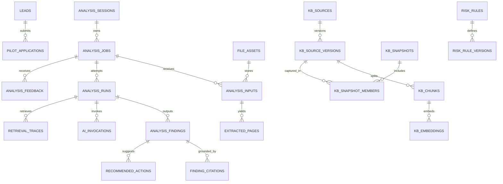
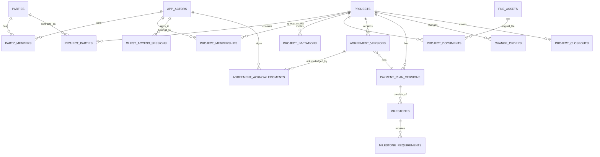
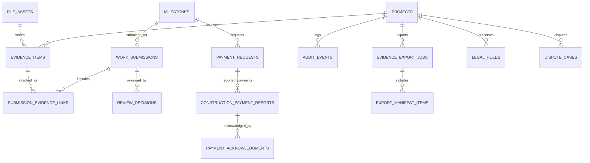
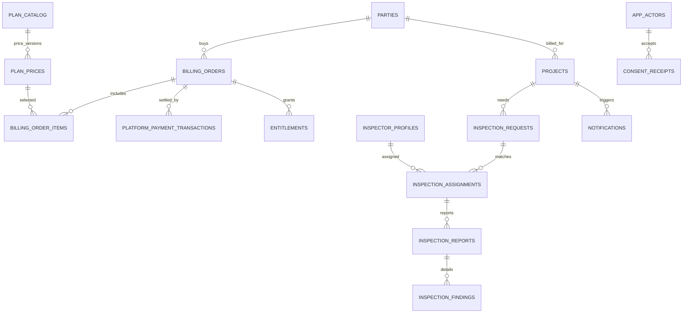
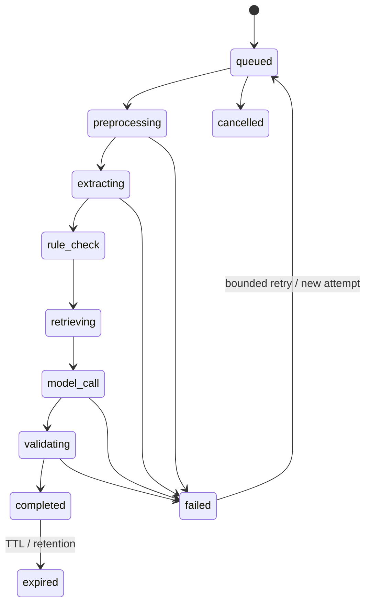
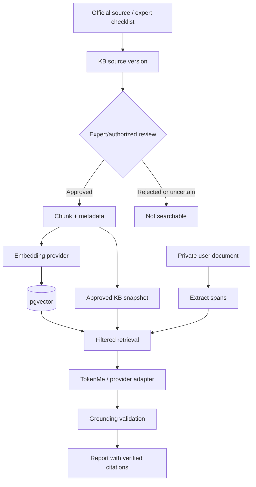
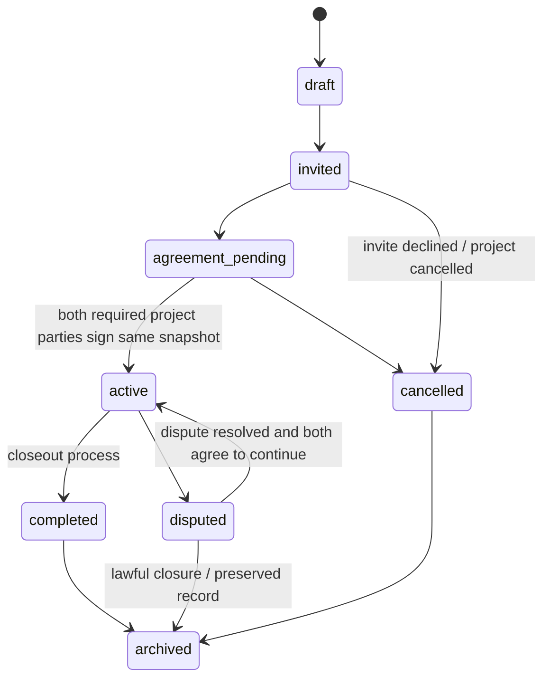
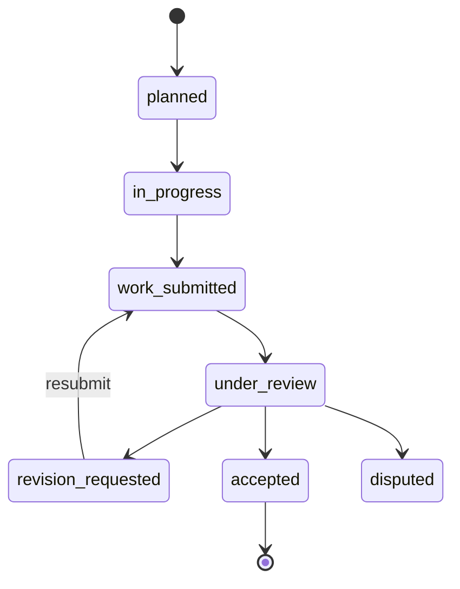
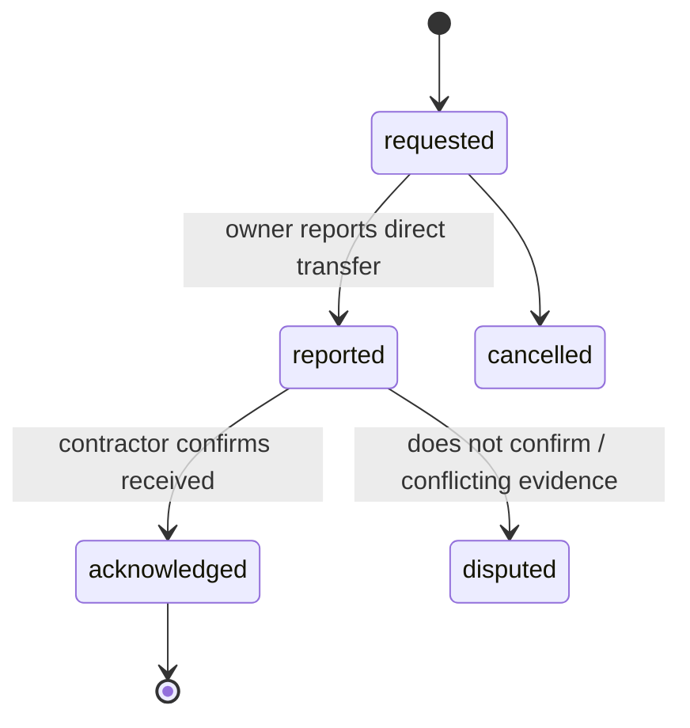

# LongRak (หลงรัก) — Database ERD & Strapi 5 Data Architecture

> **Version:** 1.0.0 (Database Design Proposal)  
> **Date:** 2026-11-17  
> **Scope:** LongRak Website + AI Document Checker + RAG + Two-Party Project + Evidence + Inspection + Billing + Trust Infrastructure  
> **Stack:** Nuxt 3/4 (frontend), Strapi 5 (CMS/business API), PostgreSQL 14+ (แนะนำตามข้อกำหนด Strapi เวอร์ชันที่ deploy), pgvector (RAG), S3-compatible private object storage, background worker  
> **Source:** `context.md` LongRak v0.1.0 (2026-11-16) และ requirement ที่สนทนาต่อเนื่องจนถึง 2026-11-17  
> **Status:** สถาปัตยกรรมที่เสนอเพื่อพัฒนา ไม่ใช่ schema ที่นำเข้า Strapi ได้อัตโนมัติ; ฟิลด์/ข้อกำหนดทางกฎหมายและผู้ให้บริการภายนอกบางส่วนต้อง validate ก่อน production

## 0. วิธีใช้เอกสารนี้

เอกสารนี้ออกแบบเพื่อให้ผู้พัฒนาสร้าง Strapi Content Types และ PostgreSQL schema ได้อย่างเป็นลำดับ ไม่ใช่สั่งสร้างทุกตารางพร้อมกัน:

- **W0 — ทำตอนนี้:** เว็บไซต์, waitlist/lead, AI วิเคราะห์ใบเสนอราคา/สัญญา/งวดจ่าย, เอกสารชั่วคราว, RAG, รายงาน, privacy.
- **W1 — โครงการนำร่อง:** Account/Guest, Project, คู่สัญญา, ยืนยันเอกสาร, งวดงาน, หลักฐาน, ตรวจรับ, ขอเงิน, บันทึกการชำระเงินตรง, export.
- **W2 — Trust infrastructure:** Change Order, Inspection, Dispute, Legal Hold, ระบบราคา/ชำระค่าบริการจริง, ความปลอดภัยและ retention ขั้นสูง.
- **W3 — Scale:** องค์กรผู้รับเหมา, bulk projects, subscription, integrations, partner analytics, advanced RAG/evaluation.

**Notation**

| แท็ก | ความหมาย | วิธีสร้าง |
|---|---|---|
| `CT` | Strapi Collection Type | Content-Type Builder หรือ `src/api/*/content-types/*/schema.json` |
| `ST` | Strapi Single Type | Content-Type Builder |
| `CP` | Strapi Component | Content-Type Builder (embedded; ไม่ใช่ business FK หลัก) |
| `SYS` | Strapi built-in/plugin | เช่น `plugin::users-permissions.user` |
| `SQL` | Custom PostgreSQL table | migration/Knex/custom repository; ไม่ให้ Strapi auto-generate CRUD |
| `OBJ` | Private object storage | S3/R2 bucket; ในฐานข้อมูลเก็บเพียง metadata/reference |
| `REL` | Logical relationship | Strapi relation field หรือ FK ใน SQL ตามการ implement |

**กติกา:** ตารางฟิลด์ในเอกสารนี้แสดง *ฟิลด์เฉพาะของโดเมน* ไม่ได้เขียน `id`, `documentId`, `createdAt`, `updatedAt` ซ้ำในทุก CT เพราะ Strapi จัดการให้. ทุก CT ที่เป็น record สำคัญควรเพิ่ม `public_id` (UUID unique ที่ backend สร้างเอง) เพื่ออ้างอิงข้าม service/SQL ได้เสถียร; `documentId` เป็น API identity ตาม Strapi 5 ส่วน `id` เป็น internal DB identity. ใน SQL ใช้ UUID PK ชัดเจน. ทุก `*_at` เก็บ UTC/timestamptz และ UI แสดง Asia/Bangkok.

**ระวัง Strapi 5:** `status` เป็น reserved attribute เมื่อเปิด Draft & Publish; เอกสารนี้ใช้ `state`, `processing_state`, `lifecycle_state`, `approval_state` แทน และแนะนำ **ปิด Draft & Publish / i18n สำหรับ transaction collections**. เปิด Draft & Publish เฉพาะ content เว็บไซต์ เช่น blog/page. ชื่อตารางใน ERD เป็น **logical names** ไม่ใช่การรับรองชื่อ physical FK/join table ที่ Strapi สร้างจริง.

---

## 1. Product/Database Rules ที่ห้ามละเมิด

1. **LongRak ไม่ถือเงินค่าก่อสร้าง (NO ESCROW).** แยก `construction_payment_reports` จาก `platform_payment_transactions` โดยเด็ดขาด.
2. **เป็นกลางต่อทั้งสองฝ่าย.** ผู้จ่ายเงินแพลตฟอร์มไม่มีสิทธิแก้หลักฐานของอีกฝ่าย; ตรวจสิทธิตาม project + party + role ทุก request.
3. **Guest ≠ anonymous identity.** Guest เข้าได้ด้วย invite token/OTP และ session สิทธิจำกัด; ผู้ยืนยันเอกสารต้องมี identity assurance ตามระดับความเสี่ยง.
4. **ข้อตกลงต้องเป็น versioned immutable snapshot.** Sign-off ต้อง bind กับ hash ของเนื้อหา *รวมแผนงวดจ่าย* และ actor/method/เวลา; แก้ไขสร้างเวอร์ชันใหม่.
5. **Audit ไม่ใช่แค่ `updatedAt`.** Event สำคัญต้อง append-only, ตรวจสอบ hash chain และมีหลักฐานเก็บใน storage ที่ป้องกันการลบตามนโยบาย.
6. **AI ไม่ใช่ผู้ตัดสินว่าฝ่ายใดโกง/ผิดกฎหมาย.** ผลวิเคราะห์ต้องมี state `unable_to_assess` และ citation ของเอกสารจริงกับฐานความรู้.
7. **Public demo แยกจาก project record.** เอกสารทดสอบหมดอายุและลบตาม privacy policy, ห้ามนำไปใช้ train/RAG ส่วนกลางโดยปริยาย.
8. **No cross-tenant leakage.** ข้อมูล project A ต้องไม่เข้า prompt, search index, export หรือ URL ของ project B.
9. **การลบตามสิทธิบุคคลต้อง reconcile กับ retention/legal hold.** ห้ามอ้าง “ลบไม่ได้ตลอดกาล”; กำหนดนโยบาย, lawful basis, legal review และลำดับการดำเนินการ.
10. **Strapi Admin ไม่ใช่ App Frontend.** Admin user กับ app user แยกกัน; ห้ามเปิด auto-generated CRUD ของข้อมูลหลักฐานให้ public/authenticated โดยไม่มี custom policy.

## 2. System Boundary: Entity Ownership

| Domain | เก็บที่ไหน | หมายเหตุ |
|---|---|---|
| Public website / FAQ / article / pricing display | Strapi CT/ST/CP | CMS แบบแก้ไขได้; Draft & Publish ใช้ได้ |
| Customer account/party/organization/project | Strapi CT + custom policy/service | Query สะดวก แต่อย่าเปิด CRUD อิสระ |
| Agreement approval, acceptance, payment acknowledgment | **SQL append-only** | เป็น legal-significant event; ห้าม editor แก้ผ่าน CMS |
| File original, signed PDF, photo/video | **OBJ private** | `file_assets` metadata ใน CT; original hash และ retention |
| Temporary extracted text / document spans | SQL private หรือ encrypted private OBJ | ข้อมูลชั่วคราว, retention TTL; ไม่ลง public Strapi Media Library |
| AI job/run/result and citations | CT + worker | CTA/analytics จาก summary; raw content protected |
| Curated RAG source metadata, risk rules, prompt versions | Strapi CT | มี approval/validity/review status |
| KB chunks/embeddings/retrieval trace | SQL + pgvector | Custom repository/worker; ไม่ใช้ Strapi CT สำหรับ vector โดยตรง |
| Critical audit, legal hold, access logs | SQL | DB roles/triggers/backup/WORM เมื่อพร้อม |
| Platform billing | Strapi CT + SQL webhook inbox | เป็นค่าบริการ LongRak ไม่ใช่เงินงวดช่าง |

## 3. High-Level ERD

> ERD แยกเป็นหลายภาพตามโดเมนเพื่อให้อ่านได้ใน Markdown ที่รองรับ Mermaid. `PK`/`FK` เป็นเชิงตรรกะ; junction tables ที่ Strapi สร้างให้เป็นรายละเอียด implementation.

### 3.1 Public Website / AI / RAG



### 3.2 Accounts / Projects / Agreements



### 3.3 Work / Acceptance / Direct Payment / Evidence



### 3.4 Inspection / Billing / Permissions



## 4. Domain Relationship Cheatsheet (Cardinality)

| From | Cardinality | To | ความหมาย |
|---|---|---|---|
| `app_actor` | 1 : N | `project_membership` | บุคคลหนึ่งอยู่ได้หลายโครงการ |
| `party` | 1 : N | `project_party` | บุคคล/บริษัทเดียวเป็นคู่สัญญาหลายโครงการ |
| `project` | 1 : N | `project_party` | ปกติ owner 1 + contractor 1; อนาคตหลาย subcontractor |
| `project` | 1 : N | `agreement_version` | สัญญาเปลี่ยนเวอร์ชันได้ |
| `agreement_version` | 1 : N | `agreement_acknowledgment` | แต่ละฝ่ายยืนยันแยกเหตุการณ์ |
| `agreement_version` | N : 1 | `payment_plan_version` | สัญญาฉบับนั้นผูกแผนงวดงานฉบับใด |
| `payment_plan_version` | 1 : N | `milestone` | แผนแต่ละ version มีงวด 1..N |
| `milestone` | 1 : N | `work_submission` | ส่งหลักฐานแก้ไขหลายรอบได้ |
| `work_submission` | 1 : N | `review_decision` | ตรวจรับ/คัดค้านหลายเหตุการณ์ที่มีลำดับเวลา |
| `milestone` | 1 : N | `payment_request` | รองรับคำขอหลายครั้ง/แก้ไขคำขอ |
| `payment_request` | 1 : N | `construction_payment_report` | รองรับ partial payments |
| `construction_payment_report` | 1 : N | `payment_acknowledgment` | แยกคนแจ้งจ่ายกับคนรับเงินจริง |
| `analysis_job` | 1 : N | `analysis_run` | Retry / rerun โดยเก็บ provenance |
| `analysis_run` | 1 : N | `analysis_finding` | พบข้อควรทบทวนหลายรายการ |
| `kb_source` | 1 : N | `kb_source_version` | กฎหมาย/คู่มือมีหลายฉบับ |
| `kb_source_version` | 1 : N | `kb_chunk` | Chunk มี metadata ต้นทาง |
| `file_asset` | 1 : N | `evidence_item` | Asset หนึ่งถูกอ้างในหลายบริบทได้ตามสิทธิ |

---
## 5. Entity Catalog — Website & Customer Acquisition

**คำอธิบายชนิดข้อมูลในทุกตาราง:** `string`/`text`/`richtext`/`email`/`boolean`/`integer`/`decimal`/`date`/`datetime`/`json`/`enumeration` เป็น Strapi field types; `relation:X` เป็น relation ไปยัง CT ที่ชื่อ X; `uuid` ใน CT คือ `string` (หรือ custom type/schema code) ที่ validate เป็น UUID; `enum` ใน SQL คือ `text + CHECK` หรือ PostgreSQL enum; `hash`/`token` เป็นค่าที่ hash ที่ฝั่ง backend ไม่ใช่ raw secret. `required` ที่เป็น conditional ต้องตรวจใน custom service แม้ Strapi schema จะบังคับไม่ได้.

### 5.1 Public CMS (แก้ผ่าน Strapi Admin ได้)

| Entity (Type/Phase) | Field → ชนิด/ตัวอย่าง | Relations / Constraints |
|---|---|---|
| **`site_settings` (ST/W0)** | `brand_name:string`, `thai_name:string`, `tagline:string`, `support_email:email`, `line_oa_url:string`, `default_locale:string`, `seo_defaults:CP.seo`, `logo:media`, `favicon:media`, `maintenance_mode:boolean` | Single row; logo/media ใช้ Media Library เพราะเป็น public asset |
| **`web_pages` (CT/W0)** | `title:string`, `slug:uid`, `page_kind:enum(home,about,ai_check,pricing,trust,faq,other)`, `blocks:dynamic_zone`, `seo:CP.seo`, `sort_order:integer`, `show_nav:boolean` | unique slug; Draft & Publish **ON** |
| **`faq_items` (CT/W0)** | `question:string`, `answer:richtext`, `category:enum(ai,agreement,evidence,payment,privacy,other)`, `sort_order:integer`, `is_featured:boolean` | Draft & Publish ON; public read only |
| **`blog_posts` (CT/W0)** | `title:string`, `slug:uid`, `excerpt:text`, `body:richtext`, `cover:media`, `author_display:string`, `seo:CP.seo`, `article_category:string`, `published_date:date` | Draft & Publish ON; articles ไม่ใช่ข้อมูลกฎหมายอ้างอิงอัตโนมัติ |
| **`leads` (CT/W0)** | `public_id:uuid`, `name:string?`, `contact_email:email?`, `phone_encrypted:string?`, `line_handle:string?`, `lead_type:enum(homeowner,contractor,interior,inspector,other)`, `lead_source:string`, `interest_note:text`, `contact_permission:boolean`, `lifecycle_state:enum(new,contacted,qualified,closed)`, `created_from:string` | ข้อมูลติดต่อไม่ public; lead ไม่เท่ากับ consent นำเอกสารไป train AI |
| **`pilot_applications` (CT/W0)** | `public_id`, `business_name:string?`, `work_type:enum(builtin,renovation,construction,other)`, `expected_project_count:integer?`, `expected_start_date:date?`, `goal:text`, `application_state:enum(new,screening,accepted,rejected)`, `source:string` | `lead` → leads N:1; อาจ link `party` หลังสร้างบัญชี |

**Strapi Components สำหรับ CMS (CP/W0):** `shared.seo` (`meta_title`, `meta_description`, `og_image`, `canonical_url`), `website.hero` (`headline`, `subheading`, `cta_label`, `cta_url`, `illustration`), `website.feature-card`, `website.step`, `website.testimonial` (**เผยแพร่เฉพาะคำรับรองที่ได้รับอนุญาต**), `website.comparison-row`, `website.cta-section`. CMS dynamic zone ใช้แค่หน้าเว็บ; ห้ามใส่ audit/payment/acceptance logic ลง dynamic zone.

### 5.2 Identity, Parties & Organizations (สำหรับ W1; บางส่วน W0 เมื่อต้องมีบัญชี)

| Entity (Type/Phase) | Field → ชนิด | Relations / Constraints |
|---|---|---|
| **`plugin::users-permissions.user` (SYS/W1)** | Strapi built-in: `username`, `email`, `password`, `confirmed`, `blocked`, `role` | เป็น account สำหรับ login แบบถาวร; ไม่ใช้แทน role ในแต่ละ project; แนะนำ session/refresh mode เมื่อวาง security |
| **`app_actors` (CT/W1)** | `public_id:uuid`, `display_name:string`, `actor_kind:enum(registered,guest,staff_proxy)`, `identity_level:enum(unverified,contact_verified,identity_checked)`, `locale:string`, `last_active_at:datetime?`, `disabled_at:datetime?` | optional 1:1 `auth_user`→SYS; คนหนึ่งอาจมีทั้ง guest history และ account ที่ claim ภายหลัง (ต้อง merge อย่างมี audit) |
| **`parties` (CT/W1)** | `public_id:uuid`, `party_kind:enum(individual,business)`, `legal_display_name:string`, `trade_name:string?`, `business_registration_no_encrypted:string?`, `tax_no_encrypted:string?`, `contact_email:email?`, `contact_phone_encrypted:string?`, `party_state:enum(active,disabled)`, `verification_level:enum(unverified,documents_checked,independently_verified)` | 1 party อาจเป็นร้านบิ้วอิน/บริษัท/บุคคล; ข้อมูลละเอียดเป็น private field ที่เข้ารหัส/จำกัดสิทธิ |
| **`party_members` (CT/W2)** | `public_id`, `membership_role:enum(owner,admin,staff,signer)`, `can_sign:boolean`, `membership_state:enum(pending,active,revoked)`, `joined_at:datetime?`, `left_at:datetime?` | N:1→`party`, N:1→`app_actor`; DB unique active `(party,actor)`; authorization signer ต้องตรวจสิทธิจริง |
| **`identity_verifications` (CT/W2)** | `public_id`, `subject_kind:enum(actor,party)`, `verification_method:enum(contact_otp,document_review,third_party)`, `assurance_level:string`, `verification_state:enum(pending,passed,failed,expired)`, `verified_at:datetime?`, `expires_at:datetime?`, `provider_ref:string?`, `review_note:text?` | relation to `app_actor` OR `party` (one-of enforced by service); เอกสารส่วนตัวใช้ `file_assets` private/retention |
| **`project_memberships` (CT/W1)** | `public_id`, `project_role:enum(owner,contractor,inspector,observer,coordinator)`, `member_state:enum(invited,active,suspended,left,revoked)`, `permissions_json:json?`, `joined_at:datetime?`, `left_at:datetime?` | N:1→`project`, N:1→`app_actor`, optional N:1→`project_party`; per-project authority; compound active unique `(project,actor,role)` custom constraint |
| **`project_parties` (CT/W1)** | `public_id`, `contract_role:enum(owner,contractor,designer,subcontractor,other)`, `is_primary:boolean`, `contract_display_name_snapshot:string`, `joined_at:datetime?`, `left_at:datetime?` | N:1→`project`, N:1→`party`; snapshot ที่ใช้ในสัญญาไม่ดึงชื่ออัปเดตย้อนหลังเงียบ ๆ |
| **`project_invitations` (CT/W1)** | `public_id`, `invite_role:enum(owner,contractor,inspector,observer)`, `target_contact_masked:string`, `invite_state:enum(pending,accepted,expired,revoked,declined)`, `expires_at:datetime`, `accepted_at:datetime?`, `revoked_at:datetime?`, `inviter_actor_id:uuid` | N:1→`project`, N:1→`inviting_actor` (`app_actor`); **token secret/hash เก็บใน SQL `guest_access_sessions` / `invitation_secrets` เท่านั้น** |
| **`guest_access_sessions` (SQL/W1)** | `id:uuid PK`, `invitation_public_id:uuid`, `actor_public_id:uuid`, `secret_hash:text`, `otp_verified_at:timestamptz?`, `issued_at:timestamptz`, `expires_at:timestamptz`, `revoked_at:timestamptz?`, `last_seen_at:timestamptz?`, `scope_json:jsonb` | hashed secret only; rate limit OTP; one guest session scoped to one invitation/project; backend can rotate/revoke; separate from JWT registered account |
| **`invitation_secrets` (SQL/W1)** | `id:uuid`, `invitation_public_id:uuid UNIQUE`, `token_hash:text`, `otp_code_hash:text?`, `otp_attempt_count:int`, `expires_at:timestamptz`, `consumed_at:timestamptz?`, `revoked_at:timestamptz?` | never log raw invite tokens; unique active invitation lifecycle via service |

**ทำไมไม่ใช้ Strapi Users & Permissions Roles = Owner/Contractor?** เพราะผู้ใช้คนเดียวอาจเป็นเจ้าของงาน A แต่เป็นผู้รับเหมาในงาน B. Global `Authenticated` ใช้บอกว่า login ผ่านแล้วเท่านั้น ส่วน authorization จริงต้องดู `project_memberships`, `project_parties`, ชนิด action และ current state.

### 5.3 Policy/Consent (ทำ W0 ก่อนรับเอกสารจริง)

| Entity (Type/Phase) | Field → ชนิด | Relations / Constraints |
|---|---|---|
| **`policy_versions` (CT/W0)** | `public_id`, `policy_kind:enum(privacy,terms,document_processing,project_terms,retention)`, `version_label:string`, `language:string`, `content:richtext`, `content_sha256:string`, `effective_at:datetime`, `retired_at:datetime?`, `policy_state:enum(draft,active,retired)` | publication policy immutable after effective; supersede with new version; private record for exact accepted text |
| **`consent_receipts` (CT/W0)** | `public_id`, `purpose_code:string`, `legal_basis_record:string`, `choice:enum(accepted,declined,withdrawn,not_applicable)`, `captured_at:datetime`, `capture_method:enum(web_checkbox,otp,account,other)`, `policy_sha256:string`, `ip_hash:string?`, `user_agent_digest:string?` | N:1→`policy_version`; N:1 optional→`app_actor`; N:1 optional→`analysis_session`; บางการประมวลผลอาศัยฐานกฎหมายอื่นไม่ใช่ consent เสมอ |
| **`data_subject_requests` (CT/W2)** | `public_id`, `request_kind:enum(access,rectification,erasure,restriction,portability,objection)`, `subject_contact_encrypted:text`, `request_state:enum(received,identity_check,reviewing,fulfilled,partially_fulfilled,declined)`, `received_at:datetime`, `due_at:datetime?`, `resolved_at:datetime?`, `decision_reason:text?` | optional relation actor/party/project; การลบต้องตรวจ legal hold/สิทธิผู้อื่น |
| **`retention_policies` (CT/W0)** | `policy_key:string UNIQUE`, `data_category:enum(demo,analysis,project_evidence,account,analytics,audit)`, `ttl_days:integer?`, `trigger_event:enum(created,completed,last_activity,policy_defined)`, `legal_basis_note:text`, `policy_state:enum(draft,active,retired)`, `reviewed_at:datetime?` | W0 อย่างน้อย demo TTL และ raw AI data deletion; ห้ามตั้ง indefinite โดยไม่มีเหตุผล |
| **`retention_jobs` (SQL/W2)** | `id:uuid`, `object_type:text`, `object_public_id:uuid`, `policy_key:text`, `scheduled_at:timestamptz`, `executed_at:timestamptz?`, `state:text`, `blocked_by_hold:boolean`, `result_digest:text?` | worker cleanup อย่างมี audit; legal hold block/review ไม่ใช่ลบถาวรอัตโนมัติทุกเคส |

---

## 6. Entity Catalog — AI Document Checker (W0)

### 6.1 Core analysis records

| Entity (Type/Phase) | Field → ชนิด | Relations / Constraints |
|---|---|---|
| **`analysis_sessions` (CT/W0)** | `public_id:uuid`, `mode:enum(sample,anonymous_upload,account,project)`, `session_state:enum(open,processing,completed,expired,deleted)`, `session_secret_digest:string`, `expires_at:datetime`, `deletion_requested_at:datetime?`, `source_page:string`, `file_count:integer`, `usage_quota_bucket:string?` | optional N:1→actor, optional N:1→project (W1); no full raw session token; TTL for demo |
| **`analysis_jobs` (CT/W0)** | `public_id:uuid`, `job_type:enum(pre_contract_check,quotation_check,milestone_check,boq_check)`, `processing_state:enum(queued,preprocessing,extracting,rule_check,retrieving,model_call,validating,completed,failed,cancelled,expired)`, `priority:integer`, `queued_at:datetime`, `started_at:datetime?`, `finished_at:datetime?`, `error_code:string?`, `idempotency_key_hash:string`, `attempt_count:integer`, `expires_at:datetime?` | N:1→analysis_session; unique `(session,idempotency_key_hash)`; never store raw error with private doc text |
| **`file_assets` (CT/W0)** | `public_id:uuid`, `purpose:enum(demo_input,project_document,evidence,identity,inspection,export,other)`, `storage_bucket_alias:string`, `object_key_private:string`, `original_name_encrypted:string?`, `mime_detected:string`, `byte_size:integer`, `sha256:string`, `object_version_id:string?`, `upload_state:enum(pending,scanned,accepted,quarantined,removed)`, `uploaded_at:datetime`, `retention_until:datetime?`, `deleted_at:datetime?`, `encryption_key_ref:string?`, `metadata_safe:json` | OBJ data never embedded in CT; signed URL by authorized service only; optional uploader actor, owner session/project/party; constrained tenant ownership |
| **`analysis_inputs` (CT/W0)** | `public_id`, `document_kind:enum(quotation,contract,boq,milestone_schedule,drawing,receipt,change_order,other,unknown)`, `sequence_no:integer`, `page_count:integer?`, `extraction_state:enum(pending,complete,partial,failed)`, `contains_pii:boolean?`, `redaction_state:enum(not_needed,pending,done,failed)`, `language_hint:string?` | N:1→analysis_job, N:1→file_asset; a run references input file hash/version snapshot |
| **`extracted_pages` (SQL/W0)** | `id:uuid`, `input_public_id:uuid`, `page_number:int`, `text_object_key:text?`, `text_sha256:text?`, `extractor_version:text`, `ocr_engine:text?`, `confidence_numeric:numeric?`, `quality_flags:jsonb`, `bbox_index_object_key:text?`, `expires_at:timestamptz` | private contents in encrypted OBJ or protected column; unique `(input_public_id,page_number)`; page-level provenance |
| **`extracted_fields` (SQL/W0)** | `id:uuid`, `job_public_id:uuid`, `field_code:text`, `value_json:jsonb`, `normalized_value_json:jsonb`, `source_input_id:uuid?`, `source_page:int?`, `source_span:jsonb?`, `read_state:text`, `extractor_version:text`, `expires_at:timestamptz` | structured extraction: money, date, materials, parties, warranty; redact where possible; private |
| **`analysis_runs` (CT/W0)** | `public_id`, `run_no:integer`, `run_state:enum(running,completed,failed,invalidated)`, `model_provider_key:string`, `model_id:string`, `model_config_digest:string`, `prompt_version_key:string`, `ruleset_version_key:string`, `knowledge_snapshot_key:string`, `schema_version:string`, `started_at:datetime`, `completed_at:datetime?`, `latency_ms:integer?`, `input_fingerprint_sha256:string`, `result_json_private:json?`, `total_tokens:integer?`, `estimated_cost_thb:decimal?` | N:1→analysis_job; no API key; raw output accessible only by authorized session; consider private OBJ for large payload |
| **`analysis_findings` (CT/W0)** | `public_id`, `finding_code:string`, `dimension:enum(parties,scope,materials,money,deposit,milestones,dates,acceptance,change_control,warranty,cancellation,evidence,signature,other)`, `finding_state:enum(needs_attention,missing_information,present_in_document,not_applicable,unable_to_assess)`, `severity:enum(info,low,medium,high,review_required)`, `title_th:string`, `explanation_th:text`, `confidence_level:enum(low,medium,high,unknown)`, `needs_professional_review:boolean`, `source_quote_verified:boolean` | N:1→analysis_run; arbitrary risk percentage **not** allowed; derived finding not legal judgment |
| **`finding_citations` (CT/W0)** | `public_id`, `citation_kind:enum(user_document,knowledge_source,rule)`, `input_page:integer?`, `quote_excerpt:text?`, `source_section:string?`, `citation_state:enum(verified,partially_verified,unverified)`, `citation_order:integer` | N:1→finding; optional N:1→analysis_input, optional N:1→kb_source_version; optional `kb_chunk_public_id`; exactly one relevant source by citation kind |
| **`recommended_actions` (CT/W0)** | `public_id`, `action_kind:enum(question_to_ask,request_document,clarify_clause,prepare_evidence,expert_review)`, `title_th:string`, `description_th:text`, `priority:enum(low,normal,high)`, `related_milestone_no:integer?`, `action_state:enum(suggested,accepted_by_user,dismissed,converted_to_project)` | N:1→analysis_finding, optional N:1→project (W1) / milestone (W1); action is suggestion until someone approves |
| **`analysis_feedback` (CT/W0)** | `public_id`, `helpfulness:integer?`, `finding_accuracy_vote:enum(accurate,uncertain,inaccurate)?`, `comment_sanitized:text?`, `issue_kind:enum(incorrect_amount,wrong_reference,unreadable,unclear,privacy,other)`, `created_at_client:datetime?` | N:1→analysis_job; no unreviewed private document excerpts in analytics |
| **`ai_invocations` (SQL/W0)** | `id:uuid`, `run_public_id:uuid`, `provider_key:text`, `model_id:text`, `request_trace_id:text`, `request_digest:text`, `response_digest:text?`, `prompt_version_key:text`, `model_parameters_json:jsonb`, `input_tokens:int?`, `output_tokens:int?`, `latency_ms:int?`, `cost_estimate_thb:numeric(14,4)?`, `error_code:text?`, `started_at:timestamptz` | metadata only; no raw prompt/doc/PII/API key in log; provider `TokenMe` via adapter; embeddings may use a different provider |

### 6.2 Analysis job lifecycle



**Required predicates**
- `AnalysisResult != completed` จนกว่า JSON schema, arithmetic, `document_quote` และ RAG reference validation ผ่านหรือถูก downgrade เป็น `unable_to_assess`.
- `sum(milestone.amount)` / `deposit_ratio` คำนวณด้วย code + decimal, ไม่เชื่อเลข LLM.
- `analysis_findings` ไม่ mutable หลัง run finalize; rerun สร้าง `analysis_runs` ใหม่.
- Only same session bearer/cookie, authenticated actor, or project membership can fetch report; public ID aloneไม่ใช่ authorization.
- หากไม่มีความชัดเจนว่ามีสิทธิส่งเอกสารเข้า provider ให้ใช้งานแค่ sample mode.

---

## 7. Entity Catalog — Curated RAG & Rules Engine

### 7.1 Knowledge catalog / approvals

| Entity (Type/Phase) | Field → ชนิด | Relations / Constraints |
|---|---|---|
| **`kb_sources` (CT/W0)** | `public_id`, `source_key:string UNIQUE`, `title:string`, `publisher:string`, `source_url:string`, `source_kind:enum(law,regulation,guideline,checklist,template,technical_reference,case_study)`, `jurisdiction:string`, `license_note:text?`, `topic_tags:json`, `source_state:enum(discovered,pending_review,approved,deprecated,revoked)`, `last_checked_at:datetime?` | 1:N→kb_source_versions; source existence != approved applicability |
| **`kb_source_versions` (CT/W0)** | `public_id`, `version_label:string`, `file_sha256:string`, `source_document_key_private:string?`, `fetched_at:datetime`, `published_at_source:date?`, `effective_at:date?`, `expires_at:date?`, `review_state:enum(unreviewed,expert_review,published,superseded,rejected,uncertain)`, `reviewed_at:datetime?`, `reviewer_name_snapshot:string?`, `applicability_scope:json`, `supersedes_version_key:string?` | N:1→kb_source; `effective_at` ต้องอ่านจากต้นฉบับ ไม่แทนด้วย crawl date; unique `(source_key,version_label)` |
| **`kb_snapshots` (CT/W0)** | `public_id`, `snapshot_key:string UNIQUE`, `snapshot_sha256:string`, `compiled_at:datetime`, `approved_at:datetime?`, `snapshot_state:enum(building,ready,active,retired)`, `notes:text?` | pinned source versions for reproducible report; only active approved versions retrieved |
| **`kb_snapshot_members` (SQL/W0)** | `snapshot_public_id:uuid`, `source_version_public_id:uuid`, `added_at:timestamptz`, `role:text` | PK composite `(snapshot_public_id,source_version_public_id)` |
| **`risk_rules` (CT/W0)** | `public_id`, `rule_code:string UNIQUE`, `dimension:string`, `description_th:text`, `work_types:json`, `document_kinds:json`, `rule_state:enum(active,retired,draft)` | 1:N→risk_rule_versions; rule name stable across revisions |
| **`risk_rule_versions` (CT/W0)** | `public_id`, `version_label:string`, `logic_kind:enum(code,config,json_logic)`, `logic_config:json`, `message_template_th:text`, `knowledge_source_keys:json`, `severity_default:enum(info,low,medium,high,review_required)`, `effective_at:datetime`, `retired_at:datetime?`, `reviewer_snapshot:string?`, `approval_state:enum(draft,approved,retired)` | N:1→risk_rule; **อย่าเก็บ arbitrary executable JS ใน CMS แล้ว eval**; validation code อยู่ repo |
| **`prompt_template_versions` (CT/W0)** | `public_id`, `prompt_key:string`, `version_label:string`, `template_body_private:text`, `output_schema_version:string`, `approved_by:string`, `approved_at:datetime?`, `template_sha256:string`, `template_state:enum(draft,approved,retired)` | unique `(prompt_key,version_label)`; no credentials; deploy-approved prompts only |
| **`model_catalog` (CT/W0)** | `public_id`, `provider_key:string`, `model_id:string`, `purpose:enum(generation,embedding,reranking,ocr)`, `context_limit:integer?`, `embedding_dimensions:integer?`, `is_active:boolean`, `model_notes:text?` | provider endpoint/credentials are ENV/secret manager, not CMS; TokenMe model and API values **must be verified**, not guessed |
| **`evaluation_cases` (CT/W0)** | `public_id`, `case_code:string UNIQUE`, `case_kind:enum(clean,missing,ambiguous,adversarial,privacy)`, `input_fixture_key_private:string`, `expected_fields:json`, `expected_findings:json`, `expert_approved_at:datetime?`, `fixture_contains_real_data:boolean` | start from synthetic/anonymized examples; exclude actual customer documents unless explicit valid basis |
| **`evaluation_runs` (CT/W0)** | `public_id`, `run_label:string`, `ruleset_version_key:string`, `prompt_version_key:string`, `model_id:string`, `kb_snapshot_key:string`, `metrics_json:json`, `started_at:datetime`, `completed_at:datetime?`, `release_decision:enum(pending,pass,fail)` | evaluation aggregates; link to evaluation_cases in SQL detail if needed |
| **`evaluation_results` (SQL/W0)** | `id:uuid`, `evaluation_run_public_id:uuid`, `evaluation_case_public_id:uuid`, `result_digest:text`, `field_accuracy:jsonb`, `finding_precision:numeric?`, `finding_recall:numeric?`, `citation_precision:numeric?`, `error_codes:jsonb` | no production private data |

### 7.2 Vector/index (สร้างด้วย SQL เอง ไม่ใช่ Strapi Content Type Builder)

| SQL entity | Fields | Index/Policy |
|---|---|---|
| **`kb_chunks` (SQL/W0)** | `id:uuid PK`, `public_id:uuid UNIQUE`, `source_version_public_id:uuid`, `chunk_order:int`, `section_path:text`, `page_start:int?`, `page_end:int?`, `body_text:text`, `body_sha256:text`, `language:text`, `metadata:jsonb`, `created_at:timestamptz` | unique `(source_version_public_id,chunk_order)`; query only approved, effective versions at retrieval time |
| **`kb_embeddings` (SQL/W0)** | `id:uuid PK`, `chunk_id:uuid`, `embedding_model_key:text`, `embedding_dimensions:int`, `embedding:vector(<DIM>)`, `embedded_at:timestamptz`, `vector_sha256:text?` | custom pgvector type; set `<DIM>` from chosen embedding model before DDL; unique `(chunk_id,embedding_model_key)` |
| **`retrieval_traces` (SQL/W0)** | `id:uuid`, `run_public_id:uuid`, `kb_snapshot_key:text`, `retriever_version:text`, `query_digest:text`, `returned_chunk_ids:uuid[]`, `scores:jsonb`, `filter_metadata:jsonb`, `created_at:timestamptz` | no raw user prompt; trace which chunks cited in that run |
| **`rule_execution_records` (SQL/W0)** | `id:uuid`, `run_public_id:uuid`, `rule_version_public_id:uuid`, `evaluation_state:text`, `input_digest:text`, `result_json:jsonb`, `executed_at:timestamptz` | immutable run provenance; don't execute CMS-sourced untrusted code |

### 7.3 RAG data lifecycle



**สำคัญ:** ภาพด้านบน `Private user document` ใช้เพื่อสร้าง *query/context ของ run ที่ได้รับอนุญาตเท่านั้น* ไม่ไหลเข้า `kb_sources/kb_chunks` ส่วนกลาง; ถ้าใน W2 เพิ่ม private project retrieval ให้แยก namespace `project_id` และ filter/authorization ก่อน retrieval ทุกครั้ง. RAG source ไม่ควรถูกแนะนำเป็นกฎหมายที่ใช้บังคับเมื่อ `effective_at`, jurisdiction, work_type ไม่ตรง.

**Embedding portability:** โมเดล Generate ของ TokenMe อาจไม่ใช่โมเดลสร้าง embedding; ให้ตั้ง `embedding_provider`, `embedding_model`, `dimension` แยกจาก `generation_provider/model` และ re-embed แบบ versioned เมื่อเปลี่ยนโมเดล.

---
## 8. Entity Catalog — Projects, Agreements & Payment Plans (W1)

### 8.1 Project master

| Entity (Type/Phase) | Field → ชนิด | Relations / Constraints |
|---|---|---|
| **`projects` (CT/W1)** | `public_id:uuid`, `project_code:string UNIQUE`, `title:string`, `description:text?`, `work_type:enum(builtin,renovation,interior,home_build,other)`, `location_label:string?`, `site_address_encrypted:text?`, `currency:enum(THB)`, `estimated_budget:decimal(14,2)?`, `agreed_contract_total:decimal(14,2)?`, `lifecycle_state:enum(draft,invited,agreement_pending,active,completed,disputed,archived,cancelled)`, `is_single_party_mode:boolean`, `start_date:date?`, `target_end_date:date?`, `actual_end_date:date?`, `created_by_actor_public_id:uuid`, `closed_at:datetime?`, `retention_policy_key:string` | N:1→`billable_party` (`parties`) optional; N:1→`current_agreement_version` optional; owner/contractor via `project_parties`; project-state changes through service only |
| **`project_documents` (CT/W1)** | `public_id`, `document_kind:enum(quotation,contract,boq,design,material_spec,milestone_schedule,invoice,receipt,change_order,inspection,other)`, `title:string`, `classification:enum(private_to_uploader,shared_with_parties,shared_with_inspector)`, `document_state:enum(uploaded,shared,proposed,acknowledged,superseded,withdrawn)`, `version_label:string?`, `uploaded_by_actor_public_id:uuid`, `uploaded_at:datetime`, `supersedes_document_public_id:uuid?` | N:1→project, N:1→file_asset, optional N:1→agreement_version/change_order; no silent overwrite; withdrawn means withdraw from active UI, historical audit preserved as policy allows |
| **`project_scope_items` (CT/W2)** | `public_id`, `item_code:string`, `description:text`, `location_in_home:string?`, `unit:string?`, `quantity:decimal(14,3)?`, `material_spec:text?`, `included:boolean`, `price_amount:decimal(14,2)?`, `source_document_public_id:uuid?`, `line_order:integer`, `scope_state:enum(proposed,agreed,changed,removed)` | N:1→project and optional N:1→agreement_version; important for built-in work: material/size/color/design details should be versioned/snapshotted |

### 8.2 Agreement / signature / change history

| Entity (Type/Phase) | Field → ชนิด | Relations / Constraints |
|---|---|---|
| **`agreement_versions` (CT/W1)** | `public_id`, `version_no:integer`, `agreement_kind:enum(contract,terms_confirmation,amendment)`, `title:string`, `document_snapshot_sha256:string`, `payment_plan_snapshot_sha256:string`, `combined_agreement_sha256:string`, `agreement_file_public_id:uuid?`, `agreement_terms_snapshot_ref:string?`, `proposed_by_actor_public_id:uuid`, `proposed_at:datetime`, `effective_at:datetime?`, `approval_state:enum(draft,pending_parties,fully_acknowledged,rejected,superseded,voided_by_joint_process)`, `supersedes_version_public_id:uuid?` | N:1→project, N:1→payment_plan_version; unique `(project,version_no)`; **after pending/acknowledged no edit contents**, use new version |
| **`agreement_acknowledgments` (SQL/W1)** | `id:uuid PK`, `public_id:uuid UNIQUE`, `agreement_version_public_id:uuid`, `project_party_public_id:uuid`, `actor_public_id:uuid`, `decision:enum(accept,reject)`, `signed_snapshot_sha256:text`, `identity_assurance_snapshot:jsonb`, `method:enum(authenticated_click,otp_verified,third_party_esign)`, `intent_statement_hash:text`, `acknowledged_at:timestamptz`, `session_ref_digest:text?`, `event_id:uuid` | append-only; unique accepted `(agreement_version,project_party)` conditional; require same `combined_agreement_sha256`; linked SQL audit event; no automatic legal-grade certification claim |
| **`change_orders` (CT/W2)** | `public_id`, `change_no:integer`, `change_kind:enum(add_scope,remove_scope,material_change,design_change,price_change,date_change,other)`, `description:text`, `reason:text?`, `requester_actor_public_id:uuid`, `price_delta:decimal(14,2)?`, `days_delta:integer?`, `change_state:enum(draft,proposed,pending_parties,agreed,rejected,cancelled)`, `created_at_business:datetime`, `supersedes_change_public_id:uuid?` | N:1→project, optional→source agreement version, N:1→result agreement version when agreed; a mutually approved change creates new signed agreement/plan snapshot if terms changed |
| **`change_order_acknowledgments` (SQL/W2)** | `id:uuid`, `change_order_public_id:uuid`, `project_party_public_id:uuid`, `actor_public_id:uuid`, `decision:text`, `change_snapshot_sha256:text`, `at:timestamptz`, `audit_event_id:uuid` | append-only, cannot edit once accepted |

### 8.3 Payment schedule & milestone terms

| Entity (Type/Phase) | Field → ชนิด | Relations / Constraints |
|---|---|---|
| **`payment_plan_versions` (CT/W1)** | `public_id`, `version_no:integer`, `plan_title:string`, `plan_total_amount:decimal(14,2)`, `currency:enum(THB)`, `plan_sha256:string`, `plan_state:enum(draft,pending_approval,approved,superseded)`, `based_on_plan_public_id:uuid?`, `created_by_actor_public_id:uuid`, `created_at_business:datetime` | N:1→project; 1:N→milestones; `sum(milestones.amount) == plan_total` enforced server-side; plan snapshot included in agreement hash |
| **`milestones` (CT/W1)** | `public_id`, `milestone_key:uuid` (logical stable key across plan revisions), `sequence_no:integer`, `title:string`, `description:text?`, `amount:decimal(14,2)`, `amount_kind:enum(fixed,estimated)`, `due_date:date?`, `planned_start_date:date?`, `deliverables:text`, `acceptance_criteria:text`, `payment_terms_text:text?`, `is_advance:boolean`, `workflow_state:enum(planned,in_progress,work_submitted,under_review,revision_requested,accepted,disputed,cancelled)`, `supersedes_milestone_public_id:uuid?` | N:1→payment_plan_version, N:1→project (redundant query link, check consistency); unique `(plan_version,sequence_no)`, stable `milestone_key` for lineage; agreed milestone immutable terms |
| **`milestone_requirements` (CT/W1)** | `public_id`, `requirement_code:string`, `title:string`, `details:text`, `evidence_kind:enum(photo,video,invoice,material_receipt,measurement,design_approval,inspection,other)`, `required_for_review:boolean`, `sort_order:integer`, `origin:enum(manual,ai_suggested,expert_template)`, `approval_state:enum(suggested,agreed,removed_before_signoff)` | N:1→milestone; AI recommendations cannot become agreed requirements until both parties accept relevant agreement version |
| **`milestone_state_events` (SQL/W1)** | `id:uuid`, `milestone_public_id:uuid`, `project_public_id:uuid`, `from_state:text`, `to_state:text`, `actor_public_id:uuid`, `reason_code:text?`, `occurred_at:timestamptz`, `audit_event_id:uuid` | append-only transition history; state cache on CT for UI; service validates transition |

### 8.4 Project lifecycle



### 8.5 Milestone lifecycle (งาน vs เงิน แยกกัน)



**Payment timeline ไม่ใช้ `milestone.workflow_state` แทนสถานะเงิน:**



**Invariant ของสัญญา:** `agreement_versions` ไม่ควรถือว่า `fully_acknowledged` ถ้ายังไม่มี **ฝ่ายผู้ว่าจ้างและผู้รับเหมาที่กำหนด** ลงนามยืนยัน snapshot เดียวกัน. ใน single-party mode ต้องขึ้น `not_mutually_accepted` ชัดเจน ไม่มีการตีความว่าอีกฝ่ายยอมรับแล้ว. บริการตรวจสัญญากับการทำ e-sign ที่ใช้เป็นหลักฐานต้องให้ผู้เชี่ยวชาญกฎหมายทบทวนขั้นตอน.

---

## 9. Entity Catalog — Evidence, Review & Direct Payment (W1)

### 9.1 Evidence and submission

| Entity (Type/Phase) | Field → ชนิด | Relations / Constraints |
|---|---|---|
| **`evidence_items` (CT/W1)** | `public_id`, `title:string`, `description:text?`, `evidence_kind:enum(photo,video,document,receipt,invoice,design_approval,communication,other)`, `evidence_origin:enum(owner,contractor,inspector,platform_system)`, `uploader_actor_public_id:uuid`, `submitted_at:datetime`, `source_capture_time:datetime?`, `capture_time_unverified:boolean`, `content_sha256:string`, `visibility:enum(parties,restricted,inspector_scope)`, `evidence_state:enum(submitted,withdrawn_from_ui,quarantined,under_legal_hold)`, `related_requirement_public_id:uuid?` | N:1→project, optional N:1→milestone, N:1→file_asset; capture metadata is not independent proof of capture date or factual truth |
| **`work_submissions` (CT/W1)** | `public_id`, `submission_no:integer`, `note:text?`, `submitted_by_actor_public_id:uuid`, `submitted_at:datetime`, `submission_state:enum(submitted,under_review,revision_requested,accepted,disputed,superseded)`, `submitted_terms_snapshot_sha256:string`, `supersedes_submission_public_id:uuid?` | N:1→milestone, N:1→project; new resubmission = new row; previous submission unchanged |
| **`submission_evidence_links` (CT/W1)** | `public_id`, `sort_order:integer`, `link_note:text?`, `linked_at:datetime` | N:1→work_submission, N:1→evidence_item; service validates same project and permissions; duplicate `(submission,evidence)` not allowed |
| **`review_decisions` (SQL/W1)** | `id:uuid`, `public_id:uuid UNIQUE`, `work_submission_public_id:uuid`, `milestone_public_id:uuid`, `project_public_id:uuid`, `actor_public_id:uuid`, `decision:enum(accept,request_revision,dispute,request_inspection)`, `reason_text:text?`, `criteria_snapshot_sha256:text`, `reviewed_at:timestamptz`, `audit_event_id:uuid` | append-only; owner/authorized inspector? only owner can accept under default policy; inspector reports findings, not auto-pay authority |
| **`review_checklist_results` (CT/W2)** | `public_id`, `requirement_code:string`, `result:enum(pass,fail,not_checked,not_applicable)`, `note:text?`, `observed_at:datetime` | N:1→work_submission; N:1→milestone_requirement; inspection technical results must be separate inspection domain |

### 9.2 Direct construction payment (เงินจากเจ้าของบ้านไปผู้รับเหมาโดยตรง)

| Entity (Type/Phase) | Field → ชนิด | Relations / Constraints |
|---|---|---|
| **`payment_requests` (CT/W1)** | `public_id`, `request_no:integer`, `requested_amount:decimal(14,2)`, `currency:enum(THB)`, `request_note:text?`, `request_state:enum(draft,submitted,under_review,approved_for_payment,contested,partially_reported,fully_reported,cancelled)`, `requested_by_actor_public_id:uuid`, `requested_at:datetime`, `due_at:datetime?`, `milestone_terms_sha256:string`, `supersedes_request_public_id:uuid?` | N:1→milestone/project; `approved_for_payment` does **not** mean money received or LongRak authorized a bank transfer |
| **`construction_payment_reports` (CT/W1)** | `public_id`, `reported_amount:decimal(14,2)`, `currency:enum(THB)`, `reported_payment_at:datetime?`, `reported_by_actor_public_id:uuid`, `transfer_reference_masked:string?`, `method:enum(bank_transfer,cash,other)`, `report_state:enum(reported,acknowledged,disputed,reversed,unknown)`, `payer_party_public_id:uuid`, `payee_party_public_id:uuid`, `created_at_business:datetime`, `note:text?` | N:1→payment_request/milestone/project; optional N:1→proof file_asset; amount may be partial; **ไม่ใช่ payment gateway transaction ของเรา** |
| **`payment_acknowledgments` (SQL/W1)** | `id:uuid`, `public_id:uuid UNIQUE`, `construction_payment_report_public_id:uuid`, `recipient_project_party_public_id:uuid`, `actor_public_id:uuid`, `decision:enum(received,not_received,disputed)`, `amount_confirmed:numeric(14,2)?`, `method:text`, `acknowledged_at:timestamptz`, `audit_event_id:uuid` | append-only; payee/authorized actor confirms receipt, not payer self-confirming; correction is new event |
| **`payment_discrepancies` (CT/W2)** | `public_id`, `discrepancy_kind:enum(amount_mismatch,missing_receipt,unauthorized_request,reversal,other)`, `description:text`, `discrepancy_state:enum(open,investigating,resolved,escalated)`, `opened_at:datetime`, `resolved_at:datetime?` | N:1→construction_payment_report; optional N:1→dispute_case |

**Critical example:** เจ้าของบ้านอัปโหลดสลิป 30,000 บาท → `construction_payment_report.report_state = reported`; ผู้รับเหมากดรับทราบ 30,000 บาท → append `payment_acknowledgment(received)` → read model แสดง `acknowledged`. หากอัปโหลดสลิปปลอม/ผิดบัญชี ห้ามแสดงว่าได้รับเงินจริงเพียงเพราะมีไฟล์.

### 9.3 Messages / activity / closeout

| Entity (Type/Phase) | Field → ชนิด | Relations / Constraints |
|---|---|---|
| **`project_discussions` (CT/W2)** | `public_id`, `subject:string`, `discussion_kind:enum(general,milestone,document,change_order,dispute)`, `opened_by_actor_public_id:uuid`, `discussion_state:enum(open,closed)`, `opened_at:datetime` | N:1→project, optional N:1→milestone/change_order; no need to clone LINE chat MVP |
| **`discussion_messages` (CT/W2)** | `public_id`, `body:text`, `sender_actor_public_id:uuid`, `sent_at:datetime`, `visibility:enum(parties,restricted)`, `message_state:enum(posted,withdrawn_with_tombstone)` | N:1→project_discussion, optional N:1→file_asset; retain edit/delete event instead of rewriting history |
| **`project_closeouts` (CT/W1)** | `public_id`, `closeout_kind:enum(mutual,owner_declared,contractor_declared,administrative)`, `closeout_state:enum(proposed,pending_ack,completed,contested)`, `final_note:text?`, `proposed_by_actor_public_id:uuid`, `proposed_at:datetime`, `completed_at:datetime?`, `outstanding_items_json:json`, `closeout_snapshot_sha256:string` | N:1→project; mutual complete requires append-only acknowledgments of required parties; single-party closeout labelled clearly |
| **`closeout_acknowledgments` (SQL/W1)** | `id:uuid`, `closeout_public_id:uuid`, `project_party_public_id:uuid`, `actor_public_id:uuid`, `decision:text`, `closeout_snapshot_sha256:text`, `acknowledged_at:timestamptz`, `audit_event_id:uuid` | append-only |
| **`notifications` (CT/W1)** | `public_id`, `recipient_actor_public_id:uuid`, `notification_kind:enum(invite,agreement,milestone_submission,review,change,payment,inspection,retention,other)`, `title:string`, `body_safe:text`, `delivery_channel:enum(in_app,email,line)`, `delivery_state:enum(pending,sent,failed,read)`, `dedupe_key:string`, `scheduled_at:datetime?`, `sent_at:datetime?`, `read_at:datetime?` | optional→project; never include full private document/OTP in notification preview; unique dedupe key per recipient if appropriate |

### 9.4 Audit, export and retention

| Entity (Type/Phase) | Field → ชนิด | Relations / Constraints |
|---|---|---|
| **`audit_events` (SQL/W1)** | `id:uuid PK`, `event_no:bigint`, `project_public_id:uuid`, `actor_public_id:uuid?`, `action:text`, `subject_type:text`, `subject_public_id:uuid`, `request_id:text`, `occurred_at:timestamptz`, `payload_digest:text`, `payload_redacted_json:jsonb`, `previous_event_hash:text`, `event_hash:text`, `chain_scope:text` | append-only; unique `(project_public_id,event_no)`; hash chain per project; users cannot CRUD; independent checkpoint later |
| **`evidence_export_jobs` (CT/W1)** | `public_id`, `requested_by_actor_public_id:uuid`, `export_scope:enum(all_authorized,agreement_only,milestone,dispute)`, `scope_filter:json`, `export_state:enum(queued,building,ready,failed,expired)`, `manifest_sha256:string?`, `archive_file_public_id:uuid?`, `created_at_business:datetime`, `expires_at:datetime?`, `error_code:string?` | N:1→project; signed download URL; content per requesting party's scope and export policy |
| **`export_manifest_items` (SQL/W1)** | `id:uuid`, `export_public_id:uuid`, `item_type:text`, `item_public_id:uuid`, `original_sha256:text`, `path_in_archive:text`, `event_timestamp:timestamptz?`, `document_version_key:text?` | manifest includes file hashes, event IDs, actors/roles, event times, verification method, export timestamp; never expose hidden other-party identity docs |
| **`legal_holds` (SQL/W2)** | `id:uuid`, `project_public_id:uuid`, `hold_reason:text`, `authorized_by_actor_public_id:uuid`, `legal_basis_reference:text?`, `opened_at:timestamptz`, `review_due_at:timestamptz?`, `released_at:timestamptz?`, `scope_json:jsonb`, `hold_state:text` | must be lawful/necessary/reviewed; block relevant retention deletion; access highly restricted |
| **`admin_evidence_access_logs` (SQL/W2)** | `id:uuid`, `admin_user_id:integer`, `project_public_id:uuid`, `object_public_id:uuid`, `access_reason_code:text`, `ticket_ref:text?`, `occurred_at:timestamptz`, `action:text`, `request_id:text` | every privileged access to private evidence recorded; support staff doesn't get blanket access |
| **`storage_integrity_checks` (SQL/W2)** | `id:uuid`, `file_public_id:uuid`, `expected_sha256:text`, `observed_sha256:text?`, `checked_at:timestamptz`, `check_state:text`, `repair_ticket_ref:text?` | routine digest verification and alert; verification proves byte identity only, not real-world truth |

### 9.5 Evidence upload process (transactional boundaries)

1. Browser requests upload session → backend checks actor/session, project membership, purpose, retention, quota.
2. Backend issues short-lived, write-only presigned URL to private object key; do not return bucket credentials.
3. Worker scans object (MIME sniff, malware, size/page checks); SHA-256 compute from bytes and store metadata.
4. `file_assets.upload_state` moves to `accepted` only after checks; `evidence_items` created by authorized actor; record immutable upload audit event.
5. `work_submissions` references *a snapshot* of evidence IDs and agreed milestone terms. Submitting locks work submission contents.
6. Owner reviews and append `review_decisions`; status projection recomputed transactionally; later modifications create additional submissions/decisions.
7. On direct payment, only record payer's report and payee's acknowledgment; LongRak holds no construction funds.

---
## 10. Entity Catalog — Independent Inspection, Disputes & Partner Ops (W2–W3)

### 10.1 Inspection as optional paid service (ผู้ตรวจอิสระ)

| Entity (Type/Phase) | Field → ชนิด | Relations / Constraints |
|---|---|---|
| **`inspector_profiles` (CT/W2)** | `public_id`, `display_name:string`, `inspector_type:enum(individual,company)`, `specialties:json`, `service_areas:json`, `qualifications_summary:text`, `active_state:enum(pending_review,approved,suspended,retired)`, `independence_declaration:text?`, `contact_private_json:json?` | optional N:1→party; may have actor user; no false claims of licensing |
| **`inspector_credentials` (CT/W2)** | `public_id`, `credential_kind:enum(license,certificate,insurance,identity,other)`, `credential_no_encrypted:string?`, `issuer:string?`, `issued_at:date?`, `expires_at:date?`, `verification_state:enum(unreviewed,verified,rejected,expired)`, `reviewed_at:datetime?` | N:1→inspector_profile, N:1→private file_asset; verification before offering technical inspection |
| **`inspection_requests` (CT/W2)** | `public_id`, `request_scope:text`, `inspection_type:enum(milestone,material,installation,defect,other)`, `preferred_date:date?`, `site_access_note_encrypted:text?`, `request_state:enum(requested,quoting,quoted,accepted,scheduled,completed,cancelled,disputed)`, `requested_by_actor_public_id:uuid`, `requested_at:datetime`, `budget_hint:decimal(14,2)?` | N:1→project, optional N:1→milestone; requesting inspection **does not automatically authorize payment/hold payment** |
| **`inspection_assignments` (CT/W2)** | `public_id`, `proposed_fee_amount:decimal(14,2)`, `platform_coordination_fee:decimal(14,2)`, `assignment_state:enum(offered,accepted,declined,scheduled,completed,cancelled)`, `scheduled_at:datetime?`, `completed_at:datetime?`, `conflict_disclosed:boolean` | N:1→inspection_request, N:1→inspector_profile; price/fees disclosed; require independence process |
| **`inspection_reports` (CT/W2)** | `public_id`, `report_no:string`, `inspection_date:date`, `scope_snapshot_sha256:string`, `summary:text`, `conclusion:enum(items_passed,items_need_rework,insufficient_access,unable_to_assess)`, `signed_report_file_public_id:uuid?`, `report_state:enum(draft,submitted,finalized,superseded)`, `signed_by_inspector_at:datetime?` | N:1→inspection_assignment; optional 1:N→inspection_findings; finalized report immutable |
| **`inspection_findings` (CT/W2)** | `public_id`, `item_no:integer`, `location_label:string`, `observation:text`, `severity:enum(info,minor,major,critical,unknown)`, `recommendation:text?`, `finding_state:enum(open,reported,reviewed)`, `evidence_file_public_ids:json` | N:1→inspection_report, optional N:1→project/milestone; technical judgment is inspector's, not AI's |
| **`inspection_report_acknowledgments` (SQL/W2)** | `id:uuid`, `report_public_id:uuid`, `project_party_public_id:uuid`, `actor_public_id:uuid`, `decision:enum(received,contested)`, `at:timestamptz`, `audit_event_id:uuid` | receiving a report != accepting quality of work or agreeing payment release |

### 10.2 Dispute workflow (ระบบช่วยจัดหลักฐาน ไม่ตัดสินคดี)

| Entity (Type/Phase) | Field → ชนิด | Relations / Constraints |
|---|---|---|
| **`dispute_cases` (CT/W2)** | `public_id`, `case_no:string`, `category:enum(non_delivery,quality,payment,scope_change,termination,other)`, `summary_sanitized:text`, `opened_by_actor_public_id:uuid`, `opened_at:datetime`, `case_state:enum(open,evidence_gathering,mediation_referred,resolved,closed_unresolved)`, `resolution_note:text?`, `closed_at:datetime?` | N:1→project; legal hold request separate authorized workflow; case not a court judgment |
| **`dispute_case_events` (SQL/W2)** | `id:uuid`, `case_public_id:uuid`, `project_public_id:uuid`, `actor_public_id:uuid?`, `event_kind:text`, `redacted_summary:text`, `related_evidence_public_ids:uuid[]`, `at:timestamptz`, `audit_event_id:uuid` | append-only event timeline; sensitive case notes access restricted |
| **`dispute_referrals` (CT/W2)** | `public_id`, `service_kind:enum(mediation,lawyer,independent_inspector,consumer_agency)`, `provider_name:string`, `referral_state:enum(suggested,requested,accepted,closed)`, `referred_at:datetime?`, `disclosure_text:text` | N:1→dispute_case; consent/authorization before sharing case evidence with third party |

### 10.3 Partnerships and B2B (later)

| Entity (Type/Phase) | Field → ชนิด | Relations / Constraints |
|---|---|---|
| **`partner_referrals` (CT/W3)** | `public_id`, `partner_party_public_id:uuid`, `referral_code:string`, `referred_party_public_id:uuid?`, `project_public_id:uuid?`, `referral_state:enum(created,qualified,converted,invalid)`, `attribution_source:string`, `converted_at:datetime?` | prevent personal-data sharing without basis; transparent referral fees when applicable |
| **`integration_connections` (CT/W3)** | `public_id`, `party_public_id:uuid`, `provider:enum(line,webhook,other)`, `connection_state:enum(active,disabled,revoked)`, `scopes:json`, `secret_reference:string?`, `last_sync_at:datetime?` | actual OAuth secrets in secret vault, not CT; tenant scoped |
| **`outbound_webhook_deliveries` (SQL/W3)** | `id:uuid`, `connection_public_id:uuid`, `event_id:uuid`, `target_digest:text`, `delivery_state:text`, `attempt_count:int`, `response_status:int?`, `next_retry_at:timestamptz?` | signed webhooks, replay protection, no raw sensitive payload in logs |

---

## 11. Entity Catalog — Commercial Billing (LongRak fees only)

> **แยกจาก §9 โดยเด็ดขาด.** Money here = LongRak license/subscription/inspection coordination. ห้ามอ้างว่า platform charge เป็นเงินก่อสร้างที่ LongRak ถืออยู่; ไม่มี escrow wallet ใน scope.

### 11.1 Plans and purchases

| Entity (Type/Phase) | Field → ชนิด | Relations / Constraints |
|---|---|---|
| **`plan_catalog` (CT/W0)** | `public_id`, `plan_code:string UNIQUE`, `display_name:string`, `description:text`, `billing_model:enum(per_project,subscription,add_on,free)`, `public_state:enum(draft,active,retired)`, `feature_summary:json`, `sort_order:integer` | public marketing price plan; do not store price history only in a mutable field |
| **`plan_prices` (CT/W2)** | `public_id`, `price_code:string UNIQUE`, `currency:enum(THB)`, `amount:decimal(14,2)`, `vat_inclusion:enum(included,excluded,not_applicable)`, `billing_period:enum(one_time,monthly,yearly)`, `effective_from:datetime`, `effective_until:datetime?`, `price_state:enum(active,retired)` | N:1→plan_catalog; each order pins exact price ID, amount and tax snapshot |
| **`billing_orders` (CT/W2)** | `public_id`, `order_no:string UNIQUE`, `order_state:enum(draft,pending_payment,paid,failed,cancelled,refunded,partially_refunded)`, `currency:enum(THB)`, `subtotal:decimal(14,2)`, `tax_total:decimal(14,2)`, `grand_total:decimal(14,2)`, `created_at_business:datetime`, `paid_at:datetime?`, `idempotency_key_hash:string?` | N:1→payer party; optional N:1→project; price snapshot immutable after issue |
| **`billing_order_items` (CT/W2)** | `public_id`, `line_no:integer`, `sku:string`, `item_description:string`, `quantity:integer`, `unit_price:decimal(14,2)`, `line_subtotal:decimal(14,2)`, `tax_amount:decimal(14,2)`, `line_total:decimal(14,2)`, `price_snapshot_json:json` | N:1→billing_order, optional N:1→plan_price or inspection assignment; unique order+line |
| **`platform_payment_transactions` (CT/W2)** | `public_id`, `gateway_provider:string`, `gateway_reference:string`, `transaction_type:enum(charge,refund,adjustment)`, `transaction_state:enum(pending,authorized,settled,failed,reversed)`, `amount:decimal(14,2)`, `currency:enum(THB)`, `occurred_at:datetime`, `gateway_payload_digest:string?` | N:1→billing_order; no sensitive card fields; Webhook is source of gateway event, reconciled by server |
| **`billing_webhook_events` (SQL/W2)** | `id:uuid`, `provider_key:text`, `provider_event_id:text UNIQUE`, `signature_verified:boolean`, `payload_digest:text`, `received_at:timestamptz`, `processing_state:text`, `processed_at:timestamptz?`, `error_code:text?` | idempotent inbox; raw payload tightly controlled / TTL; never mark order paid from browser redirect alone |
| **`entitlements` (CT/W2)** | `public_id`, `entitlement_key:string`, `limit_amount:integer?`, `used_amount:integer`, `valid_from:datetime`, `valid_until:datetime?`, `entitlement_state:enum(active,exhausted,expired,revoked)`, `feature_flags_json:json` | N:1→billing_order, N:1→party, optional N:1→project; free tier also creates entitlement via backend |
| **`subscriptions` (CT/W3)** | `public_id`, `subscription_no:string`, `subscription_state:enum(trialing,active,past_due,cancelled,expired)`, `billing_cycle:enum(monthly,yearly)`, `current_period_start:datetime`, `current_period_end:datetime`, `provider_subscription_ref:string?`, `cancel_at:datetime?` | N:1→party/plan_price; subscription is later, avoid assuming MRR in W0 |
| **`usage_events` (SQL/W2)** | `id:uuid`, `party_public_id:uuid`, `project_public_id:uuid?`, `entitlement_public_id:uuid`, `meter_key:text`, `units:int`, `idempotency_key:text`, `measured_at:timestamptz`, `source_event_id:uuid?` | unique `(entitlement_public_id,idempotency_key)`; track AI analyses, project slots, storage quota, export quotas |
| **`promo_codes` (CT/W3)** | `public_id`, `code:string UNIQUE`, `discount_kind:enum(fixed,percentage)`, `discount_value:decimal(14,2)`, `valid_from:datetime`, `valid_until:datetime`, `redemption_limit:integer?`, `promo_state:enum(active,disabled,expired)` | discount cannot bypass authorization or integrity rules |
| **`billing_documents` (CT/W2)** | `public_id`, `document_type:enum(invoice,receipt,credit_note,tax_document)`, `document_no:string UNIQUE`, `issued_at:datetime`, `total_amount:decimal(14,2)`, `billing_name_snapshot:string`, `billing_address_encrypted:text?`, `document_file_public_id:uuid?` | N:1→billing_order, optional N:1→file_asset; platform accounting only |
| **`refund_requests` (CT/W2)** | `public_id`, `reason_code:string`, `requested_amount:decimal(14,2)`, `refund_state:enum(requested,reviewing,approved,denied,processed)`, `requested_at:datetime`, `decision_at:datetime?` | N:1→billing_order; refund via gateway does not alter signed construction records |

### 11.2 Suggested pricing (ยังเป็นสมมติฐาน ไม่ใช่ข้อสรุปธุรกิจ)

| Plan | Proposed use | How to model |
|---|---|---|
| `FREE_DEMO` | ลองเอกสารตัวอย่าง (ไม่มีเอกสารจริง) | `plan_catalog` with free entitlements |
| `AI_ONE_OFF` | วิเคราะห์เอกสารแบบจ่ายครั้ง | `billing_order` + `entitlement.analysis_count` |
| `PROJECT_STANDARD` | เปิดโครงการพร้อมสองฝ่าย / หลักฐาน / งวดงาน | `billing_order` + project entitlement |
| `PROJECT_PLUS` | เพิ่มสิทธิ AI checks / export quota | separate plan price and feature flags |
| `INSPECTION_COORDINATION` | ค่าประสานตรวจงานของเรา | line item/price disclosed; inspector professional fee handled by appropriate contractual/payment arrangement |
| `BUSINESS_PACK` | โครงการหลายอันสำหรับร้านบิ้วอิน | W3 subscription or prepaid project credits |

---

## 12. Global Access Control Matrix (ต้อง implement เป็น Custom Policies)

| Action | Owner | Contractor | Project Guest | Inspector | LongRak Admin |
|---|---|---|---|---|---|
| Create project | ✓ | ✓ | – | – | support only |
| Invite another project party | ✓* | ✓* | – | – | only with logged reason |
| Upload own evidence | ✓ | ✓ | ✓ scoped | ✓ scoped | support exceptional |
| Read project documents | ✓ scoped | ✓ scoped | ✓ scoped | only inspection scope | emergency access logged |
| Accept agreement for self | ✓ | ✓ | only as authorized signer + assurance | – | **never impersonate** |
| Edit signed agreement | ✗ | ✗ | ✗ | ✗ | ✗ |
| Submit work and request payment | – | ✓ | contractor guest with valid scope | – | ✗ |
| Accept/reject work submission | ✓ | – | owner guest with valid scope | recommend only | ✗ |
| Record payer report | ✓ | – | owner guest with valid scope | – | ✗ |
| Acknowledge receiving payment | – | ✓ | contractor guest with valid scope | – | ✗ |
| Request inspection | ✓ | ✓ subject to project policy | scoped | – | coordinator only |
| Export authorized evidence | ✓ | ✓ | scoped after identity check | assigned scope | audited exception |
| Delete signed event | ✗ | ✗ | ✗ | ✗ | ✗ (lawful retention process instead) |

`✓*` = ต้องได้รับสิทธิเชิญจาก project settings/party authorization. ตารางนี้เป็น *role defaults*; `project_memberships.permissions_json` ทำให้น้อยลงได้ แต่ไม่ควร override hard legal boundaries อย่าง impersonation.

### 12.1 Recommended policy implementation

- สร้าง `requireProjectMember({ projectId, action })` กลาง; ไม่เชื่อ `projectId`, `partyId`, `actorId` ที่ client ส่งมาโดยไม่ตรวจ relationship.
- รู้ role ผ่าน actor → membership → project_party, ไม่พึ่ง global authenticated/public role.
- Resource-level ACL: project, document visibility, evidence visibility, personal identity artifacts, inspector scope, legal hold.
- Shared project docs อ่านตาม party rights; identity verification documents ไม่แชร์อัตโนมัติ.
- Disable Public API permissions สำหรับ collection ที่เป็น user-generated records ทั้งหมด; เปิดเฉพาะ custom routes พร้อม policies.
- Signed/event tables writable only by narrowly scoped application DB credentials/service.
- Admin accesses private evidence via support ticket + reason + auditable emergency workflow.

---
## 13. Strapi 5 Implementation Guide (นำไปสร้าง Collection Type ได้จริง)

### 13.1 Strapi settings

- `Content-Type Builder`: ใช้งานใน development environment แล้ว commit `src/api/**/schema.json` เข้า Git.
- เปิด `Draft & Publish` + i18n เฉพาะ content ที่เหมาะ เช่น `web_pages`, `blog_posts` (W0 ไทยเป็นหลัก; multilingual public site อาจเพิ่มทีหลัง).
- ปิด Draft & Publish สำหรับทุก CT ที่มีสถานะธุรกิจ (`projects`, `analysis_jobs`, `agreements`, `milestones`, `billing_orders`, `file_assets` ฯลฯ). ใช้ `lifecycle_state`, `processing_state`, `approval_state` ที่เราออกแบบเอง.
- **ห้าม enable generated public CRUD** ของ user/project/analysis/private file. Strapi roles ไม่พอสำหรับ project-scoped authorization; ใช้ custom controllers/services/policies.
- Strapi REST v5 ตอบ `documentId` และ flattened attributes; frontend อย่าจำลอง REST v4 (`data.attributes`), และอย่าใช้ numeric `id` เป็น public token.
- `plugin::users-permissions.user` เป็น accounts ฝั่ง end-user. Strapi Admin user แยกจาก plugin user.
- ทุก `public_id` ต้อง server-generate UUID ก่อน persist ผ่าน creation service; ตั้ง `unique:true` ใน Strapi where supported, ตรวจ DB unique constraint ที่ generate จริง.
- Strapi Collection relation หลายต่อหลาย/หนึ่งต่อหลายอาจสร้าง join table เอง; **อย่าสร้าง foreign key โดยเดาชื่อ column**. เปิด schema บน database แล้วสร้าง index ด้วย migration ที่สอดคล้อง physical schema.
- Project evidence file ควรใช้ private S3/R2 **ผ่าน custom storage service** แยกจากรูป CMS. Strapi Media Library มีปุ่ม replace/delete; ไม่ควรให้เป็นเส้นทางเดียวของ evidentiary original.
- เก็บ secret ใน env/secret manager (`AI_API_KEY`, `STORAGE_SECRET`, OTP provider, payment gateway). `model_catalog` เก็บเฉพาะชื่อ/metadata.

### 13.2 ตัวอย่าง `src/api/project/content-types/project/schema.json`

> ตัวอย่างนี้ **ใช้เริ่มสร้าง content type ได้** แต่ยังไม่ครบทุกฟิลด์และ relation จาก §8; เมื่อสร้าง relations ใน UI ให้ใช้ API UID ตามจริงในโปรเจกต์. `public_id` เป็น `string` รูป UUID โดย backend เป็นผู้ generate และ validate.

```json
{
  "kind": "collectionType",
  "collectionName": "lr_projects",
  "info": {
    "singularName": "project",
    "pluralName": "projects",
    "displayName": "LongRak Project",
    "description": "Shared owner-contractor project workspace"
  },
  "options": {
    "draftAndPublish": false
  },
  "attributes": {
    "public_id": {
      "type": "string",
      "required": true,
      "unique": true,
      "minLength": 36,
      "maxLength": 36
    },
    "project_code": {
      "type": "string",
      "required": true,
      "unique": true
    },
    "title": {
      "type": "string",
      "required": true
    },
    "description": {
      "type": "text"
    },
    "work_type": {
      "type": "enumeration",
      "enum": ["builtin", "renovation", "interior", "home_build", "other"],
      "required": true
    },
    "lifecycle_state": {
      "type": "enumeration",
      "enum": ["draft", "invited", "agreement_pending", "active", "completed", "disputed", "archived", "cancelled"],
      "default": "draft",
      "required": true
    },
    "currency": {
      "type": "enumeration",
      "enum": ["THB"],
      "default": "THB"
    },
    "estimated_budget": {
      "type": "decimal"
    },
    "agreed_contract_total": {
      "type": "decimal"
    },
    "is_single_party_mode": {
      "type": "boolean",
      "default": false
    },
    "start_date": {
      "type": "date"
    },
    "target_end_date": {
      "type": "date"
    },
    "closed_at": {
      "type": "datetime"
    },
    "billable_party": {
      "type": "relation",
      "relation": "manyToOne",
      "target": "api::party.party"
    }
  }
}
```

**ปรับหลังสร้าง:** `agreed_contract_total` อาจไม่ทราบตอน draft จึงไม่บังคับ required ใน schema; custom activation service ต้อง validate ว่า amount+currency+party signoffs+agreement snapshot พร้อม. สำหรับมูลค่าเงินใช้ decimal library (`decimal.js`/`big.js`) ไม่ใช้ binary floating point ใน calculation; ตรวจ precision/scale ของ SQL ที่ generate และตั้ง DB constraints/migration ตามจริง.

### 13.3 ตัวอย่าง TypeScript pseudo-service สำหรับ sign-off (ไม่ใช่ runnable copy-paste)

```ts
// POST /api/projects/:projectId/agreements/:agreementId/acknowledge
// Illustrative transaction boundary; adapt to Strapi 5 service/DB adapter.
async function acknowledgeAgreement(ctx: AuthContext, input: AckInput) {
  // 1) Authenticate real user or valid OTP-backed scoped guest session.
  // 2) Resolve project by public_id; require active ProjectParty signer permission.
  // 3) Lock logical agreement/project rows in a DB transaction.
  // 4) Verify agreement is pending, not superseded, and expected hash matches.
  // 5) Verify actor has reviewed exact agreement+payment-plan snapshot.
  // 6) INSERT immutable acknowledgement event (NOT UPDATE previous approval).
  // 7) INSERT audit event with previous hash under same transaction.
  // 8) Recalculate approval projection: fully acknowledged only when all required
  //    project parties accept the identical snapshot hash.
  // 9) Commit transaction; put outbox notification after commit.
  // 10) Return acknowledged version and newly calculated state.
}
```

**หมายเหตุ Strapi 5:** ใช้ Document Service API สำหรับ content access ตามปกติ; สำหรับหลาย-table critical events ต้องออกแบบ transaction/respository ที่ทดสอบ atomicity ด้วย PostgreSQL/Knex. Document Service Middleware ช่วย intercept operation ได้แต่ไม่ควรเป็นมาตรการป้องกัน *เพียงชั้นเดียว* เพราะ low-level SQL/custom code/admin อาจหลุดผ่านได้.

### 13.4 Example Strapi API UIDs / folders

```text
src/api/
  site-setting/         # ST
  web-page/             # CT
  faq-item/             # CT
  blog-post/            # CT
  lead/
  pilot-application/
  policy-version/
  consent-receipt/
  retention-policy/
  analysis-session/
  analysis-job/
  analysis-input/
  analysis-run/
  analysis-finding/
  finding-citation/
  recommended-action/
  analysis-feedback/
  file-asset/
  kb-source/
  kb-source-version/
  kb-snapshot/
  risk-rule/
  risk-rule-version/
  prompt-template-version/
  model-catalog/
  evaluation-case/
  evaluation-run/
  app-actor/
  party/
  party-member/
  project/
  project-party/
  project-membership/
  project-invitation/
  project-document/
  agreement-version/
  payment-plan-version/
  milestone/
  milestone-requirement/
  evidence-item/
  work-submission/
  submission-evidence-link/
  payment-request/
  construction-payment-report/
  project-closeout/
  notification/
  evidence-export-job/
  ... W2/W3 later

src/extensions/
  users-permissions/    # optional plugin extension

src/services/ or src/lib/ (recommended modules)
  authz/
  document-processing/
  rules-engine/
  rag/
  ai-provider/
  evidence-storage/
  agreement-signing/
  project-workflow/
  payment-ledger/
  audit-ledger/
  inspection/
  billing/
  retention/

migrations/ or database/migrations/
  longrak_kb_chunks.sql
  longrak_kb_embeddings.sql
  longrak_audit_events.sql
  longrak_acknowledgments.sql
  longrak_retrieval_traces.sql
  longrak_billing_webhook_events.sql
```

อย่าทำ Strapi Content-Type Builder + manual SQL DDL ไปสร้าง **ตารางเดียวกันซ้ำกัน**. `CT` ให้ Strapi สร้าง schema, `SQL` ให้ migration สร้างโดยแยก namespace/prefix เช่น `lr_...` และจัด migration ordering ชัดเจน.

---

## 14. PostgreSQL DDL Examples (Custom SQL tables)

> ตัวอย่างใช้เพื่อเริ่ม implement และ review, **ไม่ใช่ migration ทั้งระบบที่พร้อม production**. ต้องเติม DB role/grants, foreign keys ที่สัมพันธ์ physical schema จริง, retention/deletion workflow, partitioning เมื่อ data โต, KMS/key rotation, monitoring และ migration tests. PostgreSQL 14+; โปรดทดสอบเวอร์ชันล่าสุดที่ Strapi instance ใช้.

### 14.1 RAG chunk + embeddings

```sql
CREATE EXTENSION IF NOT EXISTS pgcrypto;
CREATE EXTENSION IF NOT EXISTS vector;

CREATE TABLE lr_kb_chunks (
  id UUID PRIMARY KEY DEFAULT gen_random_uuid(),
  public_id UUID NOT NULL UNIQUE DEFAULT gen_random_uuid(),
  source_version_public_id UUID NOT NULL,
  chunk_order INTEGER NOT NULL CHECK (chunk_order >= 0),
  section_path TEXT,
  page_start INTEGER,
  page_end INTEGER,
  body_text TEXT NOT NULL,
  body_sha256 CHAR(64) NOT NULL,
  language VARCHAR(10) NOT NULL DEFAULT 'th',
  metadata JSONB NOT NULL DEFAULT '{}'::jsonb,
  created_at TIMESTAMPTZ NOT NULL DEFAULT now(),
  CONSTRAINT uq_kb_chunk_version_order UNIQUE (source_version_public_id, chunk_order)
);
CREATE INDEX idx_kb_chunks_source_version ON lr_kb_chunks (source_version_public_id);
CREATE INDEX idx_kb_chunks_metadata_gin ON lr_kb_chunks USING gin (metadata);

-- 1024 คือ dimension ตัวอย่างเท่านั้น; ต้องแทนด้วย DIM จริงที่ตรวจจาก embedding model.
CREATE TABLE lr_kb_embeddings (
  id UUID PRIMARY KEY DEFAULT gen_random_uuid(),
  chunk_id UUID NOT NULL REFERENCES lr_kb_chunks(id) ON DELETE CASCADE,
  embedding_model_key TEXT NOT NULL,
  embedding_dimensions INTEGER NOT NULL CHECK (embedding_dimensions = 1024),
  embedding VECTOR(1024) NOT NULL,
  embedded_at TIMESTAMPTZ NOT NULL DEFAULT now(),
  CONSTRAINT uq_kb_embedding_model UNIQUE (chunk_id, embedding_model_key)
);
CREATE INDEX idx_kb_embeddings_hnsw_cosine
  ON lr_kb_embeddings USING hnsw (embedding vector_cosine_ops);
```

When changing embedding provider/dimension: create a new embedding table or compatible vector column/index per model dimension, re-embed and switch query version atomically. ห้ามผสม vector ต่างมิติ/ต่างโมเดลใน index เดียวแล้วเปรียบเทียบ score ตรง ๆ.

### 14.2 Append-only audit ledger (ตัวอย่าง)

```sql
CREATE TABLE lr_audit_events (
  id UUID PRIMARY KEY DEFAULT gen_random_uuid(),
  project_public_id UUID NOT NULL,
  event_no BIGINT NOT NULL CHECK (event_no > 0),
  actor_public_id UUID,
  action TEXT NOT NULL,
  subject_type TEXT NOT NULL,
  subject_public_id UUID NOT NULL,
  request_id TEXT NOT NULL,
  payload_redacted_json JSONB NOT NULL DEFAULT '{}'::jsonb,
  payload_digest CHAR(64) NOT NULL,
  previous_event_hash CHAR(64),
  event_hash CHAR(64) NOT NULL,
  occurred_at TIMESTAMPTZ NOT NULL DEFAULT now(),
  CONSTRAINT uq_audit_event_seq UNIQUE (project_public_id, event_no),
  CONSTRAINT uq_audit_request_subject UNIQUE (project_public_id, request_id, action, subject_public_id)
);
CREATE INDEX idx_audit_project_time ON lr_audit_events (project_public_id, occurred_at DESC);
CREATE INDEX idx_audit_subject ON lr_audit_events (subject_type, subject_public_id);

CREATE FUNCTION lr_block_audit_mutation() RETURNS trigger LANGUAGE plpgsql AS $$
BEGIN
  RAISE EXCEPTION 'Audit events are append-only; use a separately reviewed retention process';
END;
$$;
CREATE TRIGGER trg_lr_audit_no_update_or_delete
BEFORE UPDATE OR DELETE ON lr_audit_events
FOR EACH ROW EXECUTE FUNCTION lr_block_audit_mutation();
```

`event_hash` ต้องคำนวณจาก **canonical serialization** ที่นิยามชัดเจน: `project`, `event_no`, `previous_hash`, `payload_digest`, `actor`, `action`, `occurred_at` (ใช้ server-generated consistent timestamp). Lock per-project sequence row เพื่อป้องกัน race ระหว่าง INSERT. Trigger/DB permissions **ไม่กัน DB superuser** และไม่พิสูจน์เวลาแบบอิสระ; ถ้าจะอ้าง tamper-evident มากขึ้นให้ anchor periodic signed hashes ไป independent store / trusted timestamp หลังผ่าน review. ขั้นตอนลบภายใต้กฎหมายควรเป็น restricted, audited retention operation ที่ออกแบบแยกและประเมินผลต่อ hash chain ก่อนใช้จริง.

### 14.3 Additional constraints/index checklist

| Entity | Key/index ที่ควรบังคับ | ระดับ implement |
|---|---|---|
| `projects` | `project_code UNIQUE`, `public_id UNIQUE`, `(lifecycle_state, createdAt)` | Strapi schema + checked migration |
| `project_parties` | unique active `(project, party, contract_role)`; at most one primary owner (conditional) | SQL unique partial/index after inspect physical tables + service validation |
| `project_memberships` | no duplicate active `(project, actor, project_role)` | service + checked partial unique constraint |
| `project_invitations` | invite lookup by public_id; expiration index; secret hash unique per active invite | service + SQL |
| `agreement_versions` | unique `(project, version_no)`, `combined_agreement_sha256 NOT NULL` at pending | service + verified SQL unique |
| `agreement_acknowledgments` | unique accepted party/version; unique event IDs | SQL partial unique + transaction |
| `payment_plan_versions` | unique `(project,version_no)`; sum milestone amounts matches total | service transaction; cannot enforce simple CHECK across rows |
| `milestones` | unique `(plan_version,sequence_no)`; amount ≥ 0; due dates valid | service + SQL CHECK where appropriate |
| `work_submissions` | unique `(milestone,submission_no)`; no edit once submitted | service + audit/DB protection |
| `payment_requests` | unique `(milestone,request_no)`; amount > 0 | service + SQL |
| `construction_payment_reports` | project, request, report timestamp index; amount > 0 | service + DB constraints |
| `analysis_jobs` | unique `(session,idempotency_key_hash)`; state/queued_at index; TTL index | service + SQL |
| `analysis_findings` | `(analysis_run,dimension)`, `finding_code` scoped per run | service/index |
| `kb_source_versions` | `(source,version_label) UNIQUE`, `(review_state,effective_at,expires_at)` | Strapi/SQL |
| `kb_chunks` | `(source_version_public_id,chunk_order) UNIQUE`, metadata GIN | SQL |
| `kb_embeddings` | `(chunk_id,embedding_model_key) UNIQUE`, HNSW vector index | SQL |
| `billing_webhook_events` | `(provider_key,provider_event_id)` UNIQUE (provider-scoped) | SQL; adjust sample DDL if multiple providers |
| `usage_events` | `(entitlement_public_id,idempotency_key)` UNIQUE | SQL |
| `audit_events` | `(project_public_id,event_no) UNIQUE`, `(project_public_id,occurred_at)` | SQL |
| `file_assets` | `public_id UNIQUE`, `sha256`, `(purpose,retention_until)`, tenant scope | Strapi + storage service; SHA collision negligible but dedupe **never** crosses tenants without explicit design |

### 14.4 Monetary data model

- THB amount uses `numeric(14,2)` conceptually; `price * quantity` via decimal arithmetic.
- Distinguish `estimated_budget`, `contract_total`, `payment_plan_total`, `requested_amount`, `reported_amount`, `acknowledged_amount`, `platform_grand_total`.
- `total_paid` is a derived view from acknowledged construction payment events, **not** a manually editable sum.
- `contractor_earned` or `owner_owes` are legal/contractual interpretations; avoid automatically labeling debt established from incomplete information.
- Validate tax, rounding, partial payment, duplicate transfer reference, reversal and dispute separately.
- Money in construction reporting is **not held, sent, released or guaranteed by LongRak**.

---
## 15. LongRak-specific Additions: จาก AI Report สู่ Evidence Checklist (USP)

> ส่วนนี้สำคัญต่อการต่างจากแพลตฟอร์มติดตามงานทั่วไป: ระบบไม่ได้จบที่รายงาน AI แต่ช่วยเตรียมงานที่ต้องตกลงและหลักฐานที่ควรเก็บก่อนเบิกเงิน.

| Entity (Type/Phase) | Field → ชนิด | Relations / Constraints |
|---|---|---|
| **`demo_sample_cases` (CT/W0)** | `public_id`, `slug:uid`, `work_type:enum(builtin,renovation,other)`, `title:string`, `summary:text`, `sample_document_file:media` (public fictional only), `precomputed_result_json:json`, `sample_version:string`, `sample_state:enum(draft,active,retired)` | used by `/ai-check` without real AI call; label **DEMO**; sample must contain synthetic persons and finances |
| **`evidence_plan_drafts` (CT/W0)** | `public_id`, `plan_title:string`, `generated_from_run_public_id:uuid`, `generation_state:enum(proposed,reviewed,converted,discarded)`, `work_type:string`, `total_expected_milestones:integer?`, `plan_json_digest:string`, `created_at_business:datetime` | optional N:1→analysis_run, optional N:1→project when converted; cannot bind requirements to contract without party review |
| **`evidence_plan_items` (CT/W0)** | `public_id`, `sequence_no:integer`, `phase_or_milestone_hint:string`, `requirement_label:string`, `why_needed:text`, `evidence_kind:enum(photo,video,receipt,design_approval,boq,inspection,other)`, `required_before_payment:boolean`, `origin_finding_code:string?`, `review_state:enum(ai_suggested,user_selected,mutually_agreed,discarded)` | N:1→evidence_plan_draft; after mutual agreement in W1 copy/snapshot to `milestone_requirements`; never modify a signed plan item retroactively |
| **`design_revisions` (CT/W1)** | `public_id`, `design_code:string`, `revision_no:integer`, `design_kind:enum(2d_drawing,3d_render,shop_drawing,measurement,color_material_board)`, `title:string`, `dimensions_json:json?`, `materials_json:json?`, `content_sha256:string`, `approval_state:enum(draft,pending_parties,approved,replaced)`, `submitted_at:datetime`, `supersedes_design_public_id:uuid?` | N:1→project, N:1→file_asset, optional N:1→agreement_version; crucial for built-in design sign-off before fabrication |
| **`design_acknowledgments` (SQL/W1)** | `id:uuid`, `design_revision_public_id:uuid`, `actor_public_id:uuid`, `project_party_public_id:uuid`, `decision:enum(accept,request_change,reject)`, `design_sha256:text`, `at:timestamptz`, `audit_event_id:uuid` | immutable design approval, separate from overall agreement acceptance; if design alters price/time, create change order |
| **`material_spec_versions` (CT/W2)** | `public_id`, `spec_code:string`, `version_no:integer`, `brand_name:string?`, `model:string?`, `material_type:string`, `color_code:string?`, `dimensions_json:json?`, `unit_price:decimal(14,2)?`, `spec_sha256:string`, `spec_state:enum(proposed,approved,superseded)` | N:1→project and optional N:1→scope item; tie to design revision and agreement version |
| **`defect_tickets` (CT/W2)** | `public_id`, `ticket_no:string`, `defect_category:enum(installation,finish,material,measurement,other)`, `description:text`, `reported_by_actor_public_id:uuid`, `reported_at:datetime`, `defect_state:enum(open,acknowledged,in_rework,resubmitted,resolved,disputed)`, `due_date:date?`, `resolved_at:datetime?` | N:1→project, optional N:1→milestone, 1:N→evidence_items via linked reference; inspection findings may create tickets |
| **`warranty_terms` (CT/W2)** | `public_id`, `coverage_text:text`, `exclusions_text:text?`, `starts_at:date?`, `ends_at:date?`, `claim_process:text`, `term_state:enum(proposed,agreed,expired)`, `terms_snapshot_sha256:string` | N:1→project, N:1→agreement_version; warranty agreement must version along with contract |
| **`warranty_claims` (CT/W2)** | `public_id`, `claim_no:string`, `description:text`, `claim_state:enum(reported,under_review,accepted,rejected,repaired,closed)`, `reported_at:datetime`, `outcome_note:text?`, `closed_at:datetime?` | N:1→warranty_terms, N:1→project, optional N:1→defect_ticket; evidence separate, do not auto-deny based on AI |
| **`auth_challenges` (SQL/W1)** | `id:uuid`, `actor_public_id:uuid?`, `purpose:text`, `channel:enum(email,sms,line)`, `otp_hash:text`, `attempt_count:int`, `created_at:timestamptz`, `expires_at:timestamptz`, `verified_at:timestamptz?`, `locked_until:timestamptz?` | rate limit per contact hash/IP risk bucket; never store raw OTP |
| **`domain_outbox_events` (SQL/W1)** | `id:uuid`, `event_type:text`, `aggregate_type:text`, `aggregate_public_id:uuid`, `payload_safe_json:jsonb`, `created_at:timestamptz`, `published_at:timestamptz?`, `attempt_count:int`, `idempotency_key:text UNIQUE` | created in same transaction as critical event; worker dispatches email/LINE safely |
| **`analytics_funnel_events` (SQL/W0)** | `id:uuid`, `anonymous_session_digest:text`, `event_name:text`, `page_path:text`, `experiment_variant:text?`, `cohort_source:text?`, `occurred_at:timestamptz`, `safe_props_json:jsonb`, `expires_at:timestamptz` | **no document text, raw file name, contract amount tied to identity, OTP, or PII**; keep anonymous/minimized, retention |
| **`abuse_control_events` (SQL/W0)** | `id:uuid`, `risk_bucket_hash:text`, `event_kind:text`, `action_taken:text`, `occurred_at:timestamptz`, `expires_at:timestamptz` | anti-spam/rate limiting; access minimal and TTL |

### 15.1 UX-to-database mapping (จุดขาย)

| UX Step | Write/read |
|---|---|
| ผู้ใช้ลองดูตัวอย่าง | `demo_sample_cases` (no private upload) |
| อัปโหลดใบเสนอราคา | `analysis_sessions` → `analysis_jobs` → `analysis_inputs` → `file_assets` |
| อ่านจำนวนเงิน/งวดงาน | `extracted_pages`, `extracted_fields`, `rule_execution_records` |
| AI ดึงความรู้ | `kb_snapshots`, `kb_source_versions`, `kb_chunks`, `kb_embeddings`, `retrieval_traces` |
| แสดงประเด็นเสี่ยง | `analysis_runs`, `analysis_findings`, `finding_citations` |
| สร้างคำถามให้คุยกับช่าง | `recommended_actions` |
| สร้าง Evidence Checklist | `evidence_plan_drafts`, `evidence_plan_items` |
| เปิดโครงการจริง/เชิญผู้รับเหมา | `projects`, `project_parties`, `project_invitations`, `project_memberships` |
| ยืนยันแบบก่อนผลิต | `design_revisions`, `design_acknowledgments` |
| ยืนยันสัญญาและงวดเงิน | `agreement_versions`, `payment_plan_versions`, `milestones`, `agreement_acknowledgments` |
| ส่งหลักฐานเพื่อเบิกงวด | `evidence_items`, `work_submissions`, `payment_requests` |
| เจ้าของงานตรวจรับ | `review_decisions` (+ `inspection_reports` when requested) |
| จ่ายเงินเข้าบัญชีผู้รับเหมาโดยตรง | `construction_payment_reports`, `payment_acknowledgments` |
| ส่งออกหลักฐาน | `audit_events`, `evidence_export_jobs`, `export_manifest_items` |

---

## 16. API Design (REST endpoints ผ่าน Strapi Custom Controllers)

> Paths เป็นข้อเสนอ; Strapi generated routes ควรถูกปิดหรือกำหนดสิทธิอย่างเข้ม และใช้ custom controller ที่ validate ข้อมูล/สิทธิ/สถานะ.

```http
# W0 public and demo
GET    /api/longrak/site
GET    /api/longrak/demo-samples
GET    /api/longrak/demo-samples/:slug
POST   /api/longrak/leads
POST   /api/longrak/ai/sessions
POST   /api/longrak/ai/jobs
GET    /api/longrak/ai/jobs/:publicId
GET    /api/longrak/ai/jobs/:publicId/report
DELETE /api/longrak/ai/jobs/:publicId                  # privacy/retention policy aware
POST   /api/longrak/ai/jobs/:publicId/feedback
POST   /api/longrak/ai/jobs/:publicId/evidence-plan

# W1 onboarding and project
POST   /api/longrak/projects
GET    /api/longrak/projects
GET    /api/longrak/projects/:projectId
POST   /api/longrak/projects/:projectId/invitations
POST   /api/longrak/invitations/verify-otp
POST   /api/longrak/invitations/accept
POST   /api/longrak/projects/:projectId/documents/upload-session
POST   /api/longrak/projects/:projectId/documents/confirm-upload
POST   /api/longrak/projects/:projectId/agreements/versions
POST   /api/longrak/projects/:projectId/agreements/:agreementId/acknowledge
POST   /api/longrak/projects/:projectId/design-revisions
POST   /api/longrak/projects/:projectId/design-revisions/:revisionId/acknowledge
GET    /api/longrak/projects/:projectId/milestones
POST   /api/longrak/projects/:projectId/milestones/:milestoneId/work-submissions
POST   /api/longrak/projects/:projectId/work-submissions/:submissionId/reviews
POST   /api/longrak/projects/:projectId/milestones/:milestoneId/payment-requests
POST   /api/longrak/projects/:projectId/payment-requests/:requestId/payment-reports
POST   /api/longrak/projects/:projectId/payment-reports/:reportId/acknowledge
POST   /api/longrak/projects/:projectId/closeouts
POST   /api/longrak/projects/:projectId/closeouts/:closeoutId/acknowledge
GET    /api/longrak/projects/:projectId/activity
POST   /api/longrak/projects/:projectId/exports
GET    /api/longrak/exports/:exportId

# W2 services + commercial
POST   /api/longrak/projects/:projectId/change-orders
POST   /api/longrak/projects/:projectId/inspection-requests
POST   /api/longrak/projects/:projectId/disputes
GET    /api/longrak/plans
POST   /api/longrak/billing/orders
POST   /api/longrak/billing/webhooks/:provider       # verify signature, idempotent

# Admin API (strictly server/admin protected)
POST   /api/longrak-admin/kb/sources
POST   /api/longrak-admin/kb/versions/:id/ingest
POST   /api/longrak-admin/kb/versions/:id/approve
GET    /api/longrak-admin/kb/health
GET    /api/longrak-admin/evaluations
POST   /api/longrak-admin/evaluations/run
```

**API contracts:** pagination/cursors, `request_id`, idempotency keys, error codes, authorization predicates, state preconditions and signed upload/download URLs are required; no raw storage key returned as a public URL. For W0 anonymous analysis, protect polling with session secret and rate limit, not just `publicId`. All write APIs should return exact version/actor/state they persisted.

---

## 17. Security, Privacy & Data Governance Checklist

### 17.1 Before using real customer files

- [ ] Complete privacy notice including purpose, retention, AI processor, cross-border transfer where relevant, rights and contact channel.
- [ ] Validate lawful basis for each data category; do not treat checkbox as blanket permission to use client content for model training.
- [ ] DPA/provider terms for TokenMe or other AI provider and storage/OTP service, including processing region/data retention.
- [ ] Review Terms/limitation of service with Thai lawyer before legally significant agreements are enabled.
- [ ] Apply tenant authorization on **every** file/read/export/job retrieval, not only on project listing.
- [ ] Private bucket, encryption at rest, signed URL TTL, file scan, MIME sniffing, download audit where appropriate.
- [ ] Redact/minimize personal identity/bank fields in AI prompts; not all PII can be automatically detected reliably.
- [ ] Secrets/PII out of logs, Sentry, analytics, error traces, RAG shared knowledge.
- [ ] Object storage retention/versioning plus tested restore and integrity checks.
- [ ] Backup/restore Postgres + objects, secrets rotation and incident response plan.
- [ ] Threat model for prompt injection in PDF, path traversal, SSRF during URL import, zip bombs, quota abuse, link replay.
- [ ] Legal hold and subject request process reviewed before promising immutable or permanent evidence.
- [ ] File export clearly states originals received by LongRak, sha256, upload/receipt time, system history, signer method; **not** a court-certification claim.

### 17.2 Data classification

| Class | Examples | Default controls |
|---|---|---|
| `PUBLIC_CONTENT` | SEO pages, articles, public FAQs, sample fiction | public readable, CMS D&P |
| `INTERNAL_OPERATION` | lead stage, AI cost, non-sensitive telemetry | staff restricted, minimization/TTL |
| `CUSTOMER_PRIVATE` | quotation, address, phone, contract, invoice | project/session-scoped, encryption, private object |
| `HIGH_SENSITIVITY` | ID scan, bank account, signed records, dispute evidence | need-to-know, separate encryption/access logs |
| `TRUST_APPEND_ONLY` | agreement approvals, payment acknowledgments, audit hash chain | immutable event service + restricted DB role/retention protocol |
| `KB_APPROVED_SHARED` | source versions, chunks from official/licensed docs | approval+effective-date checks, no customer data |

### 17.3 Assurances we should **not** claim

- “100% ป้องกันถูกโกง/ทิ้งงาน”
- “สัญญานี้ถูกต้องตามกฎหมายแล้ว” จาก AI
- “หลักฐานรับรองใช้ชนะคดีได้แน่นอน”
- “ภาพถ่ายนี้ถ่ายที่หน้างานในวันดังกล่าวแน่นอน” จาก EXIF/เวลา upload เท่านั้น
- “ชำระเงินเรียบร้อยแล้ว” จากการอัปโหลดสลิปโดยคนโอนฝ่ายเดียว
- “ข้อมูลจะไม่มีวันถูกลบ” โดยไม่พิจารณาสิทธิและ retention ที่ชอบด้วยกฎหมาย

---
## 18. ลำดับการสร้างจริงสำหรับ Solo Developer

### Phase W0 — เว็บไซต์ + AI Checker + RAG (ทำก่อน)

**Sprint W0-A — Strapi base & website**

| Step | Create in Strapi | Deliverable |
|---|---|---|
| 1 | `site_settings` ST, `web_pages`, `faq_items`, `blog_posts` | เนื้อหา/SEO/เว็บไซต์ LongRak |
| 2 | `leads`, `pilot_applications` | Lead form + Design Partner applications |
| 3 | `policy_versions`, `consent_receipts`, `retention_policies` | มีประกาศและบันทึกข้อตกลงก่อนรับไฟล์ |
| 4 | `plan_catalog`, `demo_sample_cases` | ราคาแบบสมมติ และ demo ปลอดข้อมูลจริง |

**Sprint W0-B — Document checker pipeline**

| Step | Create | Deliverable |
|---|---|---|
| 5 | CT: `analysis_sessions`, `analysis_jobs`, `file_assets`, `analysis_inputs` | รับไฟล์แบบ private, จำกัดเวลาเก็บ |
| 6 | SQL: `extracted_pages`, `extracted_fields` | Parser + page references |
| 7 | CT: `risk_rules`, `risk_rule_versions`, `model_catalog`, `prompt_template_versions` | Rule engine และ version ของ model/prompt |
| 8 | CT: `kb_sources`, `kb_source_versions`, `kb_snapshots` | Admin curated knowledge |
| 9 | SQL: `kb_chunks`, `kb_embeddings`, `kb_snapshot_members`, `retrieval_traces` | Retrieval with citations + pgvector |
| 10 | CT: `analysis_runs`, `analysis_findings`, `finding_citations`, `recommended_actions` | Structured report แบบตรวจอ้างอิงได้ |
| 11 | CT: `evidence_plan_drafts`, `evidence_plan_items` | แปลงข้อเสนอ AI เป็นรายการหลักฐานที่ควรเตรียม |
| 12 | CT: `analysis_feedback`, `evaluation_cases`, `evaluation_runs`; SQL: `evaluation_results`, `ai_invocations`, `analytics_funnel_events`, `abuse_control_events` | วัดความถูกต้อง ต้นทุน และการใช้งาน |

**W0 route outcome:** `home → /ai-check/sample` หรือ `home → upload → privacy → job → report → evidence plan → lead/pilot`. หาก AI API ยังไม่ยืนยัน ให้เริ่ม provider mock ที่ไม่ใช้ข้อมูลจริงและ deploy demo sample ก่อน. **W0 ยังไม่จำเป็นต้องมี registered `app_actors`, projects, milestones, billing gateway.**

### Phase W1 — Two-Party Project Alpha

| Step | Create | Deliverable |
|---|---|---|
| 13 | SYS U&P user; CT `app_actors`, `parties`, `project_parties`, `project_memberships` | identity and project RBAC |
| 14 | CT `projects`, `project_invitations`; SQL `invitation_secrets`, `guest_access_sessions`, `auth_challenges` | create/invite/OTP guest |
| 15 | CT `project_documents`, `agreement_versions`, `payment_plan_versions`, `milestones`, `milestone_requirements` | stable agreement terms/plan |
| 16 | SQL `agreement_acknowledgments`, `audit_events`, `milestone_state_events`, `domain_outbox_events` | bilateral acknowledgment + append-only audit |
| 17 | CT `design_revisions`; SQL `design_acknowledgments` | built-in design acceptance |
| 18 | CT `evidence_items`, `work_submissions`, `submission_evidence_links`; SQL `review_decisions` | submit/review work without overwriting history |
| 19 | CT `payment_requests`, `construction_payment_reports`; SQL `payment_acknowledgments` | record direct contractor payments only |
| 20 | CT `project_closeouts`, `notifications`, `evidence_export_jobs`; SQL `closeout_acknowledgments`, `export_manifest_items` | closeout, alerts, evidence export |

**W1 smoke test:** สร้าง project รีโนเวทครัว → เชิญผู้รับเหมาแบบ guest → อัปโหลดสัญญา/แบบ → ยืนยัน hash เดียวกัน → อัปโหลดรูปงวด 1 → ขอเบิก → เจ้าของบ้านตรวจรับ → แจ้งจ่ายตรง → ช่างยืนยันว่าได้รับเงิน → export hash manifest. ทดสอบ scenario ที่ฝ่ายใดฝ่ายหนึ่ง **ไม่ยืนยัน/ไม่จ่าย/ถอนตัว** ด้วย.

### Phase W2 — Service & Trust

| Step | Create | Deliverable |
|---|---|---|
| 21 | `change_orders`, SQL `change_order_acknowledgments`, `project_scope_items`, `material_spec_versions` | change orders และ built-in material specs |
| 22 | `inspector_profiles`, `inspector_credentials`, `inspection_requests`, `inspection_assignments`, `inspection_reports`, `inspection_findings` | request independent inspection |
| 23 | `defect_tickets`, `warranty_terms`, `warranty_claims`, `payment_discrepancies` | defects and post-handover workflows |
| 24 | `dispute_cases`, SQL `dispute_case_events`, `legal_holds`; CT `dispute_referrals` | manage evidence and referrals, no adjudication |
| 25 | `plan_prices`, `billing_orders`, `billing_order_items`, `platform_payment_transactions`, `entitlements`, `billing_documents`, `refund_requests`; SQL `billing_webhook_events`, `usage_events` | charges for LongRak services |
| 26 | SQL `admin_evidence_access_logs`, `storage_integrity_checks`, `retention_jobs`; CT `data_subject_requests`, `identity_verifications` | compliance, retention, stronger trust |

### Phase W3 — Business Scale

`party_members`, `subscriptions`, `promo_codes`, `partner_referrals`, `integration_connections`, `outbound_webhook_deliveries`, bulk project packs, role delegation and audit/analytics dashboards. ไม่จำเป็นต้องสร้าง W3 ก่อนมี pilot.

### 18.1 Recommended minimal *development* dataset (fake data)

```text
2 actors:     homeowner_a, contractor_b
2 parties:    person_a, contractor_shop_b
1 project:    built-in kitchen THB 250,000 (synthetic)
2 agreement versions: v1 proposed, v2 accepted
1 payment plan with 4 milestones
1 approved design revision, 1 superseded revision
4 evidence requirements per milestone (some optional)
2 work submissions for milestone 1: initial + corrected
2 review events: revision_requested -> accepted
1 payment request: THB 75,000
1 construction payment report, 1 contractor receipt acknowledgment
3 W0 synthetic docs: clean quote / ambiguous contract / wrong totals
10-30 approved KB sources as verified seed target; don't fabricate source citations
```

---

## 19. End-to-End Test Matrix (DB/API Acceptance Criteria)

| ID | Test | Expected |
|---|---|---|
| AUTH-01 | Guest link used by wrong contact / expired OTP | 401/403; no project data |
| AUTH-02 | Actor in project A requests file from B via known public_id | 403/404; cross-tenant leak = 0 |
| AUTH-03 | User has contractor role in project A, owner role in project B | access follows project role; no global-role bleed |
| AG-01 | Owner and contractor sign same agreement+plan hash | fully_acknowledged; immutable ack records |
| AG-02 | Signatures target different agreement versions/hashes | cannot activate project |
| AG-03 | Attempt update signed document in API/Admin | denied; create version/change order instead |
| AG-04 | Contractor declines invitation | project not mutually approved |
| DES-01 | Design modified after approval | new design revision; old approval remains |
| MS-01 | Sum milestone amounts differs from plan total | reject activation; arithmetic report includes discrepancy |
| MS-02 | Concurrent work submissions with same sequence/version | deduplicated or conflict response |
| EV-01 | Upload external link/file with malicious MIME | rejected/quarantined |
| EV-02 | Uploaded file original digest mismatch after storage re-read | integrity alert; evidence not silently replaced |
| EV-03 | Same evidence mistakenly reused in another tenant | deny unless explicit secure transfer workflow |
| WK-01 | Contractor submits v1; owner asks revision; contractor submits v2 | both submissions and decisions preserved |
| WK-02 | Owner accepts work; payer still has not paid | accepted != payment confirmed |
| PAY-01 | Owner uploads transfer slip only | state reported, not acknowledged |
| PAY-02 | Contractor marks received on owner's behalf via forged actor ID | deny; subject auth from server session |
| PAY-03 | Two partial payments sum to request | show reported/acknowledged sums separately |
| PAY-04 | Duplicate transaction/event idempotency key | one financial event only |
| AI-01 | Contract contains instructions to ignore system prompt | instructions ignored as untrusted document text |
| AI-02 | Quote page does not contain cited text | finding downgraded/rejected |
| AI-03 | Source expired/repealed/not reviewed | excluded; otherwise label uncertain |
| AI-04 | Model unreachable or OCR unreadable | clear error/unknown; no false safe assessment |
| AI-05 | Anonymous session expired | no report retrieval; deletion as policy specifies |
| RAG-01 | A's private doc appears in B's retrieval results | test fails deployment |
| RAG-02 | Update embedding model dimension | versioned re-index, no mismatched cosine search |
| AUD-01 | Attempt UPDATE/DELETE audit via regular app DB user | denied |
| AUD-02 | Two concurrent evidence events | monotonic project event numbers, no broken hash chain |
| EX-01 | Export by owner/contractor | correct scope, manifest hashes, original files and timeline |
| EX-02 | Export by revoked guest | access denied |
| PRIV-01 | Retention job during legal hold | blocked/reviewed according to lawful policy |
| PRIV-02 | Deletion request of demo file | temporary data purged on schedule; recorded outcome |
| BILL-01 | Browser redirected to success but gateway webhook unverified | order not paid |
| BILL-02 | Gateway sends same webhook twice | one settlement only |
| INS-01 | Inspector uploads technical result | no automatic release/authorization of construction payment |

**Release gates:** W0 must pass AI citation/arithmetics/privacy/retention tests; W1 must pass every AUTH, AG, EV, WK, PAY, AUD, EX test before accepting valuable customer documents. Security/legal review is needed in addition to functional tests.

---

## 20. Open Decisions (ต้องยืนยันก่อน Production)

| Decision | Recommendation for now | Why pending |
|---|---|---|
| Exact Strapi 5 patch version | Pin current compatible release in lockfile | features/schema behavior may evolve |
| Auth guest OTP delivery (email/SMS/LINE) | Email OTP first with fallback or vendor under review | provider price/availability and assurance |
| App user auth provider | Users & Permissions refresh/session support; custom guest auth | need security/session design |
| AI generation provider | TokenMe adapter (config-driven) | actual API/model/price/DPA not yet confirmed |
| Embedding model/dimensions | Benchmark Thai retrieval first; e.g. dimension is **not** fixed yet | vector DDL/index depends on dimension |
| PDF text extraction/OCR | Text-first then OCR/VLM when needed | scanned Thai accuracy/cost |
| Contract templates & legal terminology | Lawyer-reviewed templates by work type | cannot generalize legal clauses |
| Evidence original retention | Explicit per-policy TTL + legal hold process | law and customer expectations |
| Independent timestamping | Consider W2 after technical/legal evaluation | cannot self-certify independent time |
| Inspection pricing/provider liability | Partner referrals with disclosed coordination fee | commercial/legal structure not settled |
| Platform plan prices and project duration limits | Conduct user pilot before fixing | currently hypotheses |
| B2B organization team memberships | `parties` now, `party_members` in W3 | don't overbuild |
| Financial accounting/tax docs | Verify invoice/tax rules with accounting professional | affects issuer and numbering |
| Object storage provider/versioning/WORM | Private bucket with tested restore first | provider-specific retention semantics |
| Thai language lexical search | Benchmark BM25/tokenization alternatives | built-in Postgres full-text may underperform for Thai |

---

## 21. Technical Sources & Scope Notes

**Current official Strapi documentation** (verify the exact deployed version before implementing):

1. Strapi Content-Type Builder — https://docs.strapi.io/cms/features/content-type-builder
2. Strapi REST API (documentId + flattened response) — https://docs.strapi.io/cms/api/rest
3. Strapi Document Service — https://docs.strapi.io/cms/api/content-api
4. Strapi Document Service Middlewares — https://docs.strapi.io/cms/api/document-service/middlewares
5. Strapi Draft & Publish and reserved `status` — https://docs.strapi.io/cms/features/draft-and-publish
6. Strapi Users & Permissions — https://docs.strapi.io/cms/features/users-permissions
7. Strapi Admin RBAC — https://docs.strapi.io/cms/features/rbac
8. Strapi Media Library (private provider / signed URLs) — https://docs.strapi.io/cms/features/media-library
9. Strapi PostgreSQL configuration — https://docs.strapi.io/cms/configurations/database
10. pgvector extension & indexes — https://github.com/pgvector/pgvector
11. PostgreSQL numeric/constraints/transactions — https://www.postgresql.org/docs/current/index.html

**Product source:** LongRak `context.md` version 0.1.0, dated 2026-11-16. This DB design expands its proposed data model; additional entities and architecture (for example design approval, retention jobs, audit chain, commercial billing) are **engineering recommendations** rather than previously approved product requirements.

**Legal scope:** References to electronic transactions, PDPA, construction consumer protections and escrow are design guardrails, not legal opinions. Detailed retention, identity assurance, electronic acknowledgment and platform liability should be reviewed against applicable Thai laws and project work types with qualified counsel.

---

## 22. Short Prompt for AI Coding Agent

```text
You are implementing LongRak, a Thai construction Agreement & Evidence platform.
Read context.md AND longrak-database-er-strapi.md before coding.

Stack: Nuxt + Strapi 5 + PostgreSQL + pgvector, private object storage.
First implement Phase W0 only: marketing CMS, demo samples, temporary AI document
analysis, verified page-level citations, curated RAG, privacy & retention, leads,
and evidence action-plan suggestions.

Do not create W1-W3 entities yet, except where a stable W0 reference needs it.
Use Strapi collection schemas for CMS/business metadata, custom SQL migrations
for pgvector/retrieval/audit and ephemeral private extraction records.
Never expose public CRUD for private collections. Use project/session-scoped
policies and server-side TokenMe-compatible AI adapter (credentials from ENV).

Business rules: no escrow/custody; no legal/scam verdicts; no legal-grade proof
claims; immutable signed agreement snapshots in W1; separate direct contractor
payment reports from LongRak billing; never put customer files in shared RAG.

Generate first: migration plan, content-type schema files, custom controllers,
validation schemas, synthetic seed fixtures and integration tests; do not claim
project completion until these pass. Explicitly label unverified AI API settings.
```

**Final product principle:** ให้ database ช่วยสร้าง *ข้อตกลงที่ชัดเจน + แผนหลักฐานที่ต้องเก็บ + การยืนยันของทั้งสองฝ่าย + ประวัติที่ตรวจสอบได้* โดยไม่ทำให้ LongRak กลายเป็นผู้รับเหมา ผู้รับฝากเงิน หรือผู้ตัดสินข้อพิพาท.
