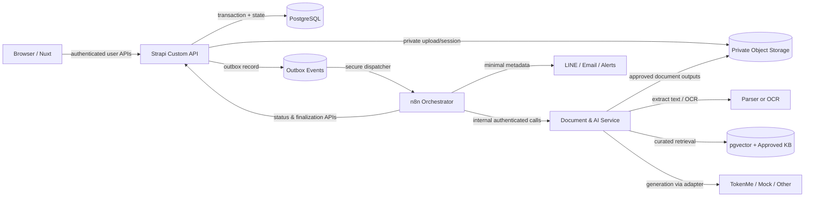

# LongRak (หลงรัก) — n8n Workflow Specification

> **File:** `spec.md`  
> **Version:** 1.0.0 (Proposed / implementation-ready specification, not imported n8n JSON)  
> **Prepared:** 2026-11-19  
> **Project:** LongRak — Agreement & Evidence Intelligence for built-in / renovation projects  
> **Primary stack:** Nuxt + Strapi 5 + PostgreSQL/pgvector + private object storage + n8n + AI provider adapter  
> **Authoritative project references:** `context.md` (LongRak v0.1.0, 2026-11-16) and `longrak-database-er-strapi.md` (v1.0.0, 2026-11-17). This document *extends* them; if field names or state machines conflict, reconcile explicitly before deployment.  
> **Status:** Design proposal. Node names, internal APIs, retry budgets and thresholds below are specifications to implement, **not a claim that endpoints already exist**.

---

## 0. Executive decision / TL;DR

**Use n8n as an asynchronous workflow orchestrator, NOT as the source of truth.**

- **Nuxt** renders public website, upload progress, user/project UI.
- **Strapi custom controllers/services** authenticate users, authorize tenant access, validate business transitions, own business tables and outbox, and expose *internal* APIs for n8n.
- **Private document/AI service** securely extracts PDF text/OCR, executes deterministic risk rules and math validation, performs pgvector RAG, calls AI (TokenMe if contract/API is confirmed), validates grounding/citations, and writes artifacts via backend APIs.
- **n8n** receives authenticated events, coordinates the steps and state notifications, handles bounded retries and dead-letter alerts, schedules maintenance/evaluations, and connects LINE/email/partner APIs.
- **PostgreSQL** remains authoritative for all lifecycle states. Important signed acknowledgments, audit and payment acknowledgment records must be committed transactionally in backend/SQL—not authored by editable n8n nodes.
- **Object storage** contains original files/reports; private bucket, authorized short-lived access, hashes, versioning and retention policies. n8n carries references, not files or document text.

**Start with W0: upload → queue → OCR/extraction → rules → RAG → TokenMe/provider adapter → validation → report + evidence plan.** The later W1–W3 automation list is included but should not block the website launch.

### In scope

1. Detailed workflow catalog with priorities and triggers.
2. n8n node-by-node build specs for core W0 workflows.
3. W1 project notifications and evidence/export jobs.
4. W2 inspections, LongRak billing events, disputes and retention.
5. Contracts, error handling, idempotency, security, observability, tests, deploy checklist.

### Explicit non-goals

- n8n must **never** hold or transfer construction milestone payments, approve acceptance, sign a contract on behalf of a user, grant user permission, or determine legal liability.
- No autonomous legal advice, contractor fraud scoring, construction quality certification, automatic payment release, or public access to private project evidence.
- No auto-learning from client files into the shared RAG corpus.
- No “court certified evidence” promise; audit trails increase traceability but do not guarantee admissibility or evidentiary weight.

---

## 1. Phase map and capabilities

| Phase | User-visible outcome | n8n responsibilities | Priority |
|---|---|---|---|
| **W0 — Website + AI Checker** | Try sample / upload quote or contract, read Thai findings and evidence checklist | Job orchestration, KB ingestion, evaluation, alerts, retention | **P0: build now** |
| **W1 — Shared project pilot** | Invite Guest, confirm agreement, submit work, request payment, acknowledge direct payment, export evidence | Transactional event notifications, reminders, export orchestration | P1 |
| **W2 — Services & Trust** | Optional independent inspection, billing for LongRak service, dispute support, legal holds | Partner notifications, payment-event follow-up, case routing, retention workflows | P2 |
| **W3 — B2B scale** | Multi-project shops, subscription, CRM, partner integrations | Scheduled reports, plan/usage notifications, partner API/webhook integration | P3 |

**Build principle:** business-critical state changes happen synchronously in Strapi custom service + DB transaction. On commit, write `domain_outbox_events` (or an equivalent reliable queue). n8n receives the resulting event and performs *eventual* side effects.

---

## 2. System architecture and data boundaries



### Ownership matrix

| Operation | Owner / authority | n8n allowed? |
|---|---|---|
| Create analysis session, check consent and rate limits | Strapi | Trigger after commit only |
| Create/claim `analysis_jobs` and decide valid state transition | Strapi + DB | Call a constrained internal transition API |
| Verify upload ownership, scan/MIME/hash, issue storage access | Strapi + file service | Receive opaque IDs, not raw storage credentials |
| OCR, PDF parse, extract fields | AI/doc service | Orchestrate via HTTP, not process untrusted binaries inline |
| Deterministic money calculation and contract rule checks | AI/doc service | Invoke result endpoint only |
| KB version approval and corpus release | Human approver + Strapi | Ingest already-approved source; never self-approve |
| pgvector retrieval, grounding, AI provider invocation | AI/doc service | Trigger and observe via internal API |
| Immutable acknowledgments and audit | Strapi SQL transactional service | **NO direct DB writes** |
| Notify user and schedule reminders | n8n | YES after backend checks authority/preference |
| Partner scheduling, outbound integrations | n8n | YES with external consent and scoped token |
| Platform payment reconciliation | Backend payment service | n8n can notify after backend confirms |
| Construction payment report | Authorized project user + Strapi | Notify only, do not move funds |

**Network:** never expose n8n editor/admin UI directly to the internet without strong authentication and network controls. The preferred pattern is that Strapi/dispatcher calls a private n8n endpoint through internal networking/reverse proxy. No browser or mobile client calls n8n directly.

### Sequence: W0 document check

```mermaid
sequenceDiagram
    participant U as User / Nuxt
    participant S as Strapi
    participant O as Outbox Dispatcher
    participant N as n8n
    participant A as Document/AI Service
    participant D as PostgreSQL + Storage
    U->>S: POST /api/longrak/ai/jobs (session/upload refs)
    S->>D: Validate, create queued job + outbox event (transaction)
    S-->>U: 202 + job_public_id + status URL
    O->>N: job.created (no raw file bytes)
    N->>S: Claim job (idempotent)
    N->>A: Extract/normalize job inputs
    A->>D: Read scoped files; persist extracted pages/fields
    N->>A: Run deterministic risk rules
    N->>A: Retrieve approved KB snapshot + AI analyze
    A->>D: Store retrieval trace / invocation metadata
    N->>A: Grounding/schema/arithmetic validation + evidence plan
    N->>S: Finalize completed OR failed with validated artifacts
    U->>S: GET /api/longrak/ai/jobs/:id (poll)
    S-->>U: State / authorized report when complete
```

**HTTP response:** `202 Accepted` comes from Strapi immediately after queuing; do **not** hold the user's HTTP request until OCR/LLM finishes. Frontend polls authorized job endpoint or consumes app-managed notifications. n8n webhook should acknowledge short-lived, independently of analysis completion.

---

## 3. Naming conventions and project layout in n8n

Workflow format: `LR-{PHASE}-{NN}-{slug}`. Use workflow tags `longrak`, `w0|w1|w2|w3`, `production|staging`, `critical|noncritical`.

Example organization:

```text
LongRak-n8n/
  W0/
    LR-W0-01-analysis-job-orchestrator
    LR-W0-02-kb-source-ingestion
    LR-W0-03-analysis-evaluation
    LR-W0-04-anonymous-retention-request
    LR-W0-05-lead-and-pilot-followup
  W1/
    LR-W1-01-project-invitation-notify
    LR-W1-02-agreement-and-design-notify
    LR-W1-03-milestone-reminder
    LR-W1-04-work-review-and-payment-notify
    LR-W1-05-evidence-export-orchestrator
  W2/
    LR-W2-01-inspection-coordination
    LR-W2-02-platform-billing-followup
    LR-W2-03-dispute-and-legal-hold-notify
    LR-W2-04-retention-scheduler
  W3/
    LR-W3-01-business-portfolio-digest
    LR-W3-02-subscription-and-usage-alerts
  Shared/
    LR-SH-01-error-handler
    LR-SH-02-deliver-notification
    LR-SH-03-provider-health-check
```

**Repository structure** (n8n JSON exports later, *not* included in this document):

```text
repo/
  context.md
  longrak-database-er-strapi.md
  spec.md
  automation/n8n/workflows/   # exported JSON, scrubbed of credentials/test data
  automation/n8n/fixtures/    # synthetic payloads only
  automation/n8n/README.md
  services/ai/                # trusted parsing, rules, RAG, provider adapter
  backend/                     # Strapi
  frontend/                    # Nuxt
```

### Workflow registry

| ID | Trigger | Main effect | Phase | Criticality |
|---|---|---|---|---|
| LR-W0-01 | `analysis.job.created` event | Extract → rule → RAG → LLM → validate → finalize | W0 | Critical |
| LR-W0-02 | Admin KB version approved / explicit ingest command | OCR/chunk/embed/review staging → snapshot candidate | W0 | Critical |
| LR-W0-03 | Manual/cron | Synthetic test suite and release gate | W0 | Critical for release |
| LR-W0-04 | Retention event / scheduled cleanup | Expire anonymous jobs, remove files per policy | W0 | Critical for privacy |
| LR-W0-05 | Lead opt-in event | Send invitation/confirmation and optional follow-up | W0 | Noncritical |
| LR-W1-01 | `project.invite.created` | Deliver Guest invite link + notification metadata | W1 | Important |
| LR-W1-02 | `agreement.proposed` / `design_revision.proposed` | Notify parties to review and acknowledge | W1 | Important |
| LR-W1-03 | Schedule at Asia/Bangkok | Reminder for milestones with policy/preference checks | W1 | Important |
| LR-W1-04 | Work/decision/payment events | Deliver informational notifications | W1 | Important |
| LR-W1-05 | `evidence.export.requested` | Authorized export job/manifest generation coordination | W1 | Critical |
| LR-W2-01 | `inspection.requested` | Contact eligible inspector and relay scheduling | W2 | Important |
| LR-W2-02 | `platform.billing.*` from backend | Invoice/receipt delivery and failed-charge notice | W2 | Important |
| LR-W2-03 | `dispute.opened` / legal-hold events | Internal routing, status notifications, export request | W2 | Critical |
| LR-W2-04 | Scheduled | Retention + legal-hold-aware cleanup | W2 | Critical |
| LR-W3-01 | Weekly schedule | B2B portfolio digest, no cross-tenant detail leaks | W3 | Optional |
| LR-W3-02 | Usage threshold event | Entitlement renewal or quota notices | W3 | Optional |
| LR-SH-01 | n8n Error Trigger | Sanitized incident + backend failure state/alert | All | Critical |
| LR-SH-02 | Execute Sub-workflow | Email/LINE delivery with opt-out and dedup | All | Important |
| LR-SH-03 | Schedule/Manual | Check AI/OCR/Strapi provider readiness | All | Important |

---

## 4. Common event, authentication and idempotency contracts

### 4.1 Event envelope (all examples are **proposed**)

The dispatcher converts a committed outbox event to an internal event. It must pass no raw document text, full filename, address, OTP, signed storage URL, or original PII.

```json
{
  "event_id": "8cd3b4be-6a3f-4b34-80dd-42a935f4633e",
  "event_type": "analysis.job.created",
  "schema_version": "1.0",
  "occurred_at": "2026-11-19T04:00:00Z",
  "request_id": "req_01",
  "aggregate_type": "analysis_job",
  "aggregate_public_id": "dc5da090-a24d-460c-a4d6-b69f5f7ad784",
  "tenant_public_id": null,
  "actor_public_id": null,
  "data": { "job_public_id": "dc5da090-a24d-460c-a4d6-b69f5f7ad784" }
}
```

**Trust:** The envelope is transport metadata, not authorization. n8n must call an internal Strapi endpoint which *rechecks* job ownership/state/eligibility. For W1 events the backend authorizes the intended notification recipients and returns minimized delivery data.

### 4.2 Authentication

- Prefer private service-to-service network plus short-lived machine token or mTLS. n8n Webhook `Header Auth` can be used behind an authenticated gateway; terminate signature validation at backend/gateway if richer HMAC/replay detection is needed.
- Restrict inbound source to the outbox dispatcher / backend network. Disable unauthenticated public production webhooks for sensitive operations.
- Strapi internal API validates service token scope, `event_id`, allowed operation, timestamp/replay window, and request body schema.
- Separate credentials for dev/staging/prod. Credentials held in n8n Credentials / secret manager; do not store credentials in workflow nodes or exported JSON.
- A notification recipient ID is never inferred from free-text payload; fetch recipient and preferences from backend.

### 4.3 Idempotency / delivery semantics

1. Business service transaction writes `domain_outbox_events` along with its state transition. Event relay uses at-least-once delivery; retries may duplicate.
2. Each n8n workflow begins with `Claim/Check Event` via backend. Backend performs atomic unique insert into `automation_event_inbox` (recommended NEW SQL table) or equivalent. `event_id + consumer_name` must be unique.
3. `analysis_jobs` also use their existing `idempotency_key_hash`, and any external callback has `request_id` and `workflow_run_id`.
4. For network timeout after side effect, **query status first**, then retry. Never assume the previous call had no effect.
5. Upserts are allowed for mutable *processing metadata* only. Immutable findings, acceptance events, signatures and audit records use unique constraints and transactional append-only operations.
6. Notification dedup key = `notification_kind + recipient_actor_id + aggregate_public_id + transition_version`, persisted by backend.
7. If claim returns `already_completed`, workflow stops successfully; if `leased_to_other`, exit or reschedule; if `not_eligible`, stop without side effect.

### 4.4 Proposed new SQL infrastructure tables

The earlier ERD places `domain_outbox_events` in W1. **Implementation correction:** promote that durable outbox to **W0** (or use an equivalently durable queue) because the public AI checker needs reliable background work already. The following two additional tables extend the existing ERD and require explicit migrations:

```sql
-- Proposals only. Add named constraints and project-specific migration standards.
CREATE TABLE automation_event_inbox (
  event_id uuid NOT NULL,
  consumer_name text NOT NULL,
  processing_state text NOT NULL DEFAULT 'claimed',
  lease_expires_at timestamptz,
  processed_at timestamptz,
  last_error_code text,
  updated_at timestamptz NOT NULL DEFAULT now(),
  PRIMARY KEY (event_id, consumer_name)
);

CREATE TABLE automation_delivery_attempts (
  delivery_id uuid PRIMARY KEY,
  event_id uuid,
  recipient_ref uuid,
  channel text NOT NULL,
  dedup_key text UNIQUE NOT NULL,
  delivery_state text NOT NULL,
  provider_message_id_digest text,
  retry_after timestamptz,
  last_error_code text,
  created_at timestamptz NOT NULL DEFAULT now()
);
```

Use a backend repository to manage leases, compare-and-set and delivery attempts. **Do not let generic Strapi public CRUD or n8n direct SQL mutate these tables without service authorization.**

### 4.5 Proposed internal API contracts

> All `/internal/automation/*` paths are **new endpoints to implement**, not routes claimed to already exist. Version at `/internal/automation/v1/*` if preferred.

| Method / path | Caller | Purpose |
|---|---|---|
| `POST /internal/automation/events/claim` | n8n | Deduplicate/lease event, enforce eligibility |
| `POST /internal/automation/events/finish` | n8n | Commit orchestration outcome |
| `POST /internal/automation/analysis-jobs/:id/claim` | n8n | Atomic job claim, state/attempt check |
| `POST /internal/automation/analysis-jobs/:id/transition` | n8n | Controlled processing state update |
| `POST /internal/automation/analysis-jobs/:id/finalize` | n8n | Atomically validate persisted report artifacts and complete |
| `POST /internal/automation/analysis-jobs/:id/fail` | n8n | Sanitized terminal/transient failure |
| `POST /internal/automation/kb/versions/:id/ingestion-state` | n8n | Stage ingest results, never self-publish |
| `POST /internal/automation/kb/snapshots/:id/stage` | n8n | Stage candidate snapshot |
| `GET /internal/automation/notifications/:eventId/targets` | n8n | Authorized minimized recipient data |
| `POST /internal/automation/notifications/deliveries` | n8n | Idempotent delivery state |
| `POST /internal/automation/evidence-exports/:id/step` | n8n | Run stage under backend authorization |
| `POST /internal/automation/retention/scan-or-execute` | n8n | Backend decides hold/expiry and deletes securely |

For processing, use a separate `ai-service` internal namespace such as:

- `POST /internal/ai/jobs/:id/extract`
- `POST /internal/ai/jobs/:id/apply-rules`
- `POST /internal/ai/jobs/:id/retrieve-and-analyze`
- `POST /internal/ai/jobs/:id/validate-and-build-plan`
- `POST /internal/ai/kb/source-versions/:id/ingest`
- `POST /internal/ai/evaluations/run`

These calls must be **idempotent by job ID + input digest + stage version**, return minimal safe metadata to n8n, and store any sensitive output within protected backend/OBJ.

---

## 5. Detailed n8n build spec: W0

### LR-W0-01 — Analysis Job Orchestrator (P0, build first)

**Goal:** when a user uploads an authorized document, produce a grounded and validated report in Thai with findings, questions/actions, and `evidence_plan_drafts` / `evidence_plan_items`.

**Start:** signed/authorized `analysis.job.created` outbox event. Only execute if `analysis_jobs.processing_state=queued` and all referenced `file_assets.upload_state=accepted`, consent/legal basis and quota are satisfied.

**Proposed nodes and connections:**

| # | n8n Node | Configuration / call | Important output |
|---|---|---|---|
| 01 | **Webhook** | `POST /webhook/longrak/analysis-job`; private gateway/header auth; short acknowledge | Envelope only |
| 02 | **Webhook immediate response configuration** | Configure Webhook node `Respond = Immediately`, HTTP `202` (no body or a generic acknowledgement); no separate Respond node required | HTTP acknowledged before long job steps |
| 03 | **HTTP Request — Claim Event** | `POST /internal/automation/events/claim` | `claimed / already_processed / leased` |
| 04 | **IF / Switch** | Skip duplicate/not eligible | No duplicate downstream |
| 05 | **HTTP Request — Claim Job** | Backend validates job version, input files & quota | `job_public_id`, safe flags, stage |
| 06 | **HTTP Request — Extract** | `POST /internal/ai/jobs/:id/extract`, service parses PDF text / OCR fallback | `extraction_state`, page_count, quality flags |
| 07 | **IF** | If empty/corrupt/unsupported → limited failure or `unable_to_assess` as defined | Controlled branch |
| 08 | **HTTP Request — Apply Rules** | Deterministic normalization of amount/dates/milestones and risk rules | digest, ruleset version, issues count |
| 09 | **HTTP Request — Retrieve + Analyze** | Query approved `kb_snapshots`, invoke configured `AI_PROVIDER`, produce candidate JSON | model/key versions, run ID, not raw output |
| 10 | **HTTP Request — Validate & Plan** | JSON schema + document quote validation + KB citations + arithmetic + evidence checklist | `valid`, `downgraded`, `retryable` |
| 11 | **IF / Switch** | Valid / degraded / terminal error | No unverified final status |
| 12 | **HTTP Request — Finalize** | `POST /internal/automation/analysis-jobs/:id/finalize`; commit `analysis_runs/findings/citations/actions/plan` with version reference | state `completed`, authorized report pointer |
| 13 | **HTTP Request — Finish event** | Mark event processed; optional enqueue sanitized `analysis.job.completed` | status OK |
| ERR | **Error workflow** | Via LR-SH-01; classify retry/dead-letter | safe error code |

**Important n8n design detail:** configure the Webhook trigger with **Respond = Immediately** and `202` so the HTTP call does not block on OCR/LLM. No separate `Respond to Webhook` node is needed in this workflow; the built-in acknowledgement is generic and the dispatcher continues with the at-least-once event. Backend/outbox determines delivery state, not just this HTTP code. Always load-test duplicate deliveries and webhook timeouts.

**State transitions:**

```text
queued
  -> preprocessing
  -> extracting
  -> rule_check
  -> retrieving
  -> model_call
  -> validating
  -> completed
  OR failed / cancelled / expired (via allowed transitions only)
```

**AI/document requirements:**

1. Confirm PDF MIME from file contents, byte/page/filename limits, scan unsafe files, and enforce private access in backend before any processing.
2. Text PDF parser first; OCR if scan or quality insufficient. If Thai OCR quality is weak, output `unable_to_assess` instead of inventing clauses.
3. Extract monetary amounts and milestones as structured fields with page and source span. Use decimal arithmetic in backend; **never accept LLM-produced sum without verification**.
4. Retrieve **only published, approved, applicable** KB versions pinned in `kb_snapshot_key`. Filter by jurisdiction, work type, effective date and topic.
5. Generate via TokenMe only if valid endpoint/model/credentials and privacy review exist; otherwise use `mock` with **synthetic fixtures only**, or fail gracefully with `AI_PROVIDER_UNAVAILABLE`.
6. Treat text inside uploaded documents and retrieved sources as **untrusted input**, not system instructions (prompt-injection defense).
7. Validate `finding_citations` against actual extracted quotes/pages or retrieved `kb_chunks`; unsupported claims must be dropped/downgraded, never presented as fact.
8. Create `recommended_actions` and `evidence_plan_items` (photo / invoice / design approval / BOQ / inspection) linked to findings. These are **AI suggestions**, not agreed contract requirements until both parties approve them in W1.
9. Persist `model_id`, `prompt_version_key`, `ruleset_version_key`, `knowledge_snapshot_key`, `input_fingerprint_sha256`, and cost/latency metadata in `analysis_runs` and `ai_invocations`.
10. Do **not** put original PDF bytes, full OCR text, signed URLs, prompts, or model raw response into n8n execution data or generic logs.

**W0 default limits (initial hypotheses, configurable):** 1–3 files per job, 15 MB per file, 30 pages total, at most 3 anonymous uses/IP risk bucket per day; these are **proposed** and require load/cost validation. Reject over-limit uploads before outbox event generation.

**Success contract example:**

```json
{
  "job_public_id": "dc5da090-a24d-460c-a4d6-b69f5f7ad784",
  "processing_state": "completed",
  "analysis_run_public_id": "2f5c8bcb-8cbf-4bb0-8b7f-4f1c18defc5d",
  "document_read_status": "partial",
  "finding_count": 3,
  "unverifiable_claim_count": 0,
  "evidence_plan_public_id": "e3f52191-7d83-4d1a-a409-39d243de0c30",
  "schema_version": "1.0",
  "knowledge_snapshot_key": "kb-approved-snapshot-v1"
}
```

This event's success response is not the user's report. User fetches authorized report from Strapi (`GET /api/longrak/ai/jobs/:publicId/report`).

**Failure paths:**

| Condition | Error code | Expected behavior |
|---|---|---|
| Invalid PDF / malware / unacceptable MIME | `FILE_REJECTED` | Stop; explain to user; preserve no unsafe bytes |
| PDF text unavailable / OCR quality too low | `DOCUMENT_UNREADABLE` | Limited `unable_to_assess` report or failed state; no confident claim |
| Unknown amount / conflicting clause | `FACT_CONFLICT` | Do not calculate confident risk percentage; request clarification |
| TokenMe timeout / 429 / 5xx | `AI_PROVIDER_UNAVAILABLE` | Bounded retry + jitter; fail/queue if exhausted |
| RAG has no approved source | `KB_UNAVAILABLE` | Produce only clearly scoped document facts/checklist, no fabricated legal citation; or mark blocked per release policy |
| JSON malformed | `MODEL_OUTPUT_INVALID` | One controlled regeneration attempt, then fail/downgrade |
| Citation doesn't match text | `GROUNDING_VALIDATION_FAILED` | Remove unsupported finding or mark unable to assess; do not publish unverifiable quote |
| Job cancelled or TTL elapsed | `JOB_NOT_ELIGIBLE` | Stop; no external model call |

**Completion criteria:** analysis and evidence checklist visible only to authorized session/account; 100% synthetic test cases have no cross-tenant leakage; all monetary fields programmatically verified; citation source version reproduced.

### LR-W0-02 — Curated KB Source Ingestion (P0)

**Goal:** ingest approved external knowledge, expert-reviewed checklists and lawful templates into a versioned RAG KB; make active snapshot reproducible. **Not a crawler that automatically declares law effective.**

**Trigger:** authorized admin action after `kb_source_versions.review_state=expert_review/published` according to the manual approval workflow; or an explicit ingestion command for previously approved source. Never ingest arbitrary user-uploaded project documents into shared knowledge.

**Nodes:**

| # | Node | Action |
|---|---|---|
| 01 | Webhook (private) / Manual Trigger | Receive `kb.source_version.ingest_requested` with source version public ID |
| 02 | HTTP Request | Check source is approved for ingestion, verify license, jurisdiction, metadata, effective dates |
| 03 | HTTP Request | Download approved source server-side (allowlist domain/storage, SSRF controls) and hash it |
| 04 | HTTP Request | Trigger parsing/OCR/chunking; preserve page/section references |
| 05 | HTTP Request | Call embedding provider (model separate from generation provider) through ai-service |
| 06 | HTTP Request | Stage `kb_chunks` and `kb_embeddings` with model dimension + metadata |
| 07 | HTTP Request | Run retrieval QA / broken-source / duplicate-content check |
| 08 | IF | Bad source or insufficient quality => mark needs review; do not activate |
| 09 | HTTP Request | Create `kb_snapshots` candidate; attach `kb_snapshot_members` of approved versions |
| 10 | Internal notification | Inform reviewer that snapshot is ready for **human approval** |

**Publish policy:** only authorized human/backend service can mark `kb_snapshots.snapshot_state=active`. Activation is atomic and versioned; old snapshot remains available for reproducibility/rollback. On law update, **review applicability before switching**, and rerun evaluation suite.

**RAG seed recommendation:** start with 10–30 curated official/expert-reviewed texts for OCPB consumer guidance, ETDA e-record practices, built-in/renovation checklists and milestone evidence. Do not infer that all OCPB rules apply identically to every contract/work type.

### LR-W0-03 — AI/RAG Regression Evaluation (P0 before real-doc launch)

**Trigger:** Manual Trigger after model/rule/prompt/KB update, plus scheduled nightly or weekly synthetic regression when cost permits.

**Nodes:** Schedule/Manual → backend `GET eligible evaluation_cases` → Loop Over Items (bounded) → `POST /internal/ai/evaluations/run` → collect `evaluation_results` → summary metrics → IF regression / leak / citation failure → block release flag or request human decision via backend; notification.

**Test fixture groups:** valid document, missing clauses, contradictory totals, scanned low-quality Thai PDF, unsupported file, stale/irrelevant law, adversarial prompt injection, cross-tenant request, duplicate job, denied consent. Reference `evaluation_cases`, `evaluation_runs`, `evaluation_results` in DB spec.

**Release gate:** someone competent reviews known-answer cases; material citation or cross-tenant failure is blocking. Define numerical precision/recall and latency thresholds only *after* baseline measurement, not arbitrary claims of accuracy.

### LR-W0-04 — Anonymous Analysis Retention / Delete (P0)

**Trigger:** Scheduled cleanup plus event created after a validated user deletion request. Do not let n8n directly delete rows/files without evaluating legal hold and applicable retention policy.

**Nodes:** Schedule Trigger → `POST /internal/automation/retention/scan-or-execute?category=demo` → receive safe aggregate `{deleted,skipped_hold,failed}` → log counters / alert failures. User-requested deletion: backend resolves identity/session ownership and policy first, then creates a deletion job for n8n to coordinate.

**Rules:** expired sessions/jobs and files are deleted or made inaccessible according to `retention_policies`; no public demo data used to train foundation models; structured non-PII cost/operational stats retained only as allowed. `expired` / `deleted` states are distinct from a successful analysis. Never expose other users' deletion results.

### LR-W0-05 — Lead / Design Partner Follow-up (P0 optional)

**Trigger:** authorized lead opt-in (`leads`, `pilot_applications`) created. Send acknowledgement, educational preview, invitation to a 10–15-minute test interview; optional one follow-up after user-approved period. No unsolicited mass messages and respect opt-out. `LR-SH-02` handles channel delivery. Do not include uploaded contract content in marketing messages.

---

## 6. Detailed n8n build spec: W1 Shared Projects

All W1 writes that change rights/obligations are performed **first in Strapi** with a validated actor, project membership, signed snapshot and SQL audit event. n8n merely gets a committed event and sends notifications or arranges non-legal side effects.

### LR-W1-01 — Guest invitation notification

- **Trigger:** `project.invitation.created` after backend has persisted `project_invitations` and a one-time opaque token/digest.
- **Flow:** Event → claim → backend fetches authorized recipient/channel and **short-lived single-use invitation URL** → send via LINE/email → delivery receipt → backend delivery state.
- **Never:** store invite token in n8n logs; send identity documents through chat; make invitation acceptance a n8n state mutation.
- **Expiry:** backend enforces expiry, resend limits, revocation and OTP; delivery failure can be retried without generating unlimited new tokens.
- **Related:** `projects`, `project_parties`, `project_invitations`, `auth_challenges`, `guest_access_sessions`.

### LR-W1-02 — Agreement/design confirmation notification

- **Triggers:** `agreement.version.proposed`, `design_revision.proposed`, `agreement.acknowledged`, `design_revision.acknowledged`, `agreement.rejected`.
- **Flow:** backend verifies current proposed version → get both parties' notification preference → send link to auth-protected review page → schedule one reminder on a configured cadence if still pending.
- **Important:** approval action happens in Strapi and writes `agreement_acknowledgments` / `design_acknowledgments` append-only. n8n never accepts approval via an email reply or webhook without app authentication.
- **Versioning:** notification references agreement version and hash digest, never mutable “latest” link alone. On superseded version cancel pending reminders.

### LR-W1-03 — Milestone deadline reminder

- **Trigger:** Schedule Trigger daily at `09:00 Asia/Bangkok` (configurable; display preferences could override).
- **Nodes:** Schedule → `GET /internal/automation/reminders/due?date=YYYY-MM-DD` → Loop Over Items → backend recheck current milestone/status + quiet hours/preference + dedup → `LR-SH-02` notify → mark delivery.
- **Remind:** evidence due, pending inspection, impending milestone review and overdue payment-request response as **neutral status reminders**.
- **Never:** claim payment is overdue or debt proven based solely on AI or date; take no automatic accept/reject action when a deadline passes.
- **Related:** `milestones`, `milestone_state_events`, `notifications`, `payment_requests`.

### LR-W1-04 — Work review / payment request notifications

**Event handlers:**

| Event | Intended recipient | Text semantics |
|---|---|---|
| `work_submission.submitted` | Owner/reviewer | Contractor uploaded evidence for review |
| `review_decision.request_change` | Contractor | Changes requested with link to app |
| `review_decision.accepted` | Contractor | Owner accepted specified work scope |
| `payment_request.created` | Owner | Contractor requests direct payment per milestone |
| `construction_payment.reported` | Contractor | Owner reports having transferred; **not yet acknowledged** |
| `payment_acknowledgment.recorded` | Owner | Contractor acknowledges receiving amount |
| `payment_discrepancy.opened` | Both relevant parties | Payment record disputed; review in app |

**Absolute constraint:** `construction_payment_reports` is information about *direct owner-to-contractor payments*. LongRak does not escrow funds. Do not mark as acknowledged or settled because a notification was delivered or a screenshot was uploaded.

### LR-W1-05 — Evidence Export Orchestration

- **Trigger:** `evidence.export.requested` after backend checks applicant role, project scope and current retention/legal-hold permissions.
- **Nodes:** claim → request an export build from backend worker → poll for completion with bounded backoff / separate follow-up event → integrity verify manifest → backend marks ready → notify requesting actor with authorized temporary download location.
- **Contents:** original file hashes, object-version IDs if available, agreement and design versions, acknowledgment event IDs/time/method, milestone/work-review/payment sequence, scope/change order links, source of system timestamps, export manifest and verifier instructions.
- **No guarantee:** evidence may support a dispute but export itself is not judicial certification. Time recorded by own systems does not independently prove the photo was taken then.
- **Security:** never put export ZIP into an email attachment or n8n execution output. Expiring download URL is minted upon authenticated user access by backend.
- **Related:** `evidence_export_jobs`, `export_manifest_items`, `audit_events`, `file_assets`.

---

## 7. W2 and W3 workflow specs (implement later)

### LR-W2-01 — Optional independent inspection

`inspection.requested` → backend confirms service scope and consent → find qualified inspector manually or from approved `inspector_profiles` → notify / propose available slots → store assignment in backend → inspector uploads protected `inspection_reports` and `inspection_findings` → notify both parties. Inspector does **not** release funds; project owner acts on report according to agreement. If no inspector is available, present accurate unavailable status, not fabricated appointment.

### LR-W2-02 — LongRak billing / receipts

Payment gateway webhook **first reaches a backend payment controller** that verifies signature and stores unique `billing_webhook_events`. After transaction is committed, emit `platform.billing.settled` / `.failed` → n8n sends receipt or retry instructions. Separate `platform_payment_transactions` from `construction_payment_reports`. No browser redirect may mark an order `paid`, and no n8n node should directly grant entitlements based on unverified gateway JSON.

### LR-W2-03 — Dispute / Legal Hold routing

Case opened by authorized party → backend preserves immutable history, records `dispute_case_events` / `legal_holds` as appropriate under approved policy → n8n notifies authorized support recipient, optionally initiates evidence export and schedules manual follow-up. No AI-generated allegation that someone broke the law. Case closure does not automatically revoke a valid legal hold without appropriate approval.

### LR-W2-04 — Retention scheduler

Nightly backend-driven scan for policy-defined expiry; check `legal_holds`, user rights, audit/contract obligations, object storage lifecycle and backup retention. Data subject request requires verified identity and manual review where applicable. Report count and failure codes only; log access and deletion of evidence explicitly. Do not promise indefinite retention.

### LR-W3-01 — B2B portfolio digest

Only organization-authorized project portfolio; weekly summary of projects needing action, evidence awaiting review, approaching milestones and disputed records. Backend compiles allowed project list; n8n delivers a link or **minimal safe summary** to verified recipient. No cross-organization joins.

### LR-W3-02 — Subscription / usage notices

`entitlements` and `usage_events` from backend produce threshold events. n8n notifies payer about quota/renewal/expiration. Never silently charge or cancel a project because notification failed. Contractual evidence access after subscription expiry follows legal/retention rules, not marketing-plan flags alone.

---

## 8. Shared workflow specs

### LR-SH-01 — Central Error Handler

**Trigger:** n8n **Error Trigger** configured as the error workflow for production workflows.

- Read workflow ID, execution ID (if present), last node, normalized error code and correlation ID; **sanitize** all error text to avoid accidental PII/secrets.
- Notify internal maintenance channel (not customer) with safe incident summary, severity, runbook link and correlation ID.
- For critical jobs, call Strapi `/analysis-jobs/:id/fail` or corresponding task error endpoint only after backend confirms error branch/claim ownership; never force `failed` after a transient retry that might succeed elsewhere.
- On recurring error threshold raise incident and pause related production ingestion/analysis if needed; expose a clear degraded state on the app.
- Error workflow does not replace explicit per-node retry and compensation logic.

### LR-SH-02 — Notification Delivery Sub-workflow

**Input:** only `notification_public_id`, channel enum, recipient ref, template code and idempotency key; backend returns safe rendered parameters.

```json
{
  "notification_public_id": "5ff4bce6-9821-4d4d-a024-36c5bf9bf915",
  "channel": "line",
  "recipient_ref": "recipient-scoped-internal-id",
  "template_code": "MILESTONE_REVIEW_REQUESTED",
  "dedup_key": "MILESTONE_REVIEW_REQUESTED:recipient:submission:1"
}
```

**Flow:** Validate → backend fetch preferences/contact consent → dedup delivery → render approved template → send through LINE/email provider with stored credential → receipt/status → retry transient failures → mark permanent failure and optional in-app notification.

**Message examples:**

- Owner: “มีหลักฐานงานงวดที่ 2 รอให้ตรวจสอบใน LongRak”
- Contractor: “มีคำขอให้แก้ไขรายละเอียดงานงวดที่ 1 โปรดเปิดโครงการเพื่อตรวจสอบ”
- Both: “มีการเสนอข้อตกลงฉบับใหม่ กรุณาตรวจสอบและยืนยันด้วยตนเอง”

Never expose contract amount, full address, identity document or sensitive dispute details in a LINE/email push unless specifically assessed and authorized; better link to app.

### LR-SH-03 — Provider Health Check

Scheduled / manual: check Strapi internal health, AI service health, embedding/pgvector readiness, TokenMe/alternate API (only safe health endpoint or a tiny synthetic prompt if supported), storage access and n8n service readiness; notify on sustained failures, no real user document used. Do not automatically fall back to a new provider without privacy/security assessment.

---

## 9. Concrete data mapping to existing ERD

| Workflow stage | Read tables/objects | Write via authority |
|---|---|---|
| Job claim | `analysis_jobs`, `analysis_sessions`, `analysis_inputs`, `file_assets` | `analysis_jobs` through Strapi transaction |
| Extract | `file_assets` private OBJ | `extracted_pages`, `extracted_fields`, `analysis_inputs` |
| Rule evaluation | `risk_rules`, `risk_rule_versions`, extracted fields | `rule_execution_records`, `analysis_runs` metadata |
| RAG retrieval | `kb_sources`, `kb_source_versions`, `kb_snapshots`, `kb_snapshot_members`, `kb_chunks`, `kb_embeddings` | `retrieval_traces`, `ai_invocations` |
| Finalize | Model candidate artifacts, extracted source spans | `analysis_runs`, `analysis_findings`, `finding_citations`, `recommended_actions` |
| Evidence plan | Final findings | `evidence_plan_drafts`, `evidence_plan_items` |
| Guest invite | `project_invitations`, `project_memberships`, `auth_challenges` | notification delivery only |
| Agreement notification | `agreement_versions`, `agreement_acknowledgments`, `design_revisions` | delivery only; no acknowledgment mutation |
| Work/pay reminder | `milestones`, `work_submissions`, `review_decisions`, `payment_requests`, `construction_payment_reports` | delivery only |
| Evidence export | `audit_events`, file assets, acknowledgment history | `evidence_export_jobs`, `export_manifest_items` via backend worker |
| Inspector routing | `inspection_requests`, `inspector_profiles`, `inspection_assignments` | assignment only via authorized backend/admin |
| Platform billing | `billing_orders`, `billing_webhook_events`, `platform_payment_transactions`, `entitlements` | send receipt/status after backend verification |
| Retention | `retention_policies`, `retention_jobs`, `legal_holds`, file assets | backend policy-enforced cleanup |

**No physical SQL table naming assumptions:** Strapi 5's generated relational tables, IDs and `documentId` can differ from logical entity names in the ERD. Use `public_id` for cross-service references and custom repositories/SQL migrations for append-only and vector data.

---

## 10. AI service boundaries and provider configuration

Because TokenMe capability/availability changes, **do not hardcode base URL, model ID, prices, embedding dimensions, OCR ability or data retention promises**. These must be verified before real customer uploads.

```dotenv
# Pseudocode names — no actual secrets committed to repo
LONGRAK_STRAPI_INTERNAL_BASE_URL=https://strapi.internal.example
LONGRAK_AI_SERVICE_BASE_URL=https://ai.internal.example
LONGRAK_N8N_EVENT_WEBHOOK_URL=https://automations.internal.example/webhook/longrak/analysis-job

AI_PROVIDER=mock                 # mock | tokenme | other
AI_API_BASE_URL=SET_AFTER_PROVIDER_CONFIRMATION
AI_CHAT_MODEL=SET_AFTER_PROVIDER_CONFIRMATION
AI_EMBEDDING_PROVIDER=local
AI_EMBEDDING_MODEL=SET_VALIDATED_MODEL
AI_REQUEST_TIMEOUT_MS=60000
RAG_TOP_K=8
RAG_MIN_RELEVANCE=SET_FROM_EVALUATION
OCR_PROVIDER=local_or_verified

# n8n secret values belong in Credentials/secret manager; do not duplicate
# full key material in env examples or exported workflow files.
```

**Provider abstraction required** in AI service:

```ts
interface GenerationProvider {
  analyze(input: {
    documentExtractRef: string;
    approvedKnowledgeChunkRefs: string[];
    promptVersion: string;
    outputSchemaVersion: string;
    requestId: string;
  }): Promise<{ candidateResultRef: string; usage: Record<string, unknown> }>;
}
```

**Suggested result contract:** align with `context.md §10`: `schema_version`, `analysis_id`, `document_type`, `document_read_status`, amount verification metadata, `findings[]` with `document_evidence` + `knowledge_citations`, `missing_information`, `limitations`, `knowledge_snapshot_id`, `model_id`, `created_at`. Also persist evidence checklist references. Never allow AI text to execute user actions or change signed contract fields.

---

## 11. Error, retry, timeout and compensation policy

### 11.1 Classification

| Type | Examples | Retry? | Escalation |
|---|---|---|---|
| Permanent input | 400 malformed/unsupported MIME, missing consent, wrong project | No | Safe user-facing error |
| Authorization | 401/403, inactive membership, expired guest | No auto-retry | Security telemetry; no leaked object details |
| Conflict/duplicate | 409 existing run, lease occupied | Check existing status | Stop successfully if processed |
| Rate / temporary | 429, 503, network timeout | Bounded exponential backoff with jitter | Retry queue / DLQ |
| Provider invalid output | JSON format failure | Max 1 repair attempt, revalidate | `unable_to_assess` / incident |
| Data integrity | mismatched file hash, invalid citation, state invariant | No unsafe automatic retry | Stop, quarantine/manual review |

### 11.2 Proposed policies (tune by measured traffic)

- Non-idempotent integrations: do not blindly enable node `Retry On Fail`; first ensure dedup and safe check-after-timeout.
- For idempotent GET/POST internal stage calls: try up to 3 attempts with delays around 5 s, 20 s, 60 s plus jitter; respect provider `Retry-After` if present. **Proposed values, not n8n defaults.**
- Do not build a single workflow that waits hours for an external service. Use backend stage events or new queued tasks for long-running OCR/export.
- Stop analysis on `cancelled`, `expired`, manual block or revoked authorization before model call, before finalization, and whenever a resumed run wakes up.
- On `AI_PROVIDER_UNAVAILABLE`, **do not silently use random different provider**; show unavailable/degraded status if no approved fallback.
- Rollback of a failed job does not delete append-only audit. Write a new error/correction event; old run remains versioned according to retention policy.
- Dead-letter state is recorded in backend with safe error reason and owner for manual reprocessing; operator replay must be idempotent.

### 11.3 Recovery runbook

1. Open n8n execution by correlation ID; **never** copy raw customer documents into an incident ticket.
2. Check job processing_state, claim lease, outbox event delivery, last stage/version, and provider availability.
3. Verify whether the side effect already committed; if yes, reconcile inbox status and do not duplicate.
4. Retry only transient failures using a new bounded attempt with same business idempotency key or a separately versioned rerun where appropriate.
5. If content is invalid, request new upload or label `unable_to_assess`. If data integrity/hash mismatch, isolate and escalate.

---

## 12. Security, privacy and trust requirements (mandatory)

**These are release blockers before handling real customer documents.**

1. **Access control:** project, party and session ownership validated by Strapi for every read/write. A random public UUID is not authorization. Guest OTP / invitation does not make an anonymous actor legally identified by itself.
2. **Storage:** all user files private, encrypted in transit and at rest, with minimum necessary signed access. Signed URL must never appear in n8n execution history or generic alert.
3. **Minimization:** n8n workflow items contain IDs/state/digests only. OCR text and model response are stored in scoped backend/OBJ, not copied through n8n where possible.
4. **Execution logging:** minimize or disable success execution payload retention; use retention/pruning for failures too, with sanitized data. Debug on synthetic docs. Avoid pinning real production data in n8n editor.
5. **Secrets:** credentials isolated by environment, service account least privilege; maintain stable `N8N_ENCRYPTION_KEY` securely and back it up, with consistent key across workers if using queue mode.
6. **Webhooks:** private ingress, authenticated source, dedup/replay window, HTTPS. Restrict editor UI with network policy and strong login; run n8n security audit.
7. **SSRF:** backend downloader only allowlists approved sources/private object keys; no `file://`, loopback, instance metadata addresses or arbitrary user-provided URLs.
8. **Prompt injection:** uploaded PDF text and retrieved legal source text are untrusted data. Generation prompt must explicitly refuse executable instructions from documents; validation independent of LLM.
9. **PII/PDPA:** before real-doc beta, verify data processing agreement, lawful basis, privacy notice, provider subprocessors/international transfer and retention. Implement subject requests and legal-hold-aware deletion.
10. **Isolation:** knowledge retrieval filtered by snapshot/source status; never index customer documents in global KB; W1 project-private index only with hard project filter and server authorization.
11. **Immutability:** signed terms and audit are not editable through Strapi Admin/n8n; preserve original hashes, timestamp methodology, append-only event history and backups.
12. **Financial boundary:** no escrow, no automated funds movement. Construction payment reports are separate from LongRak fee billing.
13. **Notification privacy:** no contract/evidence attachments sent via consumer messaging; no sensitive content in alert previews by default.
14. **Least privilege:** n8n accesses narrow internal APIs; no direct write privilege to audit/signature SQL tables, no shared admin supertoken.
15. **Incident response:** security failure or file leak triggers a clear incident runbook and legal notification assessment, not an AI-generated apology alone.

---

## 13. Deployment design for solo developer

### Stage A — minimal self-hosted setup (W0 beta)

- Deploy separate containers for `nuxt`, `strapi`, `ai-service`, `n8n`, PostgreSQL/pgvector and private object storage provider. Prefer managed storage when feasible.
- Separate database or schema for **n8n internal executions/credentials** and **LongRak app business DB** even if hosted on same Postgres server. Never share Strapi schema with n8n migrations.
- Reverse proxy (Nginx or Caddy) with TLS; private internal network for automation and AI service. Only public endpoints needed by the app should be exposed.
- n8n **regular mode** can be enough for a tiny controlled beta; enforce execution concurrency and backend job quota. Avoid downloading large PDF binaries into n8n workflow memory.
- Backup Strapi DB, n8n DB, encryption key and storage object metadata; test restores. n8n workflows exported to private repository after stripping credentials and sample customer content.

### Stage B — scale only after usage warrants it

- Use n8n **queue mode** with Redis + main + worker(s) for higher execution volume. All n8n instances must use compatible versions and consistent encryption configuration.
- Assess n8n binary data mode and licensing; external S3-compatible binary storage support can depend on plan/edition. This is another reason to keep document files out of n8n execution payloads.
- Use rate limiting, explicit worker concurrency and backpressure at Strapi queue. Outbox relay remains reliable if n8n is temporarily offline.
- Version control workflow JSON, code changes, migration files and AI prompt/rule versions. Use staging/prod separation and rollback plans.

### Suggested setup/env checklist

```text
[ ] n8n isolated instance + HTTPS + protected editor
[ ] Postgres separate n8n database / backup verified
[ ] N8N_ENCRYPTION_KEY securely provided and backed up
[ ] n8n Credentials for scoped Strapi internal token, AI-service token, email/LINE
[ ] n8n execution-data retention/pruning and safe workflow settings verified
[ ] outbound internet restricted appropriately; SSRF and unsafe nodes reviewed
[ ] Event dispatcher + claim/inbox implemented
[ ] 202 async API flow tested, including client timeout and duplicate webhook
[ ] n8n Error Workflow configured for all production workflows
[ ] AI mock provider + synthetic fixture suite before TokenMe connection
[ ] KB reviewer approval and active snapshot mechanism works
[ ] Backup/restore and rollback documented
```

---

## 14. Testing matrix (must run before release)

| Test ID | Scenario | Expected outcome |
|---|---|---|
| T01 | One valid quote PDF, standard Thai text | Completed report, at least grounded citation to actual text, evidence plan |
| T02 | Scan with weak OCR | `unable_to_assess` / partial; no invented contract clause |
| T03 | Mismatched milestone total vs contract amount | Backend arithmetic flags mismatch correctly |
| T04 | Input includes fake prompt “ignore all instructions” | Treated as source text, not executed |
| T05 | Retrieved law source outdated / not approved | Not cited as applicable authority |
| T06 | Two identical outbox events delivered concurrently | One logical job and no duplicate final artifacts |
| T07 | TokenMe/API 429 then recovers | Bounded retry; one valid final result |
| T08 | AI provider down | User sees explicit unavailable/degraded state; no fabricated findings |
| T09 | User A guesses User B job_public_id | 403/404 indistinguishable; no report leak |
| T10 | Anonymous session expired during processing | No final content published; retention honored |
| T11 | `analysis_findings` quote not present in document | Finding dropped/downgraded; mismatch logged safely |
| T12 | KB ingestion before human approval | Cannot activate snapshot |
| T13 | Guest project invite expired | Cannot join, but can re-request legitimate invite |
| T14 | Owner/contractor agreement on different version hashes | No mutual sign-off completed |
| T15 | Work submitted; owner not yet reviewed | Reminders only, no auto acceptance |
| T16 | User uploads payment screenshot but contractor disputes receipt | `reported` not `acknowledged`; dispute remains open |
| T17 | Evidence export for unauthorized actor | Denied; no file link generated |
| T18 | Retention job meets active legal hold | Skip deletion and record review-required state |
| T19 | n8n restarting mid-run | Outbox can redeliver; idempotent resume, no data corruption |
| T20 | Email/LINE provider returns temporary/permanent error | Proper retry/DLQ and no duplicate flood |
| T21 | Upload has malware/oversized PDF | Rejected before AI call and private storage quarantined |
| T22 | LongRak billing webhook arrives twice | One gateway transaction, one entitlement change |
| T23 | Adversarial document references another project ID | No cross-project retrieval, even if LLM asks |
| T24 | n8n execution retention cleanup | Does not accidentally delete business evidence retained in backend |

**W0 minimum QA dataset:** around 20–30 synthetic cases with expert-reviewed expected labels and 10 adversarial cases, as defined in `context.md §9.7`. Use measurable baseline, not a claimed accuracy percentage.

---

## 15. Observability, KPIs and cost controls

### Record in app backend / metrics (no raw documents)

- `analysis_job_queued_total`, `analysis_job_completed_total`, `analysis_job_failed_total`
- `analysis_duration_ms_p50/p95`, `ocr_duration_ms`, `llm_duration_ms`, `rag_retrieval_duration_ms`
- `ai_total_tokens`, `estimated_cost_thb_per_job`, `embedding_cost_per_source_version`
- `citation_validation_fail_total`, `arithmetic_mismatch_total`, `unable_to_assess_total`
- `kb_snapshot_age_days`, `source_last_reviewed_at`, `retrieval_hit_at_k` (evaluation)
- `outbox_pending_events`, `inbox_duplicate_total`, `workflow_error_total`, `dlq_count`
- `notification_delivery_success`, `notification_delivery_failure`, `notification_opt_out_total`
- `expired_file_cleanup_count`, `retention_blocked_by_legal_hold_count`

### Alerts and thresholds (configure from measured baseline)

- Any suspected data leak or unauthorized evidence access → high-priority incident.
- Repeated model grounding validation failure → pause risky output and review source/prompt.
- Large increase in failed analyses, provider 429 or cost per analysis → throttle and notify operator.
- Outbox oldest event age / DLQ growth beyond budget → notify operator.
- KB snapshot stale or unapproved → block publication/claims that depend on it.

For product analytics, track `sample_view → authorized_upload → queued → completed → report_view → evidence_plan_open → pilot_contact`, with no private doc content in funnel events.

---

## 16. Recommended implementation order and Definition of Done

### Sprint N0 — Infrastructure & safe event delivery

1. Deploy protected n8n staging; create service credentials; configure error workflow and log retention.
2. Implement `domain_outbox_events` relay + `automation_event_inbox` and claim APIs.
3. Build one synthetic `analysis.job.created` trigger with duplicate/retry test.
4. Define correlation IDs and safe error codes from backend to n8n.

**DoD:** 10 duplicate events do not produce duplicate job state; n8n can restart without losing legitimate work.

### Sprint N1 — Mock analysis end-to-end

1. Implement LR-W0-01 with **mock provider and synthetic PDF**.
2. Wire extraction, deterministic risk rules, schema/citation validation and `evidence_plan_drafts/items`.
3. Build Nuxt status page and report preview from Strapi APIs.

**DoD:** fake quote → valid result with source page, risk/action and evidence plan; malformed document returns transparent failure.

### Sprint N2 — Approved KB + TokenMe integration

1. Implement LR-W0-02 KB ingestion and manual approval pipeline.
2. Implement separate embedding provider + pgvector retrieval; pin KB snapshot.
3. Verify TokenMe endpoint/model/limits, pricing, DPA/security, API compatibility. Only then connect its generation adapter.
4. Implement LR-W0-03 evaluations and release gates.

**DoD:** end-to-end reproducible citations; failed groundings are rejected; provider outage handled; expert review of fixture suite completed.

### Sprint N3 — Beta readiness

1. Implement LR-W0-04 retention and LR-W0-05 optional opt-in follow-up.
2. Test access, quotas, rate limiting, file scan, security/PDPA review, backup/restore and cost controls.
3. Launch limited beta only after real-file privacy controls and terms are approved.

**DoD:** W0 security, privacy, QA matrix P0 and operational restore tests pass; no cross-tenant leakage.

### Sprint N4 — Two-party pilot, only when validated

Implement in order: invite → proposed agreement notification → milestone reminders → work/payment notifications → export. Underlying Strapi transaction/state machines must exist first. No “n8n-only” state logic for agreement acknowledgment/payment.

---

## 17. Open decisions to finalize before production

| Decision | Status / responsible owner |
|---|---|
| TokenMe production API base URL, model ID, pricing, rate limits, data treatment, DPA | **Unknown: verify directly with provider** |
| Thai PDF/OCR provider and acceptable extraction accuracy | Validate via synthetic corpus |
| Embedding model/dimension, local vs API, retrieval threshold | Choose after benchmarks |
| Exact n8n deployed version and edition, webhook response behavior, queue/binary support | Confirm in installed environment |
| AI input size, page quota, timeout, per-user spend cap | Benchmark/test and price |
| Formal contract checklist and legal applicability across built-in vs home construction | Review with qualified lawyer |
| RAG source review roles, effective-date version policy | Assign reviewer and publish process |
| Demo file TTL, backup retention and DSAR process | Legal/privacy review |
| LINE channel/provider, notification consent and opt-out | Set after channel validation |
| Inspection partner onboarding and qualification | W2 business validation |
| Billing gateway, legal invoice/tax requirements | W2 provider/accounting review |
| Pilot scope and whether to allow real customer docs at first release | Founder security/legal decision |

---

## 18. Design constraints and conventions for coding agents

1. Read `context.md` and `longrak-database-er-strapi.md` first. Do not invent fields that conflict with those references; add migration notes for every new table.
2. Implement **W0 only** until phase gate is satisfied; do not pre-build inspection/dispute/subscription workflows without business APIs.
3. No n8n workflow import JSON is included here. Build workflows in n8n using named nodes and documented contracts, then export JSON for version control. Credentials must remain out of exports.
4. All production HTTP calls use internal credentials and correlation headers (`X-Request-Id`, `X-Event-Id`, idempotency key); all paths/headers are **proposals** until API integration is written.
5. Maintain strongly typed backend contracts (OpenAPI/JSON Schema/Zod or equivalent) and validate on both sides of the service boundary.
6. Avoid untrusted arbitrary JS execution from CMS; rules use validated config + code-controlled logic.
7. Do not use LLM agents with access to signing, payment, admin CRUD, evidence deletion or notification fan-out tools.
8. Mock provider response only on explicitly labeled **synthetic demo mode**. Production must not silently serve sample results as real analysis.
9. Protect signed agreement/evidence originals with append-only audit and private storage. n8n success is never a substitute for database integrity.
10. Keep every workflow restartable, idempotent, observable, and small enough to diagnose without seeing raw client data.

---

## 19. Official technical references (checked 2026-11-19)

The project architecture and business entities above derive from the two LongRak source documents listed at the top. These links are **external technical implementation references**; check against the exact n8n version you install:

- n8n Webhook node: <https://docs.n8n.io/integrations/builtin/core-nodes/n8n-nodes-base.webhook/>
- n8n Respond to Webhook node: <https://docs.n8n.io/integrations/builtin/core-nodes/n8n-nodes-base.respondtowebhook/>
- n8n Error workflow handling: <https://docs.n8n.io/flow-logic/error-handling/>
- n8n Queue mode and Redis: <https://docs.n8n.io/hosting/scaling/queue-mode/>
- n8n Execution data retention/pruning: <https://docs.n8n.io/hosting/scaling/execution-data/>
- n8n Security audit: <https://docs.n8n.io/hosting/securing/security-audit/>
- n8n Security environment settings: <https://docs.n8n.io/hosting/configuration/environment-variables/security/>
- n8n External binary storage (edition/plan caveats): <https://docs.n8n.io/hosting/scaling/external-storage/>
- n8n Source control environment guidance: <https://docs.n8n.io/source-control-environments/create-environments/>
- LongRak Project Context: `context.md`
- LongRak Strapi Database ERD: `longrak-database-er-strapi.md`

---

## 20. One-paragraph implementation prompt

> Build the LongRak n8n automation system according to `spec.md`, `context.md` and `longrak-database-er-strapi.md`. Start with W0. n8n is a secure asynchronous orchestrator, not the business database or authority for agreements/payments. Implement an idempotent Strapi outbox event dispatcher, authenticated n8n webhooks and internal APIs; the document/AI worker must parse private PDF/OCR, run deterministic amount/risk rules, retrieve approved version-pinned KB in pgvector, call a verified model via an AI provider adapter, validate citations/JSON/arithmetic and persist a report plus evidence checklist. Build error handling, monitoring, retention and synthetic evaluation before accepting real files. Do not invent TokenMe API details or store private document contents in n8n executions. Do not build W1–W3 until the W0 acceptance criteria pass.
