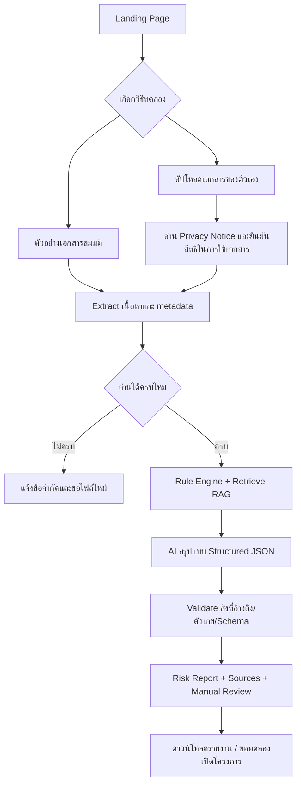
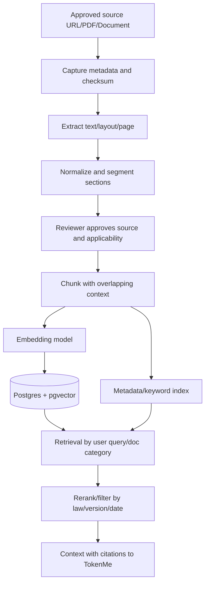
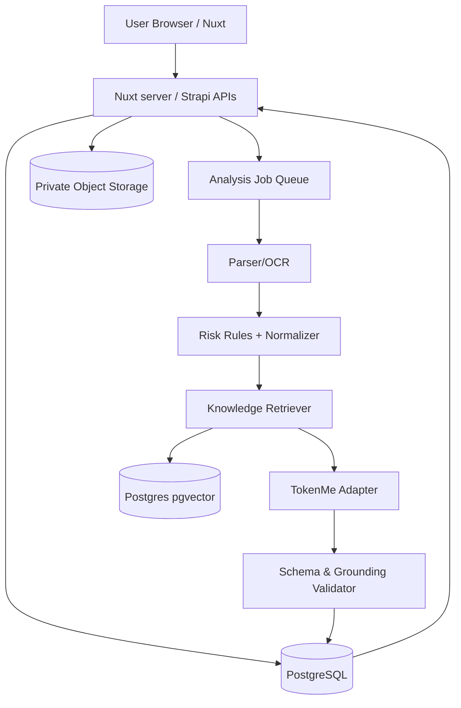

# LongRak (หลงรัก) — Project Context & Product Requirements

> **Source of truth สำหรับการสร้างเว็บไซต์และวางแผนพัฒนา MVP**  
> Version: `0.1.0` · Updated: **2026-11-16** · Language: Thai-first · Status: **Planning / Discovery / Website-first**
>
> เอกสารนี้สรุปสิ่งที่ตกลง/ระดมความคิดร่วมกัน และเติมข้อเสนอเชิงเทคนิคเพื่อให้เริ่มพัฒนาได้ทันที **สิ่งที่เป็นข้อเสนอหรือยังไม่ยืนยันจะระบุแยก ไม่ถือเป็นข้อสรุปของผู้ก่อตั้ง**

---

## 0) Instructions for AI Coding Agents / Development Team

หากใช้ไฟล์นี้กับ Cursor, Claude Code, Codex หรือทีมพัฒนา ให้ยึดหลักดังนี้:

1. **Project name ต้องเป็น `LongRak` / `หลงรัก` เท่านั้น** ห้ามเปลี่ยนเป็น TrustBuild, BuildTrust หรือชื่ออื่นที่เคยใช้เป็นตัวอย่าง.
2. **ทำ Website + AI Document Risk Checker ก่อน** แล้วค่อยทำระบบโครงการแบบสองฝ่ายในเฟสต่อไป.
3. ทุกฟีเจอร์ที่แสดงผลว่า `ตรวจแล้ว`, `อนุมัติแล้ว`, `ยืนยันแล้ว`, `จ่ายแล้ว` ต้องสะท้อนเหตุการณ์ที่เกิดขึ้นจริง; ห้ามใช้ข้อมูลจำลองโดยไม่ติดป้าย `Demo`.
4. **AI เป็นเครื่องมือช่วยตรวจความครบถ้วนและระบุข้อควรทบทวน ไม่ใช่ทนาย/วิศวกร/ผู้ตรวจรับ** และห้ามกล่าวหาว่าบุคคลเป็นมิจฉาชีพ.
5. **หลักฐานต้องตรวจสอบย้อนกลับได้**: source file, version, actor, action, timestamp, digest, provenance; อย่าทำเพียงตารางรูปถ่าย.
6. **No escrow / no custody**: LongRak ไม่รับพักเงินค่าจ้างก่อสร้าง และไม่มีสิทธิปล่อยเงินแทนคู่สัญญา.
7. **มีสถานะ `unknown` / `not_found` / `needs_review`** เมื่อ AI อ่านหรือยืนยันไม่ได้; ไม่ควรเดา.
8. **Security-by-default**: เซิร์ฟเวอร์เป็นคนเรียก AI API, ไม่ส่ง API key ไป browser, แยกข้อมูลทุกโครงการ/ผู้ใช้, อย่านำข้อมูลลูกค้าจริงเข้า RAG ส่วนกลาง.
9. `TokenMe` เป็น **AI inference provider** ที่ต้องยืนยัน API key, ราคา, รุ่นโมเดล, ความพร้อมใช้งาน และข้อตกลงก่อนเปิด Production; ห้าม hard-code base URL / model ID โดยเดาเอง.
10. แบ่งงานเป็น Must Have / Later; เว็บไซต์ควรใช้งานจริงกับตัวอย่างเอกสารและทดลองอัปโหลดได้ โดยไม่ต้องรอสร้าง Marketplace หรือระบบเรียกผู้ตรวจ.

## 1) Executive Summary

**LongRak (หลงรัก)** เป็นแนวคิดแพลตฟอร์มกลางสำหรับ **เจ้าของบ้าน/ผู้ว่าจ้าง** และ **ผู้รับเหมา/ร้านบิ้วอิน/รีโนเวท** เพื่อสร้างความชัดเจนในการว่าจ้าง เก็บหลักฐานตลอดโครงการ วิเคราะห์จุดเสี่ยงของเอกสารและการแบ่งงวดเงิน และบันทึกการส่งงาน/ตรวจรับ/ชำระเงินอย่างเป็นกลาง

### Core Promise

> **“ทุกข้อตกลงชัดเจน ทุกหลักฐานตรวจสอบได้”** *(คำโปรยที่เสนอ ยังไม่ยืนยันเป็นสโลแกนถาวร)*

### ปัญหาที่ตั้งใจแก้

- เจ้าของบ้านกลัวโอนมัดจำแล้วผู้รับเหมาหาย/ทิ้งงาน; ไม่รู้ว่างานคืบหน้าจริงแค่ไหน; งวดเงินไม่สัมพันธ์กับงาน; เอกสารไม่ครบ; เปลี่ยนแบบโดยไม่มีบันทึก; ไม่มีหลักฐานเมื่อต้องเจรจาหรือดำเนินการทางกฎหมาย.
- ผู้รับเหมากลัวลูกค้าไม่จ่าย; เปลี่ยนแบบไม่สิ้นสุด; ไม่ยอมตรวจรับ; กล่าวหาว่าไม่ได้ทำงาน; ไม่มีช่องทางพิสูจน์งานและขอรับเงินตามงวด.
- ทั้งสองฝ่ายมักกระจายข้อมูลใน LINE, โทรศัพท์, สลิป และรูปในมือถือ; ยากต่อการรวบรวมและยืนยันว่าใครตกลงอะไร เมื่อไร.

### Product Thesis

LongRak ไม่ใช่แพลตฟอร์มหาช่างเป็นหลัก และไม่ได้ไปรับเหมาก่อสร้างแทนใคร แต่คือ **neutral shared agreement & evidence workspace** ที่ทั้งสองฝ่ายเข้าถึงข้อมูลที่เกี่ยวข้องอย่างเป็นธรรม พร้อมระบบประเมินเบื้องต้นก่อนตัดสินใจและบริการตรวจงานอิสระเพิ่มเติมในอนาคต.

### Core Pillars

1. **Agreement** — เอกสาร ข้อกำหนด งวดงาน และการยืนยันร่วมกัน.
2. **Evidence** — หลักฐานต้นฉบับ ประวัติการเปลี่ยนแปลง การตรวจสอบย้อนกลับ.
3. **Milestones & Payments** — ส่งงาน ขอเบิกเงิน ตรวจรับ และบันทึกการจ่ายตรง.
4. **AI Risk Review** — วิเคราะห์ความครบถ้วนของเอกสาร ความคลุมเครือ และงวดการชำระ ด้วย AI + กฎ + เอกสารอ้างอิง.
5. **Optional Inspection** — ประสานผู้ตรวจอิสระที่มีคุณสมบัติเหมาะสมตามประเภทงาน (Phase ต่อไป).

---

## 2) Brand Identity — Confirmed vs Proposed

### Confirmed by Founder

- **Brand:** `LongRak`
- **Thai name:** `หลงรัก`
- **Meaning:** “หลงรักบ้าน” ความผูกพันกับบ้าน; เล่นคำ “ลงรัก” ที่เชื่อมโยงกับงานช่าง/งานฝีมือ.
- **Chosen logo concept:** ใช้ **ภาพที่ผู้ก่อตั้งเลือกเมื่อ 2026-11-16 เป็น Master Reference**. ห้ามสร้างโลโก้ใหม่แทนโดยพลการ.
- **Logo visual:** เส้นหัวใจสีชมพูคอรัล→พีชโอบบ้านสีน้ำเงินกรมท่า ผสานเอกสาร/ลายเซ็น ขอบมุมทองหน้าต่างทอง Wordmark `LongRak` กรมท่า และข้อความ `หลงรัก` ด้านล่าง มีเส้นตกแต่งสีทอง.
- **Brand feel:** อบอุ่น น่าเชื่อถือ เป็นกลาง ดูเป็น Startup เทคโนโลยีสมัยใหม่ แต่ไม่แข็งกระด้างเหมือนระบบงานไซต์ก่อสร้างล้วน ๆ.

### Proposed Design Tokens (approximation; ต้องเทียบสีจากไฟล์โลโก้จริง)

| Token | Suggested Value | Purpose |
|---|---|---|
| `--navy-900` | `#132D50` | Heading, navbar, main text |
| `--navy-700` | `#254669` | Secondary brand |
| `--coral-500` | `#F36F82` | Heart accent, actions |
| `--peach-400` | `#FFA87E` | Secondary accent |
| `--gold-500` | `#DAA442` | Window/detail, highlights |
| `--paper` | `#FFFCFA` | Background |
| `--slate-100` | `#F2F5F9` | Panels, surfaces |
| `--success` | `#21845C` | Confirmed/accepted state |
| `--warning` | `#CA8A04` | Needs review |
| `--danger` | `#C24143` | High concern / error |

- Typography proposal: Thai font `Noto Sans Thai` หรือ `IBM Plex Sans Thai` + Latin sans such as `Inter` (ใช้ฟอนต์ที่มีสิทธิใช้งานถูกต้อง).
- Design principle: **Warm Trust + Clear Evidence**. พื้นที่ว่างมาก อ่านง่าย รองรับมือถือ, ไอคอนเรียบง่าย, ใช้สีแดงเฉพาะเมื่อมีข้อควรระวังจริง.
- Accessibility: WCAG 2.2 AA goal, contrast, keyboard navigation, aria, reduced motion, responsive, document preview readable on mobile.

### Mascot

- **Proposed mascot (ยังไม่ถือเป็นมาสคอตที่อนุมัติขั้นสุดท้าย):** ตัวละครชื่อ `รัก (Rak)` เด็กช่าง/ผู้ช่วยผู้ประสานงาน สวมหมวกนิรภัยสีขาวติดโลโก้ LongRak เสื้อกั๊กกรมท่า ถือแท็บเล็ต บุคลิกอบอุ่น เป็นมิตร และซื่อสัตย์.
- สถานะ: มีภาพคอนเซ็ปต์มาสคอตแล้ว แต่ **ยังไม่มีการยืนยันอย่างชัดเจนว่าจะใช้เป็นแบบสุดท้าย**.
- ใช้เป็นภาพประกอบหน้าเว็บและ Empty States ได้เมื่อยืนยันสิทธิ/แบบแล้ว แต่ **อย่าให้มาสคอตทำให้ผู้ใช้เข้าใจว่าระบบรับประกันงานหรือรับรองความปลอดภัยทางวิศวกรรม**.

### Proposed Taglines (not yet selected)

- `ข้อตกลงชัดเจน หลักฐานครบถ้วน`
- `บ้านที่รัก งานที่ไว้ใจ`
- `ทุกข้อตกลงชัดเจน ทุกหลักฐานตรวจสอบได้`

### Brand assets TODO

- [ ] เก็บไฟล์โลโก้ที่เลือกไว้เป็น master (`brand/longrak-logo-master.*`); ตรวจสิทธิและไฟล์ต้นฉบับ
- [ ] สร้าง logo horizontal, vertical, monochrome, favicon, app icon จากต้นแบบเดียวกัน
- [ ] ยืนยัน tagline และ mascot
- [ ] ตรวจชื่อ/เครื่องหมายการค้า/โดเมนก่อนเปิดจริง

---

## 3) Target Audience, Positioning, GTM

### Primary Go-to-Market: B2B-led

**ร้านรับบิ้วอิน/รีโนเวทขนาดเล็ก** ที่ออกแบบ–ผลิต–ติดตั้ง–เก็บเงินเป็นงวด โดยเฉพาะเจ้าของกิจการที่ตัดสินใจเองและรับหลายโครงการต่อเดือน. เราเสนอเป็นเครื่องมือช่วยยืนยันแบบ/วัสดุ/ขอบเขตงาน ส่งหลักฐาน และขอรับเงินอย่างมืออาชีพ.

- ร้านบิ้วอินครบวงจร = Target 1
- ผู้รับเหมารีโนเวทครัว/ห้องน้ำ/คอนโดรายย่อย = Target 2
- สตูดิโออินทีเรียที่คุมงานจริง = Target 3
- บริษัทรับสร้างบ้านขนาดใหญ่ = Not first target

### Secondary: B2C direct

เจ้าของบ้านที่ **มีผู้รับเหมาอยู่แล้ว** กำลังจะเซ็นเอกสารหรือโอนเงินมัดจำ และต้องการตรวจความครบถ้วนของข้อตกลง/งวดจ่ายก่อนเริ่ม.

### Acquisition Thesis

- เริ่มต้นทดลองเข้าหา **20 ร้าน B2B + 10 เจ้าของบ้าน B2C** เพื่อสัมภาษณ์และทดสอบการเปิดใช้.
- สัดส่วนความพยายามเสนอ: **70% B2B / 30% B2C** *(สมมติฐาน ไม่ใช่สถิติตลาด)*.
- เกณฑ์วัดสำคัญ: **คนสร้าง Project แล้วเชิญคู่สัญญาเข้าร่วมได้จริง** ไม่ใช่แค่ Signup.
- ข้อความขาย B2B เน้น `ส่งงานมืออาชีพ`, `ลดข้อโต้แย้ง`, `ยืนยันแบบ`, `หลักฐานขอเงินงวด` ไม่ขึ้นต้นด้วยการกล่าวหาผู้รับเหมาว่าอาจโกง.

### Competitive Landscape

- **BUILK / BUILK iNSITE:** มีระบบติดตามความคืบหน้า, QC, defect, รูปหน้างาน, checklist, approve progress, reports; ไม่ควรแข่งขันด้วยคำว่า “อัปโหลดรูป/ติดตามงาน” อย่างเดียว.
- **Differentiation Hypothesis ของ LongRak:** user-friendly workspace ที่ **ผู้ว่าจ้างและผู้รับเหมาเท่าเทียม**, เอกสารฉบับเดียวกันที่ยืนยันร่วมกัน, ต้นทางตรวจความเสี่ยงข้อตกลง/งวดเงิน, evidence provenance และการส่งออกข้อมูลสำหรับข้อพิพาท.
- ต้อง **ขอ Demo คู่แข่ง** เพื่อตรวจสอบสิ่งที่ยังไม่ทราบ: e-sign, immutable evidence, public guest workflow, legal-evidence export, AI risk assessment. ห้ามประกาศว่าคู่แข่ง “ไม่มี” หากยังไม่ยืนยัน.

### Research / Interview Questions

- วันนี้ทำใบเสนอราคา/สัญญา/แบบงานด้วยอะไร? เปลี่ยนแบบอย่างไร?
- รูปไซต์งานส่งผ่านแชตหรือระบบ? กลับไปหาหลักฐานเก่าใช้เวลากี่นาที?
- งวดเงิน/ตรวจรับ ใครเป็นคนยืนยัน? เคยมีเคสค้างจ่ายหรือเลื่อนจ่ายหรือไม่?
- ยอมเชิญลูกค้ามาใช้ระบบที่เก็บหลักฐานร่วมกันไหม? อะไรทำให้ไม่ยอม?
- ถ้าเสีย 790/1,490 บาทต่อโครงการจะได้อะไรที่คุ้มค่าจริง?
- เหตุการณ์ใดต้องการผู้ตรวจอิสระ และใครยอมเป็นคนจ่าย?

---

## 4) Product Scope & Phases

### Phase W0 — Public Website + AI Document Checker **[Build Now]**

วัตถุประสงค์: แนะนำ LongRak, อธิบายการทำงาน, ทำให้ผู้ใช้ได้ลองคุณค่า `วิเคราะห์เอกสารก่อนจ้าง`, เก็บ Lead/Waitlist/Pilot Request.

**Must Have:**
- Responsive public website ภาษาไทย, navigation, explanation, examples, FAQ, pricing hypotheses.
- `AI Document Checker` อัปโหลดเอกสารแล้วได้รายงานข้อควรตรวจสอบพร้อมอ้างอิง **หน้า/ข้อความในเอกสาร + แหล่งความรู้**.
- `Sample Analysis` พร้อมเอกสารสมมติให้ทดลองโดยไม่ต้องอัปโหลดข้อมูลส่วนตัว.
- Email/LINE contact และ request pilot, privacy notice, terms/disclaimer.
- Admin-controlled knowledge base ชุดเริ่มต้นสำหรับ RAG; มีวันที่และต้นทาง.
- Document-processing privacy controls: file type/size limit, retention, delete, security, abuse prevention.
- Event analytics โดยไม่บันทึกเนื้อหาเอกสารลง product analytics.

**Not W0:** full milestone workflow, legal evidence export guarantee, escrow, marketplace, automatic inspection booking, public contractor fraud score.

### Phase W1 — Pilot Shared Project **[Next]**

- Account / Guest by magic link & OTP, RBAC.
- Project creation, invite, documents, agreement version, two-party acknowledgment.
- Milestone definitions, upload evidence, submit work/payment request.
- Owner review, request revision, accept, direct-payment record acknowledged by contractor.
- Audit log, file hashes, evidence export bundle, project close/dispute status.
- Basic plan purchase/activation if pricing validated.

### Phase W2 — Reliable Trust Infrastructure **[After Pilot]**

- Better identity assurance, signed records, independent trusted timestamps / WORM when appropriate.
- Fine-grained evidence retention/legal holds, independent storage verification and disaster recovery.
- Change orders, inspection-request referral workflow, admin dispute support.
- More mature billing/entitlements and B2B multi-project packs.

### Phase W3 — Scale **[Later]**

- Inspector marketplace with qualification screening and objective reports.
- Optional authorized escrow/payment partnership after legal assessment.
- Contractor organizations, team workflows, API integrations, analytics.
- Advanced AI assistance grounded in verified and current references.

---

## 5) Website Information Architecture (W0)

| Route (suggested) | Audience | Main content | CTA |
|---|---|---|---|
| `/` | Everyone | Hero, pain points two-sided, 3 pillars, social proof **only if real**, steps, pricing preview, FAQ | `ลองตรวจเอกสารฟรี` |
| `/ai-check` | Homeowner / contractor | Sample result, upload, consent, analyze progress, findings and citations | `เริ่มวิเคราะห์` |
| `/how-it-works` | Everyone | 6-step project lifecycle from agreement to evidence and direct payment | `ทดลองระบบ` |
| `/for-homeowners` | Homeowners | Protect clarity before deposit, milestone visibility, evidence trail | `ตรวจเอกสารก่อนจ้าง` |
| `/for-contractors` | Contractors / built-in | Confirm design/materials, proof of work, milestone claims, fairness | `ขอทดลองโครงการ` |
| `/pricing` | Both | Free Draft / Trust Project / Plus *(mark proposed)*, limits + add-on | `ลงทะเบียนสนใจ` |
| `/trust-and-security` | Both | What the platform does/does not guarantee, privacy, retention, evidence | `อ่านวิธีทำงาน` |
| `/faq` | Both | AI limitations, is this legal advice, file deletion, guest, payments | `ติดต่อเรา` |
| `/contact` | Leads | Contact / LINE OA / pilot form | `ขอทดลองใช้งาน` |
| `/privacy`, `/terms` | All | Privacy notice and terms reviewed before collecting real sensitive docs | — |

### Landing Page Recommended Order

1. Header: Logo + nav + CTA.
2. Hero: `ก่อนเซ็น ก่อนโอน ลองให้ LongRak ช่วยตรวจจุดที่ควรทบทวน` (proposed; ไม่อ้างการรับประกัน).
3. Social proof (ถ้ายังไม่มีเคสจริง แสดง `Early access` ไม่สร้างรีวิวปลอม).
4. Two-sided value cards: homeowner vs contractor.
5. Demo screenshot `AI Document Risk Report`.
6. How it works: upload → identify → compare against checklist → explain → next step.
7. Project preview (coming soon) for mutual evidence ledger.
8. Plan/pricing hypotheses and pilot invite.
9. FAQ, trust & limits, contact/footer.

### UI/UX Principles

- Design mobile-first; ข้อความไทยเป็นธรรมชาติ ไม่ใช้ศัพท์กฎหมายยากโดยไม่อธิบาย.
- CTA หลักมีอันเดียวต่อแต่ละส่วน; อย่าให้ `สมัคร`, `จองตรวจ`, `ซื้อแพ็ก` แข่งกันตั้งแต่วันแรก.
- Analysis output เป็น **Checklist + Evidence excerpts + Suggestions** ไม่ใช่ตรา `ผ่านกฎหมาย/ผิดกฎหมาย`.
- ข้อควรระวังมี 3 ระดับ `ต้องทบทวน`, `ข้อมูลไม่พอ`, `พบข้อมูลตามเกณฑ์` และสรุปด้านความเสี่ยงอย่างระวัง.
- ยืนยันตำแหน่งในเอกสารด้วย `page 2, line/snippet` และแหล่งอ้างอิงความรู้ด้วย URL/วันที่.
- Failure states สำคัญ: unsupported file, scanned unreadable, timeout, no findings, missing pages, provider unavailable, user opted out of AI processing.

---

## 6) W0: Public AI Document Checker — User Journey



### Step-by-step

1. ผู้ใช้เปิด `/ai-check` และเห็น `Sample Analysis` ก่อน (no signup).
2. หากอัปโหลดจริง จะแสดงรายการไฟล์ที่รับ (เช่น PDF/JPG/PNG; DOCX เมื่อพร้อม), เพดานจำนวนหน้า/ขนาด, ระยะเวลาเก็บชั่วคราว, และวัตถุประสงค์การส่งข้อมูลให้โมเดลภายนอก.
3. ผู้ใช้ยืนยันว่าเป็นเจ้าของหรือได้รับอนุญาตให้ใช้เอกสาร; ให้ **redact** เลขบัตร, บัญชี, เบอร์, ที่อยู่, ชื่อตัวบุคคลเท่าที่ทำได้ก่อนส่ง AI; ให้ผู้ใช้เลือกปิดการประมวลผลหากไม่ยอมรับเงื่อนไข.
4. Backend validate MIME/type, malware scan, page/size cap; รับเอกสารไว้ใน temporary private storage.
5. Extract text/layout/OCR เท่าที่จำเป็น พร้อม page-level provenance; ถ้าดึงข้อมูลไม่ครบ ต้องบอก `อ่านไม่ครบ`.
6. Normalize fields: ประเภทเอกสาร, คู่สัญญา (masked), ขอบเขตงาน, วัสดุ, งบ, งวดเงิน, วันเริ่ม/สิ้นสุด, เงื่อนไขตรวจรับ, เปลี่ยนงาน, รับประกัน, ยกเลิก, ชำระเงิน.
7. Rule Engine flag **missing / inconsistent / unclear / requires professional check** โดยไม่ฟันธงความชอบด้วยกฎหมาย.
8. Retrieve official knowledge chunks จาก RAG ที่ตรงชนิดงาน/เอกสาร/วันที่.
9. Call TokenMe/OpenAI-compatible provider via server adapter เพื่อสรุป structured findings ที่ผูกกับ evidence.
10. Verify output schema; ตรวจ arithmetic ของยอดงวดด้วย code, ตรวจการอ้างหน้าจริง, กรอง claim ที่ไม่มี source.
11. UI แสดงผลพร้อม CTA ดาวน์โหลดรายงาน (หากรองรับ) และขอทดลองเปิดโครงการ.
12. ลบ temporary document และ derived artifacts ตาม retention policy ที่แจ้งจริง; ห้ามเก็บถาวรโดยปริยาย.

### Suggested Initial Limits (ต้องปรับตามต้นทุนจริง)

- 1–3 files per analysis, max 10 MB/file, max 20 pages total.
- PDF with selectable text first; scanned PDF/Thai handwriting may require OCR/VLM; mark beta if accuracy unverified.
- Anonymous rate limit by IP/session + abuse signals, with fair disclosure; use CAPTCHA when needed.
- No public share link for user documents by default.
- Timeout budget, bounded retries, idempotency key, queue if job > HTTP timeout.
- `Sample Mode` ต้องใช้ข้อมูลสมมติและ precomputed output เพื่อไม่เปลือง token/ไม่สร้างผลแบบสุ่ม.

---

## 7) Document Categories & Risk Checklist

### Types to support

1. ใบเสนอราคา (Quotation)
2. ข้อตกลง/สัญญาจ้าง (Agreement/Contract)
3. BOQ/รายการวัสดุและปริมาณงาน
4. ตารางงวดจ่าย/แผนงาน (Milestone Schedule)
5. แบบงาน/รายการแก้ไขแบบ (Later: drawings/3D plans)
6. หลักฐานการรับเงิน/ใบเสร็จ (Later)
7. Change Order / บันทึกเพิ่ม-ลดงาน (Later)

### Risk Dimensions

| Dimension | Check | Expected Output |
|---|---|---|
| Parties | มีชื่อ/ช่องทางติดต่อ/บทบาทคู่สัญญาหรือไม่ | missing/ambiguous info |
| Scope | งานที่ทำ/ไม่ทำ, พื้นที่, จำนวน, คุณลักษณะ ชัดหรือไม่ | missing scope |
| Materials | ระบุยี่ห้อ/เกรด/รุ่น/ปริมาณ/สี/การทดแทนหรือไม่ | material ambiguity |
| Money | ยอดรวม, VAT/ภาษี/ค่าแรง/ค่าขนส่ง, ค่าเพิ่ม | cost transparency |
| Deposit | มัดจำเท่าไร, ซื้ออะไรแล้ว, มีหลักฐานอะไร | exposure note |
| Milestones | การจ่ายสัมพันธ์กับ deliverables / verification หรือไม่ | milestone concern |
| Dates | วันเริ่ม, วันจบ, เหตุขยายเวลา | schedule uncertainty |
| Acceptance | ตรวจรับอะไร โดยใคร วิธีคัดค้าน/แก้งาน | acceptance clarity |
| Change orders | เพิ่มลดงานต้องตกลงราคา/เวลายังไง | change-control gap |
| Warranty/Defects | รับประกันอะไรนานเท่าไร ขั้นตอนแจ้งซ่อม | warranty gap |
| Cancellation | เงื่อนไขยกเลิก/ค่าใช้จ่ายแล้วเกิดขึ้น | exit risk |
| Evidence | เอกสารแนบ, สัญญา/ใบเสร็จ/หลักฐานรับเงิน | evidence gap |
| Sign-off | ใครรับทราบฉบับไหน วันเวลาอย่างไร | acknowledgment gap |

### Payment Milestone Analysis — principle

**ห้ามตั้งว่า “มัดจำเกิน X% = ผิดกฎหมาย” โดยอัตโนมัติ** เพราะงานแต่ละประเภทมีต้นทุนวัสดุ/การผลิตและเงื่อนไขต่างกัน.

ระบบควรดู:
- `advance_ratio = advance_amount / total_contract_amount`
- `cumulative_payment_at_milestone` เทียบกับ deliverable และ evidence ที่ระบุ
- มีการชี้แจงว่าใช้เงินมัดจำซื้อวัสดุอะไร/เก็บไว้ไหน/มีหลักฐานอะไรหรือไม่
- มี `acceptance_criteria` ก่อนเรียกเก็บเงินหรือไม่
- แผนการจ่ายรวมตรงกับยอดสัญญาหรือไม่
- `mismatch`: งวดรวมเกิน/ต่ำกว่ายอดสัญญา; ทศนิยม/ภาษีผิด
- `risk_flags`: prepayment high relative to verified deliverables, undefined stage, unclear completion, missing receipt detail

**Example (สมมติ):** สัญญารีโนเวท 200,000 บาท มัดจำ 100,000 บาท = 50% และไม่มีรายการวัสดุ/เกณฑ์ส่งมอบรองรับ → flag `ต้องทบทวน` พร้อมคำถามที่ควรถาม มิใช่ตัดสินว่าเป็นการฉ้อโกง.

### Suggested Labels

- `needs_attention` — ข้อกำหนดมีความคลุมเครือ/ความเสี่ยงเชิงกระบวนการ
- `missing_information` — ไม่พบข้อความที่จำเป็นในเอกสารที่อ่านได้
- `present_in_document` — พบข้อมูลที่เข้ากับเช็กลิสต์ (ไม่ได้รับรองความถูกต้อง)
- `not_applicable` — ไม่เกี่ยวข้องกับเอกสารนี้
- `unable_to_assess` — ไฟล์อ่านไม่ได้ / ข้อเท็จจริงไม่พอ

ห้ามใช้ `safe 95%`, `legally valid`, `contractor is scammer`, `guaranteed protected`, `court-ready certified`.

---

## 8) AI Strategy: TokenMe (นายอาร์ม / 9arm)

### Verified Provider Context (as checked 2026-11-16)

- บริการที่ผู้ก่อตั้งน่าจะหมายถึงคือ **TokenMe (`https://www.tokenme.limited/`)** ซึ่งเกี่ยวข้องกับ 9arm.
- TokenMe เป็น **AI inference API provider** สำหรับเรียกโมเดลหลายตัว ไม่ใช่ชื่อโมเดลเดียวที่ 9arm ฝึกเอง.
- หน้าเว็บระบุแนวทางใช้งานด้วย **OpenAI SDK โดยเปลี่ยน `base_url`** แต่ยังระบุว่าทดลองให้บริการกับลูกค้าจำนวนจำกัด และหน้ารับ API key แสดง Soon ในผลที่ตรวจพบ.
- **ยังไม่ยืนยัน**: API key ของเรา, API endpoint/base URL ที่ใช้ได้จริง, API version, model ID ที่เปิดให้ใช้, ราคา Production, concurrency, vision/PDF support, embedding endpoint, uptime SLA, DPA/PDPA terms.
- Privacy policy TokenMe ระบุว่าไม่เก็บเนื้อหา prompt/คำตอบใน usage logs แต่มีการประมวลผลข้อมูลเพื่อให้บริการ และอาจเกี่ยวข้องกับผู้ให้บริการโครงสร้างพื้นฐาน/โมเดล; จึงต้องประเมิน subprocessors, data transfer, terms และสิทธิในการส่งเอกสารของลูกค้าก่อนใช้จริง.

### Provider Adapter Pattern (recommended)

```ts
export type AIChatProvider = {
  id: string
  analyze(input: {
    systemPrompt: string
    userPrompt: string
    contextChunks: Array<{ id: string; text: string; citation: string }>
    extractedDocument: string
    schemaVersion: string
  }): Promise<unknown>
}

// Example placeholders only; DO NOT guess actual TokenMe URL or model ID.
// Use environment variables and validate them at startup.
export const aiConfig = {
  provider: process.env.AI_PROVIDER ?? 'mock',
  baseUrl: process.env.AI_API_BASE_URL,
  apiKey: process.env.AI_API_KEY,
  model: process.env.AI_CHAT_MODEL,
}
```

**Server-only configuration:**

```dotenv
AI_PROVIDER=tokenme              # tokenme | mock | other
AI_API_BASE_URL=REPLACE_AFTER_PROVIDER_CONFIRMATION
AI_API_KEY=REPLACE_SECRET_SERVER_ONLY
AI_CHAT_MODEL=REPLACE_WITH_SUPPORTED_MODEL_ID
AI_EMBEDDING_PROVIDER=local      # can be another provider
AI_EMBEDDING_MODEL=REPLACE_WITH_VALIDATED_THAI_MODEL
AI_REQUEST_TIMEOUT_MS=60000
AI_MAX_ANALYSES_PER_IP_PER_DAY=3
RAG_TOP_K=8
RAG_MIN_RELEVANCE=CONFIGURE_AFTER_EVALUATION
```

### Production guardrails

- API keys server-only; secret manager / env; never in `NUXT_PUBLIC_` or frontend bundle.
- Disable provider logging of sensitive content if supported; verify privacy agreements, do not assume that inference provider handles our privacy obligations.
- Redact sensitive identifiers where possible **before** external inference; this can reduce model context quality, so preserve redacted original securely on our side when authorized.
- Timeout, retries with exponential backoff, per-request token budget, circuit breaker, cost meter.
- Store model ID/version, prompt version, knowledge snapshot version, extraction version, cost/latency metadata (not prompts/raw docs in generic app logs).
- Model output must pass strict JSON schema validator; cannot directly trigger project acceptance/payment actions.
- Fallback to `mock/demo` or `analysis unavailable` when provider down; no fabricated result.

### Separation of Responsibilities

- **Document parser/OCR/VLM:** ทำเอกสารให้เป็น text/layout/table/page spans.
- **Rule engine:** ความครบถ้วน + ตัวเลข/งวดจ่ายที่ deterministic.
- **RAG:** ดึงหลักเกณฑ์/แนวทางที่เชื่อถือได้และมีเวอร์ชัน.
- **Generative model (TokenMe):** สรุป อธิบาย และทำ structured findings บนหลักฐานที่ส่งให้.
- **Validator:** ตรวจว่า findings อ้างอิง source จริง ตัวเลขตรง และข้อความไม่เกินข้อพิสูจน์.

---

## 9) RAG Architecture — Knowledge Grounding (Critical)

### 9.1 What RAG is for

RAG = **Retrieval-Augmented Generation**. เราไม่จำเป็นต้องฝึกโมเดลของ 9arm ใหม่ในช่วงแรก; ให้โมเดลได้รับ `knowledge chunks` ที่ดึงมาจากคลังความรู้ LongRak ณ เวลาวิเคราะห์ แล้วอธิบายโดยมีที่มา.

**Do not confuse:** การเก็บเอกสารลูกค้าในระบบ ≠ การใส่เอกสารลูกค้าทุกคนลง global knowledge base. **ลูกค้าแต่ละโครงการต้องแยกข้อมูลตามสิทธิและไม่ถูกนำไปเป็นความรู้ส่วนรวมโดยอัตโนมัติ**.

### 9.2 Two distinct data planes

**Plane A — Curated Shared Knowledge Base**
- เอกสารสาธารณะและเอกสารที่ LongRak มีสิทธิใช้: ข้อกฎหมาย/ประกาศ/แนวทาง ETDA, สคบ., เช็กลิสต์ที่ผ่านผู้เชี่ยวชาญ, คู่มือการบันทึกหลักฐาน, ข้อควรระวังการแบ่งงวดจ่าย, เทมเพลตที่มีสิทธิใช้.
- มี source URL, publisher, version, effective date, review date, document type, scope, status `active/repealed/uncertain`.
- ผ่านการคัดกรองและอนุมัติก่อนเผยแพร่ให้ระบบวิเคราะห์.

**Plane B — Private Analysis Context**
- เอกสารที่ผู้ใช้กำลังอัปโหลด หรือเอกสารของโครงการนั้น ๆ เท่านั้น.
- Extract แยก per session/project with access controls; ephemeral for public demo; not indexed in shared knowledge.
- User content may be retrieved *within the same authorized project* in W1, never across users/tenants.

### 9.3 Knowledge Sources to seed first

| Source | Topic | Priority | Caution |
|---|---|---|---|
| สคบ. / OCPB | ธุรกิจรับสร้างบ้าน, ต่อเติม, หลักฐานรับเงิน, คำแนะนำผู้บริโภค | P0 | ต้องแยกประเภทงานและสถานะกฎหมาย |
| ETDA | หลักฐานอิเล็กทรอนิกส์, e-signature, การจัดเก็บ | P0 | ไม่เท่ากับรับรองหลักฐาน LongRak แบบอัตโนมัติ |
| คู่มือทำสัญญา/เช็กลิสต์ที่ตรวจโดยทนาย | เอกสาร, ข้อควรทบทวน, สัญญาและงวดเงิน | P0 | ต้องระบุผู้ตรวจและวันที่ |
| ผู้ตรวจ/วิศวกรร่วมออกแบบ checklist | ประเภทงานและ milestone ที่ตรวจได้ | P1 | ห้ามใช้แทนการตรวจหน้างาน |
| Case studies ที่ได้รับอนุญาตและ anonymized | คำถามที่พบบ่อย/ตัวอย่างความเสี่ยง | P2 | ต้องไม่เปิดเผยข้อมูลลูกค้า/ชื่อผู้รับเหมา |

**RAG MVP seed set แนะนำ:** 10–30 เอกสาร/บทความที่ตรวจแล้ว; ไม่ต้องเก็บข้อมูลมหาศาลก่อนรู้ว่า retrieval ตอบคำถามที่เราต้องการได้จริง.

### 9.4 Ingestion Pipeline



**Source metadata fields:**

```json
{
  "source_id": "ocpb-renovation-receipt-2566",
  "title": "ประกาศ/แนวทางเกี่ยวกับหลักฐานการรับเงินงานต่อเติม",
  "publisher": "OCPB",
  "source_url": "https://www.ocpb.go.th/news_view.php?nid=17828",
  "source_type": "official_guidance",
  "jurisdiction": "TH",
  "document_category": ["renovation", "receipts"],
  "effective_date": null,
  "retrieved_at": "2026-11-16",
  "reviewed_at": null,
  "review_status": "pending_legal_review",
  "version": "v1",
  "content_sha256": "computed_during_ingestion"
}
```

**Important:** `effective_date` ต้องอ่านจากเอกสารต้นฉบับ ห้ามใช้ publish/crawl date แทน. ถ้าข้อมูลขัดกัน ให้หยุดและตั้ง `uncertain`.

### 9.5 Chunking / Index

- Preserve hierarchy: `law/article/section`, `contract checklist`, `receipt requirements`; อย่าตัด section สำคัญกลางประโยค.
- Chunk size เริ่มทดลองราว **400–900 tokens** + overlap **50–120** (ปรับจาก benchmark); keep `page_number`, `section_title`, `source_id`, `source_url`.
- Embeddings: เลือกโมเดลที่รองรับไทยจากการ **ทดสอบ retrieval จริง**; ไม่ถือว่า TokenMe มี embedding endpoint จนยืนยัน.
- Vector DB: **PostgreSQL + pgvector** เพื่อลดจำนวนบริการที่ต้องดูแล.
- Retrieval: semantic + keyword; การค้นภาษาไทยด้วย Postgres FTS ดั้งเดิมอาจไม่เหมาะกับการตัดคำไทยทั้งหมด ต้องประเมิน tokenizer/alternative เช่น Thai segmentation library หรือ external lexical search หลัง benchmark.
- Metadata filter by source status, jurisdiction, document type, effective date; Rerank retrieved passages when needed.
- Citation resolution must point to original reliable URL, section, version and date; do not cite only AI-generated summaries.

### 9.6 Query-Time Pipeline

1. Receive extracted document fields and question `ประเมินความเสี่ยงเอกสารนี้`.
2. Determine `document_type`, `work_type`, needed rule topics.
3. Retrieve applicable knowledge and internal checklists, filter by status.
4. Assemble prompts from document excerpts + rule evidence + source IDs.
5. Ask model for bounded JSON, no free-form legal conclusions.
6. Validate every finding has a document quote/page **or clearly states not_found**, plus rule citation when citing external authority.
7. If not enough evidence, emit `unable_to_assess`.
8. Persist analysis version + provenance only according to applicable retention settings.

### 9.7 Evaluation / RAG QA

Prepare a small Thai dataset first:
- 20–30 synthetic docs (quotation, contract, payment schedule, receipt) with known issues.
- 10 clean/adequate docs, 10 incomplete docs, 10 ambiguous docs.
- 10 adversarial tests: wrong totals, scanned Thai text, handwritten numbers, irrelevant document, conflicting versions, forged-looking screenshots, prompt injection in uploaded PDF, stale regulation, missing pages, data leakage attempt.
- Ground truth reviewed by someone competent for document/process checks; any legal rules reviewed by lawyer.

Metrics (targets to be set after baseline):
- Field extraction accuracy per field: parties, amounts, dates, milestone count.
- Retrieval hit@k / MRR / citation precision.
- Finding precision/recall on approved risk checklist.
- Unsupported-claim rate / hallucination rate.
- False `present` and false `high risk` rate.
- Latency p50/p95, cost/analysis, error/timeout rate.
- Cross-tenant leakage tests = must pass 100%.

**Release gate:** หากยังไม่มี evaluation และ legal review ให้ระบุอย่างเด่นชัดว่า `AI Beta: ช่วยตรวจข้อมูลเบื้องต้น ไม่ใช่ความเห็นทางกฎหมายหรือวิศวกรรม`.

---

## 10) AI Output Contract (JSON Schema Concept)

Return strict JSON; ส่วน UI ค่อย render เป็นภาษาไทยด้วยข้อความที่ผ่าน validation:

```json
{
  "schema_version": "1.0",
  "analysis_id": "uuid",
  "document_type": "quotation",
  "document_read_status": "complete_or_partial",
  "summary": "เป็นใบเสนอราคางานรีโนเวทที่ยังมีรายการควรทบทวน",
  "amounts": {
    "contract_total_thb": 200000,
    "listed_milestones_total_thb": 200000,
    "advance_thb": 100000,
    "advance_ratio": 0.5,
    "arithmetic_verified": true
  },
  "findings": [
    {
      "id": "F001",
      "dimension": "payment_milestones",
      "status": "needs_attention",
      "title": "ยังไม่มีหลักฐานรองรับการจ่ายล่วงหน้า",
      "reason": "เอกสารระบุมัดจำ 50% แต่ไม่พบรายการวัสดุหรือเกณฑ์ตรวจรับก่อนจ่าย",
      "document_evidence": [
        {"document_id": "doc-001", "page": 2, "quote": "จ่ายมัดจำ 100,000 บาท"}
      ],
      "knowledge_citations": [
        {"source_id": "ocpb-guidance-v1", "section": "เรื่องการชำระเงิน", "url": "https://www.ocpb.go.th/news_view.php?nid=17828"}
      ],
      "question_to_ask": "เงินก้อนนี้ใช้ซื้อวัสดุอะไร และมีหลักฐานการจัดซื้อ/ส่งมอบอย่างไร",
      "suggested_action": "ขอรายละเอียดวัสดุและหลักฐานก่อนยืนยันเงื่อนไขจ่ายล่วงหน้า",
      "needs_professional_review": false
    }
  ],
  "missing_information": ["กำหนดวันแล้วเสร็จ"],
  "limitations": ["ไม่ใช่คำปรึกษาทางกฎหมายหรือการรับรองคุณภาพงาน"],
  "knowledge_snapshot_id": "kb-2026-11-16-v1",
  "model_id": "configured-at-runtime",
  "created_at": "2026-11-16T00:00:00+07:00"
}
```

**NOTE:** object นี้เป็นโครงร่าง/ตัวอย่างสมมติ ไม่ได้หมายความว่า URL ที่อ้างรองรับข้อสรุปทุกคำโดยตรง; ระบบจริงต้องตรวจ source-section mapping และการใช้กฎเฉพาะงานก่อนส่งให้ผู้ใช้.

### Response validation

- `total = sum(milestones)` ตรวจด้วย programmatic validator ไม่เชื่อเลขจาก LLM.
- `document_evidence.quote` ต้อง match extracted text/span โดยใช้ matching ที่ตรวจสอบได้ (ยอม tolerance เฉพาะ OCR); ไม่ match = drop finding or label unverifiable.
- `knowledge_citations` ต้องเป็น `source_id` ที่ถูก retrieve จริง และยัง active.
- If unsupported ⇒ do not promote to high confidence.
- If document unreadable ⇒ do not produce confident judgments.
- Long-term: separate `evidence_quality_score` (how complete data is) from `legal_risk` (requires expert review); ไม่ทำคะแนนรวมกำกวม.

---

## 11) Shared Project (W1) — Roles & Permission Model

| Role | Can do | Cannot do |
|---|---|---|
| `owner` / ผู้ว่าจ้าง | Create project, invite contractor, upload, review, accept/reject work, record direct payment, request inspection | Alter immutable historical events or impersonate contractor |
| `contractor` / ผู้รับเหมา | Accept invite, review agreement, upload work evidence, request milestone payment, acknowledge payment, dispute | Delete owner's evidence or mark owner as having paid |
| `guest` / invited limited user | Access project via magic link/OTP and scoped permissions | See other projects; serve as legal identity proof without checks |
| `inspector` (later) | View authorized scope, upload signed findings, disclose qualifications | Automatically authorize payment without owner's agreed instruction |
| `platform_admin` | Support, manage abuse, approved content and operational status under audited access | Modify signed history silently; view private docs without legitimate reason |

### Trust invariants

- Neither party can overwrite an **acknowledged agreement**; changes create a new version/change order.
- Neither party can unilaterally turn `payment requested` into `payment confirmed`.
- Neither party can make an `acceptance` on behalf of the other.
- A person may **leave a project**, but leaving does not silently erase records lawfully retained for agreed purposes; apply lawful retention/deletion procedures.
- All signed/acknowledged content must display `version` + actors + timestamp + method of acknowledgment.
- A user may upload evidence unilaterally; it must be labelled `submitted by X`, **not** `verified by both parties`.
- Fees payer ≠ authority to manipulate neutral shared evidence.

### Project lifecycle

`DRAFT → INVITED → AGREEMENT_PENDING → ACTIVE → (COMPLETED | DISPUTED) → ARCHIVED`

- If other side declines: `INVITE_DECLINED` and optional single-party record mode (**not mutually acknowledged**).
- `DISPUTED` preserves records under applicable policy, not auto-arbitration.
- `COMPLETED` requires appropriate two-party closeout or clearly shows which party closed unilaterally.

### Milestone lifecycle

`PLANNED → IN_PROGRESS → WORK_SUBMITTED → UNDER_REVIEW → (REVISION_REQUESTED | ACCEPTED | DISPUTED)`  
`PAYMENT_REQUESTED → PAYMENT_REPORTED → PAYMENT_ACKNOWLEDGED`

These are distinct timelines: **work acceptance is not proof of payment; payment report is not proof of receipt**.

### Example end-to-end

- Owner creates `รีโนเวทห้องครัว 150,000 บาท`, uploads quotation.
- Invites contractor via expiring magic link; contractor verifies OTP and acknowledges role.
- Both review `Agreement v1`, payment schedule, project specifics; sign/acknowledge.
- Contractor uploads photo + material invoice evidence to milestone 1 and requests review.
- Owner reviews; can request more detail or independent inspection (later).
- Owner pays contractor directly and uploads slip / contractor acknowledges receipt.
- Repeat until completion; export evidence with manifest, actor timeline, versions.

---

## 12) Suggested Information Architecture for App (W1)

Routes:

```text
/app
  /dashboard
  /projects/new
  /projects/:projectId
  /projects/:projectId/agreements
  /projects/:projectId/milestones
  /projects/:projectId/milestones/:milestoneId
  /projects/:projectId/evidence
  /projects/:projectId/payments
  /projects/:projectId/activity
  /projects/:projectId/export
/invite/:token
/admin/knowledge
/admin/analysis-logs
```

Project detail components:
- Heading: project name, total contract amount, work type, status, parties.
- Agreement card: signed/acknowledged version, outstanding changes, source documents.
- Milestone timeline with amounts, date, acceptance criteria and requests.
- Evidence gallery with filters for submitter, date, milestone, file type.
- Payment ledger: reported vs acknowledged, no direct custody.
- Activity & Audit log.
- Actions depend on RBAC, with **explicit permission/error states**.

---

## 13) Technical Architecture & Stack

### Founder-Fit Stack

- Frontend + SEO: **Nuxt (Vue, TypeScript)**.
- Backend CMS / business APIs: **Strapi (Node.js)** as existing preferred stack, but **avoid writing core immutable audit/evidence logic as simple editable CMS collections**; encapsulate in transactional service handlers with strict policies and authorization.
- Database: **PostgreSQL**; add **pgvector** for RAG knowledge embeddings.
- Object storage: **S3-compatible** private bucket (e.g. Cloudflare R2 / S3) with versioning/retention capabilities selected and tested for real deployment.
- AI provider: **TokenMe** through server-only provider abstraction, with `mock`/fallback provider.
- OCR/Document extraction: begin text-PDF parser + optional OCR service; evaluate quality on Thai docs. A small separate Python worker/FastAPI can be introduced if OCR complexity warrants it, not required at Day 1.
- Background jobs: simple queue for analysis; add Redis/BullMQ when load merits, or DB-backed queue for controlled MVP.
- Deployment: Ubuntu VPS, Docker Compose, reverse proxy (Nginx/Caddy), HTTPS, env/secret management; CI/CD and backups before handling real customer files.
- Logging/monitoring: structured app logs without raw documents; performance, failed analyses, API errors and cost.

### Conceptual architecture



### Recommended separation of services

- `web`: Nuxt public + UI.
- `api`: Strapi business API (project, user, admin KB metadata).
- `ai-service` (can be Nuxt/Node server module initially): doc jobs, RAG, provider adapter, schema validation.
- `db`: PostgreSQL/pgvector.
- `storage`: S3-compatible, private.
- `jobs`: queue/worker when needed.

Avoid overengineering microservices at first; enforce module boundaries in code now so extraction later is possible.

---

## 14) Data Model (Proposal)

### W0 Public Checker

| Table / Model | Key fields |
|---|---|
| `analysis_sessions` | id, anonymous/session user id, created_at, status, consent_version, expiry_at, deleted_at |
| `analysis_documents` | id, session_id, object_key, mime, sha256, size, page_count, extraction_status, expires_at |
| `extraction_pages` | id, document_id, page, normalized_text_ref, extraction_method, quality_flags |
| `analysis_runs` | id, session_id, model_id, prompt_version, knowledge_snapshot_id, structured_output_ref, result_status, latency_ms, token_cost |
| `findings` | id, analysis_run_id, code, status, severity, document_evidence_ref, source_ref, action |
| `leads` | id, name/contact consented, lead_source, pilot_interest, created_at |

**Privacy:** anonymous analysis should expire on a short, disclosed schedule; no automatic persistent user account from guest uploads. Avoid storing raw extracted text and full outputs indefinitely in general logs.

### Curated RAG

| Table / Model | Key fields |
|---|---|
| `kb_sources` | id, title, source_url, publisher, license, scope, jurisdiction, effective_at, active_until, status, checksum, reviewed_by, reviewed_at |
| `kb_versions` | id, source_id, version, fetched_at, approved_at, document_key, checksum |
| `kb_chunks` | id, version_id, chunk_index, section_title, page, text, embedding, tags, checksum |
| `kb_retrieval_logs` | id, analysis_run_id, chunk_ids, retrieval_version, score metadata; **no private content** |
| `risk_rules` | id, code, doc_type, dimension, version, validation_fn, explanation_th, applicable_scope, reviewed_by |
| `prompt_versions` | id, version, template, approved_at, output_schema_version |

### W1 Shared Projects

| Table / Model | Key fields |
|---|---|
| `users` | id, contact, verification level, status |
| `projects` | id, project_code, title, work_type, amount, status, owner_id, payer_id |
| `project_members` | project_id, user_id, role, invited_at, joined_at, access_status |
| `invitations` | id, project_id, role, hashed_token, expires_at, used_at, revoked_at |
| `agreements` | id, project_id, version, file_sha256, status, supersedes_id |
| `agreement_acknowledgements` | id, agreement_id, user_id, method, actor_verified_level, timestamp, event_id |
| `milestones` | id, project_id, number, title, amount, target_date, acceptance_criteria, status |
| `evidence_files` | id, project_id, milestone_id, uploaded_by, storage_key, sha256, mime, created_at, metadata |
| `work_submissions` | id, milestone_id, submitted_by, note, submitted_at, status |
| `acceptance_events` | id, milestone_id, actor_id, decision, note, event_id |
| `payment_requests` | id, milestone_id, requested_by, amount, status |
| `payment_records` | id, milestone_id, reported_by, amount, proof_id, acknowledged_by, status |
| `change_orders` | id, project_id, prev_version_id, requested_by, description, price_delta, date_delta, status |
| `audit_events` | id, project_id, actor_id, action, entity_id, event_payload_hash, previous_event_hash, server_timestamp, request_id |
| `exports` | id, project_id, requested_by, manifest_object_key, sha256, created_at |
| `legal_holds` | id, project_id, reason, authorized_by, started_at, reviewed_at, released_at |

### Critical database/processing invariants

- All writes server-authorized, project-level RBAC, server-generated UTC timestamp; display Thailand local time in UI.
- Hash and original file provenance stored before further transformation. A SHA-256 hash only demonstrates equality of bytes, **not that the file depicts real facts or capture time**.
- Append-only logical audit log; no user UI delete/update for confirmed events. For stronger integrity, design immutable storage/WORM and independently verifiable roots when justified.
- Legal retention and erasure workflows can create tombstones/deletion events as required; “immutable” must not mean violating data rights.
- Database transactions for agreement version acceptance and milestone status transitions.
- Comprehensive integration tests for role boundaries and unauthorized access.

---

## 15) Suggested API Surface

```http
# W0 public demo
GET    /api/ai/check/sample
POST   /api/ai/check/jobs           # authenticated or limited anonymous
GET    /api/ai/check/jobs/:id
GET    /api/ai/check/jobs/:id/report
DELETE /api/ai/check/jobs/:id       # request data deletion within policy
POST   /api/leads

# W1 project
POST   /api/projects
GET    /api/projects/:id
POST   /api/projects/:id/invitations
POST   /api/invitations/accept
POST   /api/projects/:id/documents
POST   /api/projects/:id/agreements/:version/acknowledge
POST   /api/projects/:id/milestones
POST   /api/projects/:id/milestones/:milestoneId/evidence
POST   /api/projects/:id/milestones/:milestoneId/submit
POST   /api/projects/:id/milestones/:milestoneId/review
POST   /api/projects/:id/milestones/:milestoneId/payment-requests
POST   /api/projects/:id/milestones/:milestoneId/payment-reports
POST   /api/projects/:id/milestones/:milestoneId/payment-acknowledgements
GET    /api/projects/:id/audit-events
POST   /api/projects/:id/exports

# Admin curated RAG
POST   /api/admin/kb/sources
POST   /api/admin/kb/sources/:id/ingest
POST   /api/admin/kb/versions/:id/approve
GET    /api/admin/kb/health
```

### API conventions

- Version APIs or schemas, provide idempotency keys for payment/status transitions.
- All upload/download URLs signed and expiring; never public-bucket original.
- Use input validation, MIME sniffing, max body sizes, CSRF considerations, auth/session rotation.
- Analysis job via status polling/SSE only from authorized session, no guessing by ID.
- Separate demo result from legally significant project record: demo has no acknowledgment, no two-party status.

---

## 16) Security, Privacy, Legal & Trust Requirements

### Core legal positions

1. **Electronic records may be evidence**, but their admissibility/weight depends on method of creation, integrity, storage, identification and context. **LongRak does not guarantee court acceptance or evidentiary outcome.**
2. **E-signature** requires appropriate identity, intent and reliable method for relevant transaction; a click button without supporting audit records is not automatically sufficient for every case.
3. **Personal data (PDPA):** collect minimum needed, notice purpose, protect access, define retention, honor rights and lawful exceptions, support legal holds with professional advice.
4. **Construction and renovation consumer rules:** check applicability by type of work and document. Requirements for home construction and renovation receipt can differ; do not generalize one rule to all projects.
5. **Money:** only receive own platform/service fees in W0/W1. Construction payments move between parties directly. Escrow needs separate legal/regulatory assessment and licensed partner.
6. **Professional role:** AI does not issue legal opinions or engineering certification. Inspection only through qualified independent professional when later enabled.
7. **Risk language:** “ข้อควรตรวจสอบ” ≠ “มีการผิดสัญญา/โกง/ผิดกฎหมาย”. No contractor blacklists from AI guesses.

### Baseline Security Controls

- TLS everywhere, HSTS, secure cookies, same-site settings, authentication with email/phone OTP or passkey when appropriate.
- RBAC + object ownership checks in every API, never rely on frontend visibility.
- File antivirus/unsafe file scanning, file-type whitelist, size/page caps, zip bomb and decompression protection.
- Private storage with signed URLs, encryption at rest, least privilege, separate environments.
- Backups with tested restore, periodic security updates, vulnerability scanning, logging of admin evidence access.
- No raw documents in analytics, crash reports, prompt logs, or public search indexing.
- Prompt-injection defense: uploaded doc is **untrusted content**, not instructions to the model. Never let document text call tools, override system behavior, or access another project.
- Abuse prevention: rate limits, upload quota, anonymous retention, admin emergency pause.
- Provenance: SHA-256, actor metadata, event timeline, versions; do not claim `blockchain` where not used.
- Deletion/retention: default lifecycle rules, clear retention policy, different for demo vs signed project. Legal holds authorized and reviewed, not perpetual by default.

### Legal/Trust page should explicitly say

- `LongRak ช่วยจัดการเอกสารและหลักฐาน ไม่รับประกันผู้รับเหมาจะไม่ทิ้งงาน`
- `ผลวิเคราะห์ AI เป็นการช่วยตรวจข้อมูลเบื้องต้น ไม่ใช่คำปรึกษากฎหมายหรือผลตรวจของวิศวกร`
- `ระบบไม่ได้รับฝากเงินค่าก่อสร้างและไม่ได้ปล่อยเงินแทนคู่สัญญา`
- `หลักฐานอิเล็กทรอนิกส์อาจนำไปประกอบการใช้สิทธิทางกฎหมายได้ แต่ศาลเป็นผู้ชั่งน้ำหนักความน่าเชื่อถือ`
- `ผู้ใช้ต้องมีสิทธิอัปโหลดเอกสาร และเห็นข้อตกลงการประมวลผลข้อมูลก่อนส่งเอกสารให้ AI`

### Required review before live customer files

- [ ] Privacy notice, consent/legal basis, DPA with providers, cross-border transfer assessment.
- [ ] Terms of service and platform liability reviewed by Thai counsel.
- [ ] e-sign/acknowledgment flow reviewed for intended level of assurance.
- [ ] Evidence export/retention and deletion policy reviewed.
- [ ] Analysis UI content reviewed to avoid unauthorized legal/engineering practice.

---

## 17) Revenue Model & Pricing Hypotheses

> **ยังไม่ได้รับการทดสอบกับลูกค้าจ่ายจริง**. ตัวเลขด้านล่างเป็นสมมติฐานจากการสนทนาเพื่อใช้ทดลองขาย ไม่ใช่ราคาที่สรุปถาวร.

| Plan / Feature | Hypothetical Price | What it contains |
|---|---:|---|
| `Free Draft` | ฟรี | ลองสร้างร่างโครงการ/ตัวอย่างเช็กลิสต์ จำกัดการใช้งาน |
| `Trust Project` | **790 บาท/โครงการ** | ข้อตกลงร่วมกัน หลักฐาน งวดงาน ตรวจรับ ประวัติและส่งออกตามข้อจำกัด |
| `Trust Project Plus` | **1,490 บาท/โครงการ** | Trust Project + AI ตรวจความครบถ้วนเอกสาร/ความเสี่ยงงวดเงิน |
| `Independent Inspection Coordination` | **ค่าประสานงานประมาณ 300–700 บาท/ครั้ง** | ค่าประสานแยกจากราคาของผู้ตรวจจริง |
| `B2B Multi-Project` | TBD | ซื้อแพ็กหลายโครงการ / รายเดือนเมื่อเห็นการใช้งานซ้ำ |

### Who pays

- **Default B2C concept:** เจ้าของบ้านจ่าย, ผู้รับเหมาเข้าร่วมฟรี.
- **B2B acquisition concept:** ร้านบิ้วอิน/รีโนเวทเป็นผู้ชำระค่าระบบและเชิญเจ้าของบ้านเข้าฟรี, หรือให้เจ้าของบ้านเป็นผู้จ่ายก็ได้.
- **Neutrality rule:** ใครจ่ายเงินก็ไม่มีสิทธิแก้ลบข้อเท็จจริงหรืออนุมัติแทนอีกฝ่าย.
- **No transaction fee per payment milestone**, เพื่อไม่ให้คนหนีไปจ่ายนอกระบบและทำให้ข้อมูลขาดตอน.
- W0 website อาจเปิด **Free Sample + capped free AI trial** เก็บ lead ก่อนพิสูจน์ความเต็มใจจ่าย; อย่าใช้ AI unlimited ฟรี.

### Cost Model to watch

- Inference tokens + embeddings + OCR/VLM pages.
- Private storage and egress, long-term retention cost, backups.
- Hosting, database, job queue, monitoring, domain.
- Acquisition cost, customer support, legal/document review, payment processing.
- Need: `cost_per_analysis`, `cost_per_active_project`, `gross_margin_per_project` dashboard before pricing final.

---

## 18) Roadmap for Solo Founder

### Sprint 0: Brand & Foundation (3–5 working days, estimate)

- [ ] Commit `context.md` as project source of truth.
- [ ] Capture approved logo reference in assets; create design tokens.
- [ ] Define public site content, disclaimers, sample docs and sample report.
- [ ] Set up Nuxt repo, lint, testing, GitHub Actions CI, env management.
- [ ] Confirm TokenMe API access; if not available, implement mock provider first.

### Sprint 1: Marketing Website (5–7 working days, estimate)

- [ ] Hero, B2B/B2C benefits, how it works, feature cards, FAQ, plans, trust page.
- [ ] Contact/LINE OA lead form, privacy page, analytics events.
- [ ] Mobile responsive, SEO metadata, OG images, sitemap, accessibility checks.

### Sprint 2: AI Checker Beta (7–12 working days, estimate)

- [ ] Drag-drop upload & consent with strict limits.
- [ ] File parsing/text extraction, mock and live model adapters.
- [ ] Rule-based fields + basic numeric validation.
- [ ] Seed 10–30 curated knowledge sources and pgvector ingestion.
- [ ] Structured report with document page citations and knowledge references.
- [ ] QA on synthetic documents, privacy/retention, rate limits.

### Sprint 3: Validate Demand (in parallel / after W0)

- [ ] Interview 20 B2B + 10 B2C leads.
- [ ] Measure `upload → analyzed → understood → project/pilot interest`.
- [ ] Obtain first 2–3 partner stores for pilot, with written scope and data controls.
- [ ] Collect feature requests and willingness to pay, not just verbal praise.

### Sprint 4: Two-Party Project Alpha (when validated)

- [ ] Project + invite/OTP + agreement version.
- [ ] Milestone/evidence/payment request/review flows.
- [ ] Audit log and basic export, authorization tests.
- [ ] Run limited pilots and independent legal/security review before broad launch.

*Durations are planning estimates, not commitments or delivery promises.*

---

## 19) KPIs, Analytics & Experiment Design

### Website Funnel

`landing_view → ai_check_open → sample_view → upload_started → upload_success → analysis_completed → report_read → CTA_clicked → lead_submitted`

Store event metadata only (no private document content/filename/person names in analytics).

### Core Metrics

- Landing to checker CTR.
- Successful analysis rate, extraction failure rate, median/p95 response time.
- % of findings with verified source snippets.
- Cost per completed analysis.
- Result usefulness rating (1–5) with optional feedback that does not require uploading sensitive content.
- Lead conversion; pilot project activation; invited contractor join rate.
- % both-party agreement acknowledged (W1).
- % milestone submissions reviewed on platform (W1).
- Cost of stored evidence per active/archived project (W1).

### Pilot Success Hypotheses (not guaranteed)

- At least 10 paid users/projects cumulatively within 90 days after sellable pilot, adjusted by acquisition realities.
- Contractors actually join projects instead of receiving screenshots through LINE only.
- Analysis report yields clear next action, not generic AI prose.
- AI corrections by humans steadily decline on audited test dataset.
- Gross margin remains positive with sustainable storage and AI costs.

---

## 20) Content & SEO Plan for Website

### Pages/articles to publish (proposal)

- เช็กลิสต์ก่อนโอนมัดจำผู้รับเหมา
- ใบเสนอราคาบิ้วอินที่ดีควรระบุอะไรบ้าง
- แบ่งงวดจ่ายรีโนเวทบ้านอย่างไรให้ตรวจสอบได้
- การตรวจรับงานกับการยืนยันว่าโอนเงินแล้วต่างกันอย่างไร
- ทำไมเก็บรูปใน LINE อย่างเดียวจึงค้นหาหลักฐานยาก
- แก้แบบบิ้วอินกลางทางควรมีบันทึกอะไรบ้าง
- ผู้รับเหมาควรเก็บหลักฐานอะไรเพื่อป้องกันลูกค้าค้างจ่าย
- เอกสารอิเล็กทรอนิกส์เป็นพยานหลักฐานได้หรือไม่ (อ้าง ETDA)

Keep content educational and balanced to both parties; no fearmongering, no unsupported promise of legal win or fraud prevention.

---

## 21) Open Decisions / Pending Validation

**Founder decisions needed later (ไม่ต้องขวางการทำเว็บไซต์):**

1. Confirm exact tagline / lock hex colors from approved master logo.
2. Confirm mascot `รัก (Rak)` as final or iterate.
3. Verify brand name, trademark, domain, and social usernames.
4. Confirm TokenMe account, real API base URL, live model ID, price, provider agreement, supported context and vision; choose fallback.
5. Choose actual OCR service and Thai embedding model after tests.
6. Set W0 demo retention period (e.g. 24 hours is *proposal*, not adopted policy) and confirm whether anonymous uploads allowed.
7. Approve file formats, page limits, free usage caps, paid analysis model.
8. Establish counsel-reviewed legal disclaimers and proper user consent/notice.
9. Validate GTM hypothesis with B2B stores: who actually pays — owner vs store.
10. Decide how many project months/evidence GB are included in 790/1,490 baht pricing.
11. Decide when to open inspection add-on and screen qualified inspectors.
12. Validate exact source acts/sections and effective dates before converting legal references into automated rules.

---

## 22) Explicit Non-Goals / Anti-Features (Early Stages)

- Not a contractor marketplace at launch.
- Not a building company, engineer, lawyer, insurer, bank or escrow agent.
- Do not promise `ไม่มีใครทิ้งงานได้` or `ได้เงินคืน 100%`.
- Do not make AI a legal adjudicator or permit it to trigger payments.
- Do not use unverified scores for contractor reputation or publish accusation lists.
- Do not make project evidence universally permanent against lawful deletion requirements.
- Do not collect Thai national ID images for casual free demo without an essential need and legal review.
- Do not train/fine-tune on customer-uploaded documents without separate lawful basis/permission.
- Do not rely solely on LLM output for arithmetic or legal interpretation.
- Do not overpromise “evidence certified for court”.

---

## 23) Sample Homepage Copy (Working Draft)

### Hero

**LongRak — หลงรัก**  
**ก่อนตกลงจ้าง ลองตรวจให้ชัด ก่อนเริ่มงาน เก็บหลักฐานให้ครบ**

`LongRak ช่วยให้เจ้าของบ้านและผู้รับเหมามีพื้นที่กลางสำหรับเอกสาร ข้อตกลง งวดงาน และหลักฐานที่ตรวจสอบย้อนหลังได้ เริ่มจากทดลองให้ AI ช่วยตรวจรายการที่ควรทบทวนในใบเสนอราคาหรือสัญญาของคุณ`

Primary CTA: **`ทดลองวิเคราะห์เอกสาร`**  
Secondary CTA: **`ดูวิธีการทำงาน`**

Supporting copy: `ผลประเมิน AI เป็นข้อมูลเพื่อช่วยตรวจความครบถ้วนเบื้องต้น ไม่ใช่คำปรึกษาทางกฎหมายหรือวิศวกรรม`

### Value props

- **เจ้าของบ้าน:** เห็นข้อตกลงและงวดจ่ายชัดเจน ก่อนโอนมัดจำ.
- **ผู้รับเหมา:** มีพื้นที่ส่งผลงาน ขอเบิกเงิน และบันทึกการตรวจรับที่เป็นธรรม.
- **ทั้งสองฝ่าย:** มีประวัติเอกสารและการเปลี่ยนแปลง ตรวจสอบร่วมกันได้.

### Analysis CTA

`มีใบเสนอราคาอยู่แล้ว? ลองอัปโหลดเอกสารให้ระบบช่วยหาจุดที่ควรถามก่อนเซ็น`  
Button: `ลองตรวจเอกสาร`

### Pricing section disclaimer

`ราคาที่แสดงเป็นแผนทดลองสำหรับ Early Access และอาจเปลี่ยนก่อนเปิดบริการเต็มรูปแบบ`

---

## 24) Acceptance Criteria for First Website Release (Definition of Done)

### Website

- [ ] All public routes load on mobile and desktop with chosen LongRak logo.
- [ ] Clear two-sided messaging and visible limitations.
- [ ] No fabricated reviews, testimonials, legal badges, security certificates or numbers.
- [ ] SEO metadata, sitemap, OG, semantic headings and accessible controls.
- [ ] Contact/lead collection works with appropriate notice and validation.

### AI Checker

- [ ] Visitor can run sample without account and see a stable demo result.
- [ ] Real upload goes through consent + validation + server-only provider.
- [ ] Unreadable or unsupported docs report limitation clearly.
- [ ] Numerical milestones validated by deterministic code.
- [ ] Every displayed finding is tied to document evidence or explicitly `missing/not readable`.
- [ ] External sources shown with title/URL/section/date; no invented citations.
- [ ] Prevent model from obeying instructions embedded in uploaded docs.
- [ ] Per-session data isolated, rate limited, and deleted on disclosed schedule.
- [ ] Mock provider runs local dev without TokenMe key; live integration switches by config.
- [ ] Test suite includes malformed file, abuse, arithmetic mismatch, missing sections, prompt injection, Thai PDF extraction.

### Operations

- [ ] Error handling, backup/restore for persistent app data, monitoring.
- [ ] Privacy notice/terms reviewed before real user-upload launch.
- [ ] No secrets committed, test DB and production DB separated.
- [ ] Costs of AI + OCR + storage are measurable.

---

## 25) Research References & Verification Notes (checked 2026-11-16)

The following sources inform the *context* and the design of the knowledge base. They are **not automatically approved as legal rules** until independently reviewed and ingested with proper metadata.

1. **TokenMe official:** https://www.tokenme.limited/ — AI inference API, OpenAI SDK-compatible positioning, limited rollout.
2. **TokenMe Terms:** https://www.tokenme.limited/terms — provider terms, model response caveats and service limitations.
3. **TokenMe Privacy:** https://www.tokenme.limited/privacy — prompts/responses not retained in usage logs according to provider; other processors may be involved.
4. **BUILK iNSITE:** https://www.builk.com/insite/ — progress, inspection, defect and approval capabilities.
5. **BUILK iNSITE FAQ:** https://www.builk.com/insite/faq/ — construction QC/inspection coverage.
6. **OCPB official guidance:** https://www.ocpb.go.th/news_view.php?nid=17828 — consumer document/receipt guidance for renovation-related work; verify current law and scope.
7. **OCPB official news:** https://www.ocpb.go.th/news_view.php?nid=16497 — 2025 complaints and documentation issues.
8. **ETDA Electronic Evidence:** https://www.etda.or.th/th/Useful-Resource/online_doc_evidence.aspx — electronic documents can be admitted as evidence under conditions.
9. **ETDA Electronic Transactions Act (amendment):** https://www.etda.or.th/th/Useful-Resource/%E0%B8%81%E0%B8%8F%E0%B8%AB%E0%B8%A1%E0%B8%B2%E0%B8%A2-HTML/%E0%B8%9E%E0%B8%A3%E0%B8%B0%E0%B8%A3%E0%B8%B2%E0%B8%8A%E0%B8%9A%E0%B8%8D%E0%B8%8D%E0%B8%95%E0%B8%A7%E0%B8%B2%E0%B8%94%E0%B8%A7%E0%B8%A2%E0%B8%98%E0%B8%A3%E0%B8%81%E0%B8%A3%E0%B8%A3%E0%B8%A1%E0%B8%97%E0%B8%B2%E0%B8%87%E0%B8%AD%E0%B9%80%E0%B8%A5%E0%B8%81%E0%B8%97%E0%B8%A3%E0%B8%AD%E0%B8%99%E0%B8%81%E0%B8%AA/%E0%B8%9E%E0%B8%A3%E0%B8%B0%E0%B8%A3%E0%B8%B2%E0%B8%8A%E0%B8%9A%E0%B8%8D%E0%B8%8D%E0%B8%95%E0%B8%A7%E0%B8%B2%E0%B8%94%E0%B8%A7%E0%B8%A2%E0%B8%98%E0%B8%A3%E0%B8%81%E0%B8%A3%E0%B8%A3%E0%B8%A1%E0%B8%97%E0%B8%B2%E0%B8%87%E0%B8%AD%E0%B9%80%E0%B8%A5%E0%B8%81%E0%B8%97%E0%B8%A3%E0%B8%AD%E0%B8%99%E0%B8%81%E0%B8%AA-%28%E0%B8%89%E0%B8%9A%E0%B8%9A%E0%B8%97-2%29-%E0%B8%9E-%E0%B8%A8-2544.aspx — Section 11 as amended.
10. **ETDA e-Signature FAQ:** https://www.etda.or.th/th/Useful-Resource/e-Signature-FAQ.aspx — practical e-signature considerations.
11. **ETDA e-Signature guidance:** https://www.etda.or.th/th/Useful-Resource/knowledge-sharing/articles/e-Signature/%E0%B8%81%E0%B8%B2%E0%B8%A3%E0%B8%A5%E0%B8%87%E0%B8%A5%E0%B8%B2%E0%B8%A2%E0%B8%A1%E0%B8%AD%E0%B8%8A%E0%B8%AD%E0%B8%9A%E0%B8%99%E0%B9%82%E0%B8%A5%E0%B8%81%E0%B8%AD%E0%B8%AD%E0%B8%99%E0%B9%84%E0%B8%A5%E0%B8%99.aspx — choose method by risk.

**Freshness note:** มีรายงานเกี่ยวกับร่างกฎหมายธุรกรรมอิเล็กทรอนิกส์ฉบับใหม่ในเดือนพฤศจิกายน 2026 แต่ **ร่างไม่ใช่กฎหมายที่มีผลบังคับแล้ว**. ระบบ RAG ต้อง version แหล่งกฎหมายและมีขั้นตอนตรวจสถานะก่อนนำมาทำ rule.

---

## 26) Founder Summary in One Paragraph

LongRak (หลงรัก) คือแพลตฟอร์มสร้างความมั่นใจระหว่างผู้ว่าจ้างกับผู้รับเหมา โดยเปิดให้ทั้งสองฝ่ายใช้พื้นที่กลางในการจัดเก็บเอกสาร ยืนยันข้อตกลง ติดตามงวดงาน ส่งหลักฐาน ตรวจรับ และบันทึกการจ่ายตรงอย่างตรวจสอบย้อนหลังได้; เริ่มธุรกิจด้วยการเปิดเว็บไซต์และให้ผู้เยี่ยมชมทดลอง AI วิเคราะห์เอกสารสัญญา/ใบเสนอราคา/งวดจ่ายโดยใช้ TokenMe เป็นผู้ให้บริการ AI inference (หลังยืนยันสิทธิการเข้าถึง) เชื่อมกับ RAG ที่คัดกรองข้อมูลกฎหมายและแนวทางไทยจากแหล่งเชื่อถือได้ พร้อมแยกเอกสารส่วนตัวออกจากคลังความรู้กลางอย่างเคร่งครัด; หาลูกค้ากลุ่มแรกจากร้านบิ้วอินและรีโนเวทรายย่อยที่ทำงานเป็นงวด รวมถึงเจ้าของบ้านที่กำลังจะว่าจ้าง โดยทดลองราคาแพลตฟอร์ม 790/1,490 บาทต่อโครงการและให้ผู้รับเหมา Guest เข้าร่วมได้ฟรี; LongRak ไม่รับถือเงินก่อสร้าง ไม่รับประกันผลการก่อสร้าง ไม่ให้คำปรึกษากฎหมาย/วิศวกรรมแทนผู้เชี่ยวชาญ และไม่รับรองว่าหลักฐานจะชนะคดี แต่เน้นทำให้ข้อตกลงและข้อเท็จจริงชัดเจนตั้งแต่วันแรก.

---

**Document owner:** LongRak founder  
**Change control:** เมื่อมีการเลือกแพ็กเกจ ราคา เทคนิค หรือกฎหมายฉบับใหม่ ให้บันทึกวันที่และสถานะ `confirmed / proposed / deprecated` ก่อนอัปเดต Context; อย่าลบสมมติฐานเก่าโดยไม่บันทึกเหตุผล.
